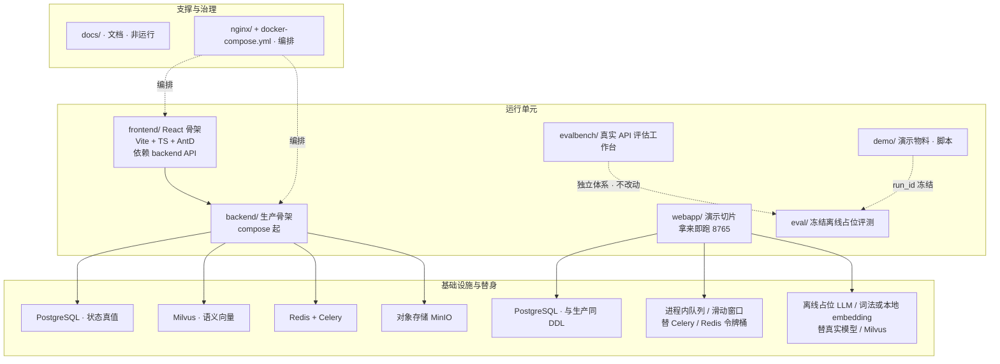

# 架构复核：多用户多部门当前边界与本轮范围

> 编制：系统架构师 梁承宇 ｜ 适用：`P5企业级知识库项目`（A/B 档开发框架骨架 + 工程实现版）
> **性质**：架构复核文档。本次**未修改任何项目源码、未执行迁移、未改动 `eval/` / `demo/` / `evalbench/` 冻结区**，仅新增本文档与 `docs/change-manifest.md`。
> 事实源：`README.md`、`docs/org-model-change-plan.md`（601 行，上一轮完整改造方案）、`docs/enterprise-readiness.md`、`docs/permission-model.md`、`backend/app/**`、`webapp/**`、`frontend/**`、`.env.example` 的本次实查结果，以及主理人本轮派发口径。
> 三态纪律：全文严格区分「**已实现 / 只设计 / 未做**」。文中「本轮落地项」指主理人本轮**工作范围**，不代表每一条都已提交；状态以本清单编制时的实查快照为准。
> **口径优先级**：用户本轮新指令「系统为多用户多部门架构，暂不实现多租户；多租户仅作为未来研发方向写入文档」**覆盖历史口径**。`docs/org-model-change-plan.md` 的 13 步改造是**未来路线**，本轮不执行。

---

## 0. 本轮结论摘要

1. **三套运行时不是同一套**：`backend/` 是生产骨架（PostgreSQL / Milvus / Redis + Celery / 对象存储，由 `docker-compose.yml` 编排），`webapp/` 是**拿来即跑的演示切片**（PostgreSQL 同 DDL、进程内滑动窗口替 Redis 限流、进程内队列替 Celery），`frontend/` 是依赖 backend API 的 React 骨架。
2. **多用户多部门在 backend 已有、在 webapp 缺失**：`backend/app/models/identity.py` 已实现 `Department` 部门树（物化路径 `path`）、`User.department_id`、`ACLGrant`、五角色与 `decide()`；`webapp/` 仍是单库 + `admin`/`user` 两级 + owner 过滤，**没有部门表、没有部门级可见性**。
3. **本轮补的是演示切片内的统计维度与模型档位，不是权限模型**：A 项 `tenant → department` 改的是**成本 / 限流统计与展示维度**，属于维度对齐；B 项 LLM「低思考 / 快速」档只动 `webapp/` 配置、提供者与设置页。两者都**不给 webapp 增加部门级权限**。
4. **backend 的 `tenant_id` / `TenantRepository` 历史命名保留为技术债**，不改数据模型、不改 `backend/migrations/versions/0001_initial.py`；多租户作为未来研发方向，按 `docs/org-model-change-plan.md` 的 13 步清理。
5. **本轮未触发完整 13 步改造**，原因见 §4.3。`docs/org-model-change-plan.md` §8 的六个一票否决项与三分区回归是**完整改造的准出门禁**，不是本轮 webapp 维度对齐的准出条件。

---

## 1. 系统真实边界

### 1.1 分层图

### 1.2 真跑 / 替身对照

| 单元 | 目录 | 是否真跑 | 启动方式 | 替身关系 | 三态 |
|---|---|---|---|---|---|
| 生产骨架 | `backend/` | **真跑**（需外部组件） | `docker compose up -d --build` + `alembic upgrade head` | 无替身；PostgreSQL / Milvus / Redis / Celery / MinIO 为真实组件 | 已实现（骨架，未压测） |
| 演示切片 | `webapp/` | **真跑**（需 PostgreSQL；可先起 compose infra） | `python -m uvicorn webapp.main:app --port 8765`，`admin / admin123` | **PostgreSQL（与生产同 DDL，库/模式可配）**；**进程内 `deque` 滑动窗口替 Redis 令牌桶**；**进程内队列替 Celery**；**离线占位 / 外部 Provider 替真实模型链路**；**词法或本地 embedding 替 Milvus** | 已实现（演示级） |
| React 骨架 | `frontend/` | **真跑**（需 npm 或 compose，依赖 backend API） | `npm install && npm run dev` 或 compose | 无替身；是独立前端工程，**不是** `webapp/` 的静态页 | 已实现（骨架） |
| 冻结占位评测 | `eval/` | **真跑**（`unittest` 14 OK） | `python -m unittest discover -s eval/tests -t .` | 结果为 `comparable=false` / `NOT_COMPARABLE`，`real_api` 被契约门禁阻断，**不产出质量基线** | 已实现（冻结，禁止改动） |
| 真实 API 评估工作台 | `evalbench/` | **真跑**（`unittest` 16 OK） | `python -m unittest discover -s evalbench/tests -t .` | 独立体系：多提示词 / 多参数 / 多模型对比、逐轮 Git 分支收敛；**不 import backend**、不改动 `eval/` | 已实现 |
| 演示物料 | `demo/` | **脚本真跑**（16/16 `DEMO_READY`），非服务 | `python demo/selftest.py` | `run_id=RUN-095a2a4a40c6` 与 `config_snapshot` 冻结 | 已实现（冻结，禁止改动） |
| 文档 | `docs/` | 非运行 | — | — | 已实现 |
| 编排 | `nginx/`、`docker-compose.yml` | 非运行单元本身 | compose | 反代 + SSE 关缓冲 + 安全响应头 | 已实现（骨架） |

> **替身不是缺陷，是定位**：`webapp/` 用 PostgreSQL + 进程内队列换取「最小外部依赖、拿来即演示」；`backend/` 用真实组件换取「约束渗透到表结构与代码分层」。两者职责不同，讲解时必须分开说，不得把演示切片说成生产实现。

---

## 2. 「多用户多部门」口径统一

### 2.1 六项口径

| 项 | 目标口径（单组织） | `backend/` 现状 | `webapp/` 现状 |
|---|---|---|---|
| **组织边界** | 单组织单库，`departments` 为顶层根；无跨组织隔离 | 已有 `Department` + `Tenant` 历史根节点；`tenant_id` / `TenantRepository` 为**历史命名技术债**，不代表已实现多租户隔离 | 单库 `default`，无组织表、无部门表 |
| **部门树** | `parent_id` 自关联 + `path` 物化路径 + `level`；子树按路径前缀判定 | **已实现**：`identity.py` 的 `Department`，含 `path` / `level` / `sort_order`、`UniqueConstraint(tenant_id, name, parent_id)`；`auth.py` 种子 HQ / RD / MK 三部门 | **未做**：无部门表、无成员归属 |
| **角色层级** | 未来目标四角色 `admin` / `dept_admin` / `dept_user` / `viewer`；当前保留五角色 | **已实现（现状五角色）**：`platform_admin` / `tenant_admin` / `dept_admin` / `dept_user` / `viewer`，另有 `ROLE_SENSITIVITY_CEILING`、`WRITE_ROLES`；四角色为 `org-model-change-plan.md` 的**未来目标态**，本轮不改 | `admin` / `user` **两级** |
| **资源归属** | `User.department_id`；知识库 / 文档 / 切片的 `department_id` + `owner_id` | **已实现**：`identity.py` 的 `User.department_id`，知识模型带 `department_id` / `owner_id` | 仅 `owner_id` / `user_id` / `created_by`，**无 `department_id`** |
| **可见范围** | 部门 / 子树 / 角色 / owner / 显式授权 / 敏感度上限叠加；`decide()` 为唯一权威 | **已实现**：`Visibility` 三值（`dept` / `tenant` / `public`）、敏感度偏序、`ACLGrant`（`subject_type = user / department / role`）、`decide()` 的「同部门 / 子树 / owner」判定、Milvus expr + `filter_candidates()` 双重过滤 | 仅 **owner 过滤 + `admin` 门禁**；无 `decide()`、无行级 ACL、无 expr 过滤 |
| **越权边界** | 候选集下推（SQL + 向量 expr）→ 召回后逐条 `decide()` 复核；写接口 403；身份由服务端派生 | **已实现（骨架级）**：`TenantRepository` 强过滤、`decide()` 纯函数、`filter_candidates()`；列表侧逐条复核为 `org-model-change-plan.md` 标注的**未来 Must 缺口** | 写接口 `require_admin` + owner 过滤；`docs/enterprise-readiness.md` 明确「演示切片未做部门树、跨租户 expr 过滤、审计留存合规与脱敏检索」 |

### 2.2 与目标状态的差距

| 维度 | backend 已有什么 | webapp 缺什么 | 本轮补了什么 | 还欠什么 |
|---|---|---|---|---|
| 组织与部门 | 部门树、物化路径、种子部门、部门 / 用户 / 授权接口 | 部门表、成员归属、部门视图、按部门过滤 | **无**（本轮不动 webapp 组织结构） | webapp 最小可演示部门能力（`org-model-change-plan.md` §2.4 C5，只设计）；backend 去 `tenant_id`（13 步，未来） |
| 角色与权限 | 五角色、敏感度偏序、`decide()`、双重过滤 | 部门级可见性、`decide()`、行级 ACL、子树 | **无**（本轮不动权限模型） | 四角色合并、Visibility 两值、列表侧 `decide()` 复核、A13 七断言（完整改造，未来） |
| 成本 / 限流统计 | backend 侧按 IP 令牌桶（`middleware/rate_limit.py`），无用量 / 预算台账 | `usage_events` / `rate_rules` / `budgets` / `DIMENSIONS` 仍用 `tenant` 维度 | **A 项本轮落地**：`tenant → department` 的统计与展示维度对齐 | `docs/cost-metrics-spec.md` 口径固化；真实供应商单价与账单校准（只设计 / 未做） |
| 模型档位 | `backend/app/integrations/llm.py` + `DEEPSEEK_*` 配置；超时 60 秒、模型层无重试、抽取式降级 | 「低思考 / 快速」显式档位缺失；`.env.example` 无 webapp 段 | **B 项本轮落地**：低思考 / 快速档 + 设置页 + `.env.example`（Discovery 网关与默认模型 `deepseek-v4.1-flash-1017` 在 `webapp/settings.py:25`、`webapp/providers.py:426-432` **已就位**） | 档位与思考参数的端到端验证；真实外部模型调用**本轮不执行** |
| 文档与验收 | `org-model-change-plan.md` 完整方案、`permission-model.md` 等 | — | 本轮新增 `architecture-review.md` / `change-manifest.md` 及并行产出文档 | 三态标注纠偏、新计数冻结、A1–A13 与 30 条越权用例（完整改造，未来） |

### 2.3 本轮落地项的准确含义（防止误读）

- **A 项是「维度改名」而非「实现多部门」**：`webapp/observability.py`、`webapp/db.py`、`webapp/main.py`、`webapp/routers_evaltest.py`、`webapp/tests/` 与前端展示文案里的 `tenant`（租户）改为 `department`（部门），用途是让**成本归集与限流统计维度**与「单组织多部门」的产品口径一致。改完后 webapp 的权限模型**仍**是 `admin`/`user` + owner 过滤，没有部门级可见性。
- **A 项的四处联动缺一即坏**（`org-model-change-plan.md` §5.6 C22-3）：`webapp/observability.py:252 CONFIG_KEYS`、`webapp/db.py:325` 默认值、`webapp/routers_chat.py:129`、`webapp/routers_evaltest.py:72` 的 `cfg.get("tenant", "default")` 必须同批改为 `department`，否则 `set_config()` 白名单会拒绝旧键或旧键读不到。这四处与冻结的 `config_snapshot_hash`（配置快照哈希）是**两条独立链路**，改名不触碰任何 `run_id`。
- **B 项不触发真实外部模型调用**：本轮只改配置枚举、Provider 装配与设置页；回归一律走离线占位（`offline`）或 `unittest`，不产生供应商计费。
- **实查状态说明（编制时快照）**：编制本清单时，`webapp/observability.py:36-37 / :65 / :83-86 / :197-207 / :252`、`webapp/db.py:161 / :176 / :190 / :317 / :325`、`webapp/main.py:49 / :67`、`.env.example` 仍为 `tenant` 口径，A / B 的增量部分尚未在工作区就位，故在 `docs/change-manifest.md` 中状态标「未做（本轮落地项 · 进行中）」。
- **主理人最终回填（2026-11-14）**：A / B 两项**均已落地**，且额外落地了统一 429 错误契约与迁移三态修正；本文 §5 表格里「进行中 / 尚未就位」的表述已被 `docs/change-manifest.md` §0.0 的最终状态覆盖，以该节为准。C22-3 四处配置键已同批改为 `department` 并加断言锁定；`rate_rules` 最终按**三维**收敛（`user/endpoint/model`），未采纳编制时设想的四维方案。66 项 webapp 单测 + 33 项端到端 + 其余四套回归全绿，冻结区零 diff。

---

## 3. 多租户作为未来研发方向

### 3.1 当前为什么不做

1. **用户明确指令**：本轮口径为「暂不实现多租户；多租户仅作为未来研发方向写入文档」。项目定位是**单组织内部知识库**的开发框架骨架与工程实现版，不是 SaaS 交付。
2. **复杂度与团队规模不匹配**：项目为 1 名自学 FastAPI / 数据库的转行者维护，A/B 档、无 SLA、无运维值守。多租户会同时引入隔离、计费、配额、迁移四组额外约束，超出「把链路讲通」的目标。
3. **改造方案已定但未执行**：`docs/org-model-change-plan.md`（601 行，C1–C35 裁决、13 步改造、`0002` 迁移、Milvus 蓝绿、A13 验收）是**完整设计**，其性质为「设计评审与改造方案」，文档头部明确「未修改任何项目源码、未执行迁移」。它是未来路线图，不是本轮任务。
4. **降维近似不可逆**：该方案 §10.3 已写明，删列、key、审计、partition key、JWT 语义全改后反向回补约需 1.5–2 倍工作量。在业务路线未最终确认前保留现状是更稳妥的选择。

### 3.2 未来若做需要补的租户维度

| 维度 | 需补内容 | 现有参考 |
|---|---|---|
| **隔离** | `tenant_id` 由依赖注入产生、`TenantRepository` 强过滤；Milvus expr 首条件固定 `tenant_id`；缓存 / 进度 / 对象 key 带 tenant 前缀；跨租户越权用例集；审计按租户分区；物理隔离（独立 Schema / 分库 + 连接池路由）为更高档选项 | `docs/permission-model.md` §1 / §5「逻辑隔离的诚实边界」；`docs/kb-capability-checklist.md` A5 / A6 |
| **计费** | `usage_events` / `budgets` 增加 tenant 维度；按租户单价与供应商账单对账；token 计量区分估算值与真实 usage；多币种与账单周期 | `webapp/observability.py` 的 `PRICES` / `PRICE_NOTE`（当前为演示估算值）；`docs/enterprise-readiness.md` §5 |
| **配额** | 按租户分级限流、存储配额（现 `Tenant.quota_bytes` 字段存在但未接入）、全局并发闸（`MAX_CONCURRENT_INGEST_PER_TENANT` 当前为预留常量）、`429` / `413` 分级策略 | `backend/app/core/config.py`；`docs/enterprise-readiness.md` §3 / checklist F1 |
| **迁移** | 租户开户与数据导入导出、共享 Schema → 独立 Schema 的路由演进、跨租户数据搬迁与校验、备份恢复与回滚演练、密钥与配置按租户隔离 | `docs/org-model-change-plan.md` §4.2（0002 七阶段）、§7（部署与回滚） |

> 未来若走 `docs/org-model-change-plan.md` 的**反向路线**（即彻底移除 tenant、以部门树为唯一边界），则上表不是「补租户」，而是「把 tenant 的历史命名清理掉」；两条路线互斥，启动前需先确认产品方向。

### 3.3 当前 `tenant_id` 历史命名如何处置

- **处置结论：保留为技术债，本轮不清理**。不改 `backend/app/models/identity.py` 的 `Tenant` 类、不改 `TenantMixin`、不改 `TenantRepository`、不改 `0001_initial.py` 基线、不改 backend 的 `tenant_id` 列与 JWT 载荷语义。
- **登记方式**：在 `docs/change-manifest.md` §5「权限与安全」与 §9「明确不动表」逐文件登记路径与原因；本文档 §2.1 / §3.3 明写「这些是历史命名，不代表已实现多租户隔离」。
- **未来清理路径**：按 `docs/org-model-change-plan.md` §5.11 的 13 步自底向上执行（`core/constants.py` → 模型 / schema → `db/base.py` / `repository.py` → `permission.py` → `deps` / `security` / `middleware` / `config` → `integrations/*` → `services/*` / `tasks/*` / `agent/*` → `api/v1/*` → `0002` → `webapp/` → `docs/*` → 测试重写与计数冻结）。该清单**禁止 `sed` 全局机械替换**（C2 / D5）。
- **准出门禁**：完整改造的准出见 §4；本轮不进入该门禁。

### 3.4 三态声明

> **当前系统不是「已实现多租户」**：backend 存在 `tenant_id` / `TenantRepository` / `Tenant` 模型等历史命名，`docs/permission-model.md` §5 把它定义为「代码约束的逻辑隔离，不是数据库约束」；`docs/kb-capability-checklist.md` A6「多租户物理隔离」状态为**架构预留**，`docs/enterprise-readiness.md` §1 声明 webapp 为「单租户 `default`」演示切片。多租户的隔离、计费、配额、迁移四组能力均为**只设计 / 未做**。本轮文档不得把技术债写成能力。

---

## 4. 六个一票否决项与三分区回归口径

> 本节**逐字引用** `docs/org-model-change-plan.md` §8.5 与 §8.4，**不改写**。引用目的是登记完整改造的准出门禁；本节不构成对本轮 webapp 维度对齐的准出要求。

### 4.1 六个一票否决项（逐字引自 §8.5）

| # | 一票否决 | 判定 |
|---|---|---|
| 1 | A13 任一断言未通过 | A13 报告非 7/7 全绿即 No-Go |
| 2 | `eval/` / `demo/` 非零 diff | `git diff --exit-code` 非 0 即 No-Go |
| 3 | 30 条权限用例任一漏放 | 越权拦截率 < 100% 即 No-Go |
| 4 | tenant 残留（排除区外）非零 | 五组检索式任一命中即 No-Go |
| 5 | 三态标注失真未修 | §5.9 六类任一未修即 No-Go |
| 6 | 缓存串部门命中 | 旧授权快照可命中即 No-Go |

> 同节缺陷分级（逐字）：越权 / 数据丢失 → P0（立即停）；回归失败 → P1（不可变区回归失败升 P0）；一般文档措辞 / 展示层 → P2/P3。准出为 Go（六项全过 + P0=0）/ 有条件 Go（仅 P2/P3 且书面记录）/ No-Go（任一票否决或 P0 未清）。

### 4.2 三分区回归口径（逐字引自 §8.4）

> **回归三分区**（架构师逐字原文口径）：不可变区 I1–I3（`git diff --exit-code -- eval/ demo/` + `python demo/selftest.py` + 14/16 OK）/ 可变区 M1–M7（webapp pytest、selftest、backend pytest、新计数冻结 + 三项 0 命中判定）/ 新增回归 N1–N10（A13 七断言、30 条用例、缓存串部门、任务跨部门、部门移动、A6 变异测试等）。顺序 I → M → N → 残留清零 → 新计数冻结 → Go/No-Go。

> 同节基线口径（逐字）：**可变基线**：webapp 51 项 pytest、33 项 selftest、backend 16 项 pytest（因扩充越权用例，计数纳入可变区）、eval 14、evalbench 16。判定为「命令全绿 + 新计数单独冻结写入 CHANGELOG」，**不得要求仍等于 51/33/16**。**不可变基线**：demo 16/16、`run_id=RUN-095a2a4a40c6`、`config_snapshot`、`eval/` 冻结对象零字节改动。

### 4.3 本轮为什么没有触发完整 13 步改造

| 原因 | 说明 |
|---|---|
| **范围纪律** | 用户本轮指令是「暂不实现多租户，多租户仅作为未来研发方向**写入文档**」，交付物为架构复核、改动清单与并行文档。13 步是 `docs/org-model-change-plan.md` 里「彻底移除 tenant」的**代码改造**，会改动 backend 数据模型、17 张表、JWT 载荷与 Milvus schema，超出本轮授权。把「列未完成」当成「本期要补完」正是该方案 §0 明确反对的范围蔓延。 |
| **不破坏可运行演示** | `webapp/` 是零外部依赖、拿来即跑的演示切片（`uvicorn` 8765、`admin / admin123`、33/33 selftest），`backend/` 是独立 compose 体系，`frontend/` 依赖 backend API。本轮只改 webapp 内的统计维度与模型档位，三者解耦；同步改 backend 会打断「零配置可跑」的演示链路，并连带要求 frontend / 迁移 / 回归同时切换。 |
| **需要真实数据迁移窗口** | 13 步含 `0002_single_org_departments.py` 七阶段（17 表 `DROP COLUMN`、值映射、唯一键与索引重建）与 Milvus 蓝绿重建（partition key 不可 ALTER、全量 reindex、配置指针切换 + 一次性重启全部 backend 进程）。该方案 §7.1 要求 `pg_dump -Fc` + 临时库实跑 `pg_restore` 验证、冻结写入、在途任务排空与成组回滚。当前为单人维护项目、演示 / 开发库、无 SLA 与运维值守，不具备执行条件。 |
| **门禁与改动不匹配** | §8 六项一票否决中的 A13 七断言、30 条越权用例、tenant 残留清零、缓存串部门，都是针对「去 tenant 后权限边界变化」设计的。本轮不改权限模型与 backend 数据模型，强行套用会产生大量与改动无关的失败。本轮实际相关的是 §8.4 的不可变区（`eval/` / `demo/` 零 diff、demo 16/16、eval 14 / evalbench 16）与三态标注纪律。 |

---

## 5. 本轮范围与状态声明

| 项 | 范围 | 状态 |
|---|---|---|
| A：成本 / 限流统计维度 `tenant → department` | `webapp/observability.py`、`webapp/main.py`、`webapp/db.py`、`webapp/routers_evaltest.py`、`webapp/tests/`、前端展示文案 | **已实现**（最终回填；含幂等迁移与三态回归；限流按三维收敛） |
| B：LLM「低思考 / 快速」档 | `webapp/settings.py`、`webapp/providers.py`、设置页、`.env.example`；默认 `deepseek-v4.1-flash-1017`（Discovery 网关） | **已实现**（最终回填；11 项单测锁定；2026-11-14 网关参数对照实测确认 `thinking=disabled` 生效，`reasoning` 布尔参数无效） |
| 两份交付文档 | `docs/architecture-review.md`、`docs/change-manifest.md` | 已实现（本轮新增） |
| 并行产出文档 | 见 `docs/change-manifest.md` §7 | **已实现**：11 份 Markdown 全部落盘 + 独立演示页（个人材料，已移出仓库；主理人接管了其中两份的落盘） |
| 明确不动 | `eval/`、`demo/`、`evalbench/`、`docs/CHANGELOG.md`、`docs/evaluation-plan.md` 的 `__TBC__` 行、backend 的 `tenant_id` 数据模型与 `0001_initial.py` | 已实现（现状保留）/ 明确不动，本轮零 diff |

> 本节表格原为编制时快照，状态列由主理人于 2026-11-14 代码冻结后按实查更新；详细最终状态见 `docs/change-manifest.md` §0.0。
| 真实外部 LLM 调用 | 无 | 未做（本轮纪律禁止） |

> 全部文件路径、改动范围（新增 / 修改 / 仅复核 / 明确不动）、影响范围、三态与备注，见 **`docs/change-manifest.md`**。可量化验收标准的索引见该文档 §10，本节不重复抄录数字。
