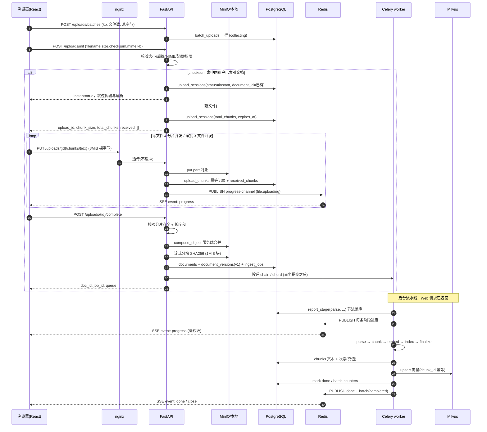

# 大文件与多文档批量上传：异步处理与进度反馈方案

这是本骨架的重点模块。设计目标不是「能传大文件」，而是**在文件可能 2GB、一批可能 200 个、
worker 可能崩、浏览器可能刷新、Redis 可能抖动的条件下，进度始终可解释、状态始终可恢复**。

---

## 1. 为什么不用一次 POST

| 问题 | 一次 POST 传整文件 | 分片 + 异步流水线 |
|---|---|---|
| 内存 | nginx / uvicorn / ORM 任一层都可能整文件读入 | 单请求恒定 8MiB，合并发生在对象存储服务端 |
| 超时 | 2GB 上传 + 分钟级解析必然撞超时 | 上传请求毫秒级；解析在 Celery worker |
| 断线 | 重传整包 | 只补 `missing_chunks` |
| 失败 | 全批一起失败 | 单文件/单页独立重试，其余继续 |
| 进度 | 只能给「上传中」 | 批次 → 文件 → 阶段 → 页/片段四级可量化 |
| 扩容 | Web 与解析抢资源 | 解析走独立 worker 队列，heavy 队列单独扩 |

---

## 2. 端到端时序



**关键顺序**：`PG 事务提交` → `入队`。反过来会出现 worker 抢先跑、读不到刚建的文档。
`complete` 放在线程池里执行，避免合并与哈希阻塞事件循环；SSE 路由**不注入 db 依赖**，长连接不占连接池。

---

## 3. 状态机

### 3.1 上传会话 `upload_sessions.status`

```
initialized → uploading → assembling → completed
     │            │            │
     │            ├→ cancelled  ├→ failed (校验和不匹配)
     │            └→ expired    └→ (超时由 beat 清理)
     └→ instant (秒传，直接终态)
```

### 3.2 文档 `documents.status` 与 Celery 阶段

| 阶段 | 权重 | 文档状态 | 进度贡献 |
|---|---|---|---|
| 分片传输 | 20% | pending | `upload_progress = received/total` |
| parse 解析 | 30% | parsing | 按页/页范围子任务计数 |
| chunk 分块 | 10% | chunking | 一次性 100% |
| embed 向量化 | 40% | embedding | `done_units / total_units`，按 batch 推进 |
| index 写索引 | 15% | indexing | 一次性 100% |
| finalize 收尾 | 5% | indexed | 100%，写 `chunk_count` / `indexed_at` |

```
doc_progress = 100 × (0.20 × upload_progress + 0.80 × Σ stage_weight × stage_progress)
batch_progress = Σ (file_size × file_progress) / Σ file_size     # 体积加权
```

体积加权的意义：一个 500MB 的扫描件和一个 2KB 的 txt 不该各占批次进度 50%。

### 3.3 批次状态

```
collecting → processing → completed
                       ├→ partial  (部分成功)
                       └→ failed   (全部失败)
```

`build_snapshot()` 从 PG 重算 `succeeded/failed/cancelled/running`，是唯一权威口径。

---

## 4. 三层进度通道（核心设计）

| 层 | 介质 | 作用 | 更新频率 |
|---|---|---|---|
| 实时推送 | Redis pub/sub `kb:{tenant}:progress-channel:{batch}` | 前端 SSE，毫秒级 | 每条事件 |
| 快速快照 | Redis `kb:{tenant}:progress-snapshot:{batch}` | 断线重连立刻给最近状态 | 每条事件，TTL 24h |
| 真值 | PG `ingest_jobs` + `batch_uploads` + `upload_sessions` | worker 崩溃/浏览器刷新/Redis 重启都能重建 | 节流 0.5s，**阶段切换/完成/失败强制写** |

为什么高频事件不直接写 PG：200 个文件 × 每页一条 = 上万次 UPDATE，会把业务库打满。
节流键用 Redis `SET NX PX 500`；但「阶段切换」「完成」「失败」三类事件绕过节流，
保证关键状态绝不丢。Redis 推送是「尽力而为」——推失败不影响入库主链路。

### 前端订阅

- 用 `fetch + ReadableStream` 手解析 SSE，**不用 EventSource**：EventSource 不能带
  `Authorization`，把 JWT 放 query string 会进 nginx 日志与浏览器历史。
- 建连先拉一次 `/batches/{id}/progress` 权威快照，刷新页面不会进度归零；
- 支持 `Last-Event-ID` 跳过已收事件；15s 心跳保活；
- 流失败自动降级 2s 轮询 PG，界面显示「降级轮询 PG」而不是假死；
- 收到 `progress/done` 事件后 600ms 节流刷新快照，避免每事件一次 HTTP。

### 服务端 SSE

- 纯 ASGI trace 中间件（不是 `BaseHTTPMiddleware`），不包装响应流；
- nginx：`proxy_buffering off` + `X-Accel-Buffering: no` + `proxy_read_timeout 3600s`；
- 事件类型：`snapshot`（权威快照）、`progress`（阶段推进）、`done`（单文件完成）、
  `batch`（批次收口）、`error`、`close`、`: keepalive`；
- channel 与快照 key 都带 tenant 前缀，跨租户订阅只会拿到空快照。

---

## 5. 大文件的两条特殊路径

### 5.1 服务端权威 checksum

浏览器 `crypto.subtle.digest` 需要 `arrayBuffer()` 整文件，2GB 会直接打爆内存。
约定：`checksum` 以 `skip:` 开头时，前端不做整文件哈希，服务端合并后**流式 SHA256**
的结果即为权威 checksum。代价是大文件不参与秒传，但校验强度不降。

### 5.2 页级并行 chord

`is_large = size >= 100MB`，`page_count > 200` 时进一步拆分：

```
chord(
  group(parse_page_range.s(ctx, start, end) × ceil(pages/40)),   # ingest_heavy 队列
  chain(merge_parsed, chunk_document, embed_and_index, finalize_document)
)
```

- 每个子任务只解析自己的页范围，产物写 `intermediate/{tenant}/{doc}/pages-00000-00040.json`；
- **中间产物走对象存储，不塞进 Celery result**（Redis 不该承载大对象）；
- `merge_parsed` 按文件名里的页范围排序后合并并按 `page_no` 排序，保证阅读顺序；
- 页级进度用 Redis `INCR kb:{tenant}:parsed-pages:{doc}` 汇总，避免多个 worker 互相覆盖；
- 单个子任务失败独立重试，不影响其他页；整体失败仍能在任务中心一键重试。

---

## 6. 失败与恢复矩阵

| 故障 | 表现 | 兜底 |
|---|---|---|
| 网络断了 | 部分分片已到 | `/status` 返回 `missing_chunks`，只补缺失片 |
| 分片重复上传 | 同一 idx 两次 PUT | `uq_upload_chunk_idx` + 先查后写，幂等返回成功 |
| 合并后校验和不符 | 文件损坏/客户端算错 | `status=failed`，保留原分片可排查，提示重传 |
| worker 被 kill -9 | 任务 ack 不到、心跳停更 | `acks_late` + beat 每 5min 扫 `heartbeat_at < 15min` 重投 |
| 阶段超时 | 某页解析卡死 | soft/hard time limit + 指数退避重试，上限 3 次 |
| Milvus 写失败 | PG 有文本、无向量 | 不回滚文本；每日 `reconcile_vectors` 按 chunk_id 差集补齐 |
| Redis 挂了 | 实时进度断了 | SSE 降级轮询 PG；入库任务不受影响 |
| 浏览器刷新 | 内存进度丢失 | SSE 建连先发 PG 快照 |
| 会话过期 | 分片残留 | beat 每小时清 `expires_at < now` 的会话与分片对象 |
| 删文档后向量残留 | 幽灵片段 | 先 PG 软删 → 异步清 Milvus → 标记 chunks 软删 → 每日对账清孤儿 |

**幂等键**：`chunk.id = uuid5(doc_id, version_no, seq)`，同时是 Milvus 主键；
重复执行只覆盖不新增。`ingest_jobs.idempotency_key` 保证同一上传不会重复建任务。

---

## 7. 配置项（`.env`）

| 变量 | 默认 | 说明 |
|---|---|---|
| `MAX_UPLOAD_SIZE_MB` | 2048 | 单文件上限 |
| `UPLOAD_CHUNK_SIZE_MB` | 8 | 分片大小；MinIO compose 要求非末片 ≥5MiB |
| `UPLOAD_SESSION_TTL_HOURS` | 48 | 断点续传窗口 |
| `MAX_BATCH_FILES` | 200 | 单批次文件数 |
| `MAX_CHUNK_CONCURRENCY` | 4 | 前端单文件并发分片数 |
| `LARGE_FILE_SIZE_MB` | 100 | 超过走 heavy 队列 |
| `LARGE_FILE_PAGE_THRESHOLD` | 200 | 超过才拆页级子任务 |
| `PARSE_PAGE_BATCH` | 40 | 每个页级子任务页数 |
| `MAX_CONCURRENT_INGEST_PER_TENANT` | 4 | 租户级并发闸（预留） |
| `PROGRESS_THROTTLE_SECONDS` | 0.5 | PG 写节流 |
| `SSE_HEARTBEAT_SECONDS` | 15 | 心跳间隔 |
| `INGEST_SOFT/HARD_TIME_LIMIT` | 600 / 900 | 任务时限；`visibility_timeout` 自动取 hard×2 |
| `INGEST_MAX_RETRIES` | 3 | 重试上限 |

---

## 8. 怎么验证这条链路

1. 起全栈后上传 3 个文件（其中 1 个重复）→ 观察一个文件「秒传命中」；
2. 上传中途刷新页面 → 进度条从 PG 快照恢复，不归零；
3. 上传中手动 `docker compose stop redis` → 前端切到「降级轮询 PG」，解析继续；
4. `docker compose stop worker-light` 再传文件 → 任务停在 queued，看板可见；
5. 造一个 >100MB / >200 页 PDF → 任务中心显示 `is_large=true`、`queue=ingest_heavy`，
   Redis 里能看到 `parsed-pages` 计数；
6. 故意传错 checksum → `status=failed`，任务中心出现失败记录并可重试；
7. `docker compose exec beat celery -A app.tasks.celery_app:celery_app call app.tasks.maintenance.reconcile_vectors`
   → 对账报告显示 `missing_fixed` / `orphans_removed`。

> 这些是「功能可跑」的验证，不是性能结论。2GB 文件的实际耗时、P95 进度延迟、
> 8 并发下的资源水位，仍需要压测数据才能对外讲。
