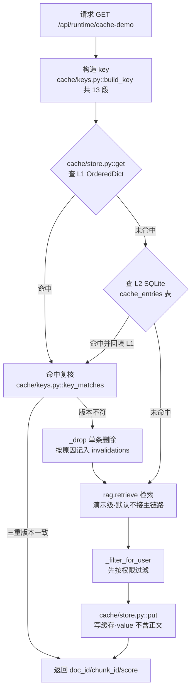

# 通用缓存层与重启恢复设计说明（02-design）

> 文档性质：**设计说明（只写入本文，不改任何源码）**
> 编写日期：**2026-11-14**
> 适用项目：企业内部知识库 RAG（检索增强生成）——「开发框架骨架 + 可运行演示切片」，演示用，**非上线交付版**
> 本轮事实基线：`cache/` 通用缓存包 + 重启恢复适配层已落地；本文按**已落地事实**撰写，不推测、不补写尚未存在的代码
> 上游调研：`docs/cache-recovery/01-research.md`（下文简称「01 调研」），本文**只引用、不修改**；配套口径：`docs/async-upload.md`（异步上传与进度三层通道）、`docs/org-model-change-plan.md`（去多租户、改多用户多部门）、`docs/knowledge/01-research.md`（同期姊妹篇）

---

## 0. 阅读约定与三态标注

### 0.1 本文写什么、不写什么

本文描述**本轮已落地**的 `cache/` 包与 `webapp/` 恢复适配层：缓存 key 怎么拼、缓存怎么分层、失效怎么触发、重启后哪些状态能救、怎么验收、评审怎么答。全文只写一份 Markdown，不改动任何 `.py` / `.html` / `.js` / `.yml`，不动冻结区 `eval/` `demo/` `evalbench/`，不改 01 调研，也不碰 `cache/` `webapp/` `knowledge/` `parsing/` `docs/knowledge/` `docs/parsing/` 的既有文件。

### 0.2 术语与字段首现中文对照

以下英文键名、字段名、命令名在本文**首次出现**，统一给出中文说明；后文复用时不再重复加括号。

| 英文 | 中文说明 |
|---|---|
| RAG | 检索增强生成：先检索证据片段，再让大模型作答 |
| TTL | 存活时间：缓存条目到期自动失效的时长 |
| LRU | 最近最少使用：容量满时淘汰最久未用条目的策略 |
| L1 / L2 | 一级进程内缓存 / 二级持久化缓存 |
| key | 缓存键：由「影响输出的全部输入」拼成的确定性摘要 |
| ACL / RBAC | 访问控制列表 / 基于角色的访问控制 |
| SSE | 服务端推送事件：单向长连接把进度推给浏览器 |
| `CachePolicy` | 缓存策略对象：`enabled`（总开关）、`l1_capacity`（=256，进程内 LRU 上限）、`l2_capacity`（=5000，SQLite 条目上限）、`ttl_seconds`（=900，正常结果存活秒数）、`negative_ttl_seconds`（=60，空结果存活秒数）、`ttl_jitter`（=0.10，抖动比例）、`org_namespace`（="org"，静态组织命名空间） |
| `CacheStore` | 双层缓存存储：`put()` 写、`get()` 读、`state_get/set/incr` 读写运行时状态、`invalidate_all()` 主动清空、`purge_expired()` 清过期、`enforce_capacity()` 容量淘汰、`clear_memory()` 清 L1 |
| `CacheStats` | 缓存统计：`l1_hits` / `l2_hits` / `misses` / `hit_rate`（命中率）/ `writes` / `invalidations`（按原因分组的失效计数）/ `evictions` / `ghost_purged` / `expired_purged` |
| `VersionController` | 版本控制器：`bump_data_version()`、`bump_grant_version()`、`sync_policy_version()`、`eager_purge()` |
| `RecoveryReport` / `CheckResult` | 恢复报告 / 单项检查结果：`started_at`（启动时间）、`boot_count`（启动计数）、`last_shutdown_at`（上次关闭时间）、`checks`、`orphan_task_ids`、`requeued`（重投数）、`ghost_vectors`、`expired_cache_purged`、`capacity_evicted`、`healthy`（全部检查通过）、`notes` |
| `authz_snapshot` | 授权快照：角色 + 部门 id + 排序后的可见部门集合 + 授权版本 + 组织命名空间的 sha256 摘要 |
| `data_version` / `grant_version` / `policy_version` | 数据版本 / 授权版本 / 策略版本，均落 `runtime_state` 表、重启不丢 |
| `decide()` | 授权判定函数：判断「当前主体能否看某文档」，本文约定缓存**不负责授权** |
| `runtime_state` / `cache_entries` | `CacheStore` 建的两张 SQLite 表：运行时状态表 / 缓存条目表 |
| `documents.status` | 文档状态机字段：`queued` / `analyzing` 表示未完成的入库任务 |
| `chunk_embeddings` / `chunks` | 向量缓存表 / 分块表；前者残留、后者已无对应记录的向量即幽灵向量 |
| `owner_id` / `doc_id` / `chunk_id` / `score` | 文档归属者 / 文档标识 / 分块标识 / 相关性得分 |
| `SIGKILL` / `SIGTERM` | 不可捕获的强制终止信号 / 可捕获的终止信号 |
| `PARSING_OFFLINE` / `WEBAPP_FRESHNESS_ENABLED` | 一键离线开关 / 新鲜度开关，两者默认关闭 |

### 0.3 本文三态标注定义

本文对**本轮能力**统一使用完成度三态，只回答「做没做成」：

- **【已实现】**：`cache/` 或 `webapp/` 里已有可运行代码，可实查、可被测试断言。
- **【只设计】**：有明确的方案、字段或接口约定，但未落地为可运行代码（例如生产侧的 Redis / Celery 替换路径）。
- **【未做】**：既无代码也无落地设计，明确不做或仅列为候选（答案缓存、语义缓存、真实压测等）。

### 0.4 与 01 调研三套口径的关系：不同用途，不换算

01 调研里存在三套彼此独立的标注，本文**都不沿用、不换算**：

| 口径 | 出处 | 回答的问题 | 本文处理 |
|---|---|---|---|
| 调研三态【已实现】/【只设计】/【未做】 | 01 调研 §0.2、§A / §B 正文 | 「**调研时点、落地之前**，全仓现状完成度如何」 | 不沿用：那是对落地前全仓的快照 |
| 落地三态 已具备基础 / 需补齐 / 本期不建议做 | 01 调研 §C | 「该不该做、先做什么」的**优先级决策** | 不换算：决策优先级 ≠ 完成度事实 |
| 公开经验值与验收判据 | 01 调研 §A5 / §B6 / §D | 「应当能算哪些指标、公开阈值参考」 | 只继承设计原则，数字一律标「非本项目实测」 |

01 调研在落地后另增了 §0.0「主理人最终状态回填（优先级高于下文）」，明确「C1–C7 落地口径保留不回改，用于追溯调研 → 落地过程」，并单独列出落地后的最终状态表——这本身就是「调研口径与落地事实并存、不换算」的实证，与本节结论一致；本文承接的正是该落地后最终状态。

本文三态只回答一件事：**本轮 `cache/` 包 + 重启恢复适配层到底做成没做成**，是落地后的事实标注。三条「不换算」写死：

1. 01 调研 §0.3 把「检索结果缓存」标【未做】、§C5 标「本期不建议做」，是 `cache/` 落地**之前**下的范围判断；本轮已落地通用缓存包与演示级 `cache-demo` 接口，本文按落地后事实重新标注，既**不把「本期不建议做」换算成本文【未做】**，也不反过来用本文【已实现】去否定调研当时的范围建议。
2. 落地三态是**决策优先级**，本文三态是**完成度事实**，二者不一一对应、不互相推导。同一能力在 01 调研标「需补齐」、本文标【已实现」，两句话都成立、不矛盾。
3. 01 调研 §A / §B 的论证——先按权限过滤再写、命中后复核、真值层先行、TTL 不作权限控制——本文作为**设计原则继承**并落到代码，属于「引用结论」，不是「搬运状态标注」。

### 0.5 数字口径与免责

- 本文出现的 `ttl_seconds=900`、`negative_ttl_seconds=60`、`ttl_jitter=0.10`、`l1_capacity=256`、`l2_capacity=5000` 是 `CachePolicy` 的**演示默认经验起始值**；代码 `as_dict()` 自带说明「演示默认经验起始值，非压测结论，需用真实流量校准」。它们是**配置默认值，不是实测数字、不是 SLA**。
- 01 调研 §D 收录的相似度阈值、TTL 时长、抖动区间、心跳秒数、命中率、成本节省、QPS 压测值一律为**公开经验值，非本项目实测**；本文凡引用一律显式标注，不转述为本项目结论，也**不编造**任何命中率、延迟、P95/P99、成本节省、QPS、价格或 URL。

---

## 1. 缓存分层与数据流图

### 1.1 三层结构与职责

| 层 | 实现 | 重启后 | 放什么 | 三态 |
|---|---|---|---|---|
| L1 进程内 | `OrderedDict` LRU（`cache/store.py`） | **必然清空** | 可重建的派生数据，纯加速器 | 【已实现】 |
| L2 持久化 | SQLite 表 `cache_entries` / `runtime_state`（同业务库文件） | 条目仍在 | 带 TTL 的派生结果 + 版本计数器 | 【已实现】 |
| 真值层 | SQLite 业务表 `documents` / `chunks` / `chunk_embeddings` | 原样保留 | 文档、分块、任务、策略的**唯一权威** | 【已实现】 |

生产对应「PG（PostgreSQL）为状态真值 + Redis 做实时通道」，本包是演示替身（见 §8）。**缓存永远不写真值，只写派生**。

### 1.2 数据流（Mermaid）

### 1.3 逐步落点文件

| 步 | 动作 | 落点文件 | 关键约束 |
|---|---|---|---|
| 1 | 接收请求、组装用户身份 | `webapp/routers_runtime.py` | admin 全见、普通用户只留 `owner_id` 匹配文档 |
| 2 | 构造 13 段 key | `cache/keys.py::build_key` | 每段对应一类事故（见 §2） |
| 3 | 查 L1 | `cache/store.py::CacheStore.get` | 先查 TTL、再 `key_matches()` 复核三重版本 |
| 4 | 查 L2 | `cache/store.py::CacheStore.get` | 命中后回填 L1，`_touch_l2` 更新命中数 |
| 5 | miss 回源检索 | `webapp/rag.py::retrieve` | **演示级，默认不接 `rag.retrieve()` 主链路** |
| 6 | 先权限过滤 | `webapp/routers_runtime.py::_filter_for_user` | 缓存里绝不落未授权内容 |
| 7 | 写缓存 | `cache/store.py::CacheStore.put` | value 只含 `doc_id` / `chunk_id` / `score`，**不含正文** |
| 8 | 命中复核 | `cache/keys.py::key_matches` | 比对 `data_version` / `authz_snapshot` / `policy_version` |
| 9 | 版本不符处理 | `cache/store.py::_drop` | 单条删除，原因写入 `invalidations` |

演示接口额外做两步自证：写完后 `clear_memory()` 清 L1，再查一次验证 **L2 命中**；随后用「新 `data_version` 重新构造 key」验证**懒失效**（不改全局版本、不删条目），证明旧 key 自然不命中。

---

## 2. 缓存 key 逐段表：每一段都是一道事故防线

`build_key()` 返回 `(key, parts)`：key 是 `kb:` 开头的 32 位摘要，`parts` 供 `/api/runtime/status` 逐段展示「这个 key 为什么这样拼」。13 段如下，**缺一段就出一类事故**：

| 段名 | 中文说明 | 取值来源 | 缺了会出什么事故 |
|---|---|---|---|
| `schema` | 缓存结构版本（`CACHE_SCHEMA_VERSION`="v1"） | 常量 `cache/contracts.py` | key 结构升级后新旧格式互串，无法整体失效 |
| `org` | 静态组织命名空间（`org_namespace`="org"） | `CachePolicy` | 跨组织 / 跨部署串数据、越权读到别库内容 |
| `kind` | 缓存种类（默认 `retrieval` 检索结果） | 调用方 | 检索结果与其它类型缓存互串、取错结构 |
| `query` | 归一化查询哈希（`query_hash`） | `normalize_query()` 去空白、折叠空格、统一大小写后 sha256 | 不同问题互串、返回旧答案 |
| `embedding` | 向量缓存键（`embedding_cache_key`，provider + 模型名） | `chunk_embeddings.cache_key` 口径 | **串模型**：旧向量空间与新空间不可比，召回错乱 |
| `model` | 生成 / 排序模型名 | 调用方 | 换模型仍复用旧口径结果 |
| `top_k` | 取回候选条数 | 调用方 | 换条数仍复用旧排序结果 |
| `retrieval_mode` | 检索模式（稠密 / 词法 / 混合） | 调用方 | 换召回方式仍用旧候选集 |
| `rerank` | 重排档位 | 调用方 | 换重排档后旧排序结果不失效 |
| `freshness` | 新鲜度开关（on / off） | `WEBAPP_FRESHNESS_ENABLED` | 开关切换后仍复用旧判定结果 |
| `authz` | 授权快照段（`authz_snapshot` 摘要） | `authz_snapshot()` | **串权限**：A 用户命中 B 用户结果，最严重 |
| `data_version` | 文档集合版本 | `runtime_state` 计数器 | 文档增删改后旧片段复现、返回旧答案 |
| `policy_version` | 策略内容哈希 | `policy_version()` | 策略改了仍用旧新鲜度 / 冲突判定结果 |

### 2.1 `authz_snapshot` 与 `decide()` 的关系（硬约束）

- `authz_snapshot()` 由 `role`（角色）、`department_id`（部门 id）、`visible_department_ids` **排序后**的可见部门集合、`grant_version`（授权版本）、`org_namespace` 拼成 sha256 摘要；排序保证集合与顺序无关、哈希稳定。
- **缓存不负责授权**。`decide()`（授权判定）只发生在两个位置：写入前的 `_filter_for_user()` 过滤，以及命中后的 `key_matches()` 轻量复核。缓存层从不缓存「已放行」这个断言。
- 因此是**双保险**：`authz` 段让转岗 / 角色变更 / `ACLGrant` 变更（`grant_version` 递增）后旧 key 自然不可命中；即使 key 碰撞或版本漏改，命中后 `key_matches()` 仍比对 `authz_snapshot` 不符即按 `authz_snapshot_changed` 记失效并单条删除。
- **TTL 不是权限控制**：授权撤销必须靠版本变化即时失效，绝不等 TTL 到期。01 调研 §A3 的结论「稍旧的内容可接受，稍旧的授权绝不可接受」本文原样继承。

---

## 3. 失效策略：懒失效为主，TTL 兜底

### 3.1 三种机制对比

| 机制 | 触发 | 优点 | 局限 | 本项目落点 | 三态 |
|---|---|---|---|---|---|
| **懒失效（版本感知）** | 版本递增，旧 key 自然不命中，TTL 到期回收 | 精确、无需扫全库、不产生写放大、不与在途请求竞争 | 依赖版本可靠递增与传播 | `cache/invalidation.py::VersionController` + `cache/store.py::key_matches` | 【已实现】 |
| **主动清空（eager）** | `eager_purge()` → `invalidate_all()` 删 L1+L2 | 即时腾空间、演练对照 | 批量删有写放大，生产 `noeviction` 下严禁 `FLUSHALL` | `cache/store.py::invalidate_all` | 【已实现】 |
| **TTL 时间失效** | 到期自动删 / `purge_expired()` 启动清理 | 实现简单、有陈旧度上限兜底 | 窗口内一定存在陈旧读 | `CachePolicy.ttl_seconds` + `purge_expired()` | 【已实现】 |

### 3.2 版本递增的三个触发点

| 触发点 | 动作 | 影响的 key 段 | 落点 |
|---|---|---|---|
| 文档新增 / 更新 / 删除 / 重解析 | `bump_data_version()` | `data_version` | `cache/invalidation.py`；启动时文档指纹变化也触发（`cache/recovery.py`） |
| 转岗 / 角色变更 / `ACLGrant` 增改 | `bump_grant_version()` | `authz` | `cache/invalidation.py` |
| 前端改新鲜度策略 / 解析策略 | `sync_policy_version()` | `policy_version` | `cache/invalidation.py`；策略持久化见 `webapp/recovery.py::persist_policy` |

三个版本计数器都落 `runtime_state` 表（`state_incr` / `state_set`），**重启不丢**。版本递增后不批量删条目——key 里带版本号，旧 key 自然不可命中，空间由 TTL 回收。

### 3.3 为什么只靠 TTL 不够

1. 文档删除十秒后，十分钟 TTL 的检索缓存仍会把已删片段喂进上下文。
2. 授权被撤销后，TTL 窗口内用户仍能看到已无权限的资料。
3. 「检索缓存更新了、策略版本没跟着变」会更隐蔽地继续返回旧判定结果。
4. 结论：**TTL 只是陈旧度上限兜底，不是正确性边界**；正确性由「版本 + 命中后复核 + 显式失效」共同承担（继承 01 调研 §A3）。

### 3.4 三件套：负缓存、抖动、容量

- **负缓存短 TTL**：空结果（未命中检索）用 `negative_ttl_seconds=60` 单独存，`is_negative=True`，防缓存穿透；注意区分「未找到」与「暂时不可用」，不混为同一负缓存。【已实现】
- **TTL 抖动防雪崩**：`_ttl_for()` 在基础 TTL 上叠加 `±ttl_jitter`（默认 0.10）随机偏移，打散集中过期。【已实现】
- **容量 LRU**：L1 超 `l1_capacity=256` 由 `_trim_l1()` 弹最久未用；L2 超 `l2_capacity=5000` 由 `enforce_capacity()` 按 `last_access` 淘汰最久未用条目。【已实现】
- **命中复核**：`get()` 无论 L1 还是 L2 命中，都先过 `key_matches()` 比对 `data_version` / `authz_snapshot` / `policy_version`；不符经 `_mismatch_reason()` 判定原因（`data_version_changed` / `authz_snapshot_changed` / `policy_changed`），`_drop()` 单条删除并计入 `invalidations`。【已实现】

> 上述 900 / 60 / 0.10 / 256 / 5000 均为**演示默认经验起始值**，非实测、非压测结论；01 调研 §A4 / §D 的同类阈值是**公开经验值，非本项目实测**。

---

## 4. 重启状态三分类与 7 项启动自检

### 4.1 三分类表

| 类别 | 判定标准 | 本项目具体例子 | 处置 |
|---|---|---|---|
| **可安全丢弃** | 丢了不影响正确性，最多损失体验 / 统计精度 | 三维限流滑动窗口、`_TRACE_HISTORY` / `_HISTORY` 解析轨迹 `deque`、SSE 连接 | 重启清零，不重建；可记「窗口重置」事件 |
| **可从真值重建** | 真值在 SQLite / PG，内存只是投影 | 进程内队列 `_sem` / `_active` / `_queued`、进度快照、`documents.status IN ('queued','analyzing')` 孤儿任务 | 启动时扫真值、幂等重投，不信任旧内存 |
| **必须持久化** | 丢了会产生错误或「改了又回退」 | 配置与策略（`knowledge_policy` / `parsing_strategy` / `cache_policy`）、版本计数器、`runtime_state`、文档与向量缓存 `chunk_embeddings`、L2 缓存条目 | 落 SQLite，重启后原样恢复 |

分类结果与 `CheckResult.category` 的三个取值 `discardable` / `rebuildable` / `must_persist` 一一对应，由 `test_startup_report_categories_are_complete` 断言覆盖。

### 4.2 `cache/recovery.py::run_startup_checks` 的 7 项检查映射

| # | 检查名 | 分类 | 做什么 | 落点 |
|---|---|---|---|---|
| 1 | `schema_ready` | must_persist | 校验 `cache_entries` / `runtime_state` 两张表齐备 | `cache/store.py::ensure_schema` |
| 2 | `volatile_state_discarded` | discardable | 声明限流窗口 / 轨迹 `deque` / SSE 连接重启即丢、窗口从零开始 | `webapp/observability.py` 等 |
| 3 | `orphan_tasks_recovered` | rebuildable | 扫 `documents.status IN ('queued','analyzing')`，注入 `requeue` 回调**幂等重投** | `cache/recovery.py` + `webapp/db.py` |
| 4 | `ghost_vectors_reconciled` | must_persist | 删 `chunk_embeddings` 中 `chunk_id` 不在 `chunks` 表的残留向量；源头治理见 `webapp/routers_docs.py::delete_doc` 删文档前先删对应向量缓存 | `cache/recovery.py` + `webapp/routers_docs.py` |
| 5 | `data_version_consistent` | must_persist | 用 `compute_doc_fingerprint()` 对比上次启动指纹，变化则 `bump_data_version()`（懒失效） | `cache/keys.py` + `cache/recovery.py` |
| 6 | `policies_persisted` | must_persist | 确认 `grant_version` / `policy_version` 在库，策略从 `runtime_state` 恢复而非进程内存 | `webapp/recovery.py::persist_policy` |
| 7 | `expired_cache_purged` | must_persist | 启动时 `purge_expired()` + `enforce_capacity()` 清过期与超容量条目 | `cache/store.py` |

`RecoveryReport.healthy` 是「全部 `CheckResult.passed` 为真」的派生判定；`boot_count` 每次启动 `state_incr` 自增；`last_shutdown_at` 由 `webapp/recovery.py::note_shutdown()` 在优雅关闭时写入。

### 4.3 `SIGKILL` 实证与「真值先行」

- 本轮真实进程重启演练（见 §5）采用**强停进程**：`SIGKILL` 不可捕获，`webapp/main.py` 的 lifespan `finally` 未执行，`note_shutdown()` 没机会写 `last_shutdown_at`，因此恢复报告里该字段为空。
- `cache/recovery.py::was_graceful()` 正是靠「`last_shutdown_at` 是否存在」区分优雅关闭与异常退出；空即说明上次非干净退出，进入 recovery 分支。
- 但演练结果 `healthy=True`、孤儿任务重投、幽灵向量清理、策略完整恢复——**系统一致性不依赖优雅关闭**。
- 结论（继承 01 调研 §B4）：**真值层先行、状态随时可从真值重建、写入幂等**，才是 `SIGKILL` 下不丢状态的根本；不能把正确性押在 shutdown handler 上，要测恢复路径而非只测「优雅关闭那条虚构故事」。

---

## 5. 真·重启演练记录（2026-11-14）

> 本节是**功能连通性实证**，不是压测、不是 SLA 结论。全程隔离库 `.data/restart-check/app.db`，不影响主库。

### 5.1 方法

1. 首次启动进程，`recovery.startup()` 跑自检，写 `boot_count=1`。
2. 通过 `PUT` 把新鲜度策略改为 `half_life=45` / `blend=0.5`（`persist_policy` 落 `runtime_state`），并写入 1 条检索结果缓存条目（L1 + L2）。
3. 人为埋入 1 个 `analyzing` 状态的孤儿任务、1 条 `chunk_id` 已不在 `chunks` 表的幽灵向量。
4. **强停进程**（`SIGKILL`，不走优雅关闭，故 `last_shutdown_at` 未写入）。
5. 用同一隔离库重启，观察 `/api/runtime/status` 的恢复报告与缓存行为。

### 5.2 强停前快照

| 项 | 值 |
|---|---|
| 策略 | `half_life=45` / `blend=0.5` |
| L2 缓存条目 | 1 条 |
| 孤儿任务 | 1 个（`analyzing`） |
| 幽灵向量 | 1 条 |
| `boot_count` | 1 |

### 5.3 重启后结果

| 观察项 | 结果 | 说明 |
|---|---|---|
| `healthy` | `True` | 7 项检查全部 passed |
| `boot_count` | `1 → 2` | `state_incr` 生效，确认是一次真实重启 |
| 孤儿任务重投 | `requeued=1` | 幂等重投，不重复分析 |
| 幽灵向量对账 | 清理 `1` 条 | `ghost_vectors_reconciled` |
| 策略恢复 | `45 / 0.5` 完整保留 | 从 `runtime_state` 恢复，未回默认 |
| L2 缓存条目 | 仍在 | 清 L1 后仍可命中，复核三重版本 |
| 接口错误 | 无 500 | 启动到查询链路连通 |
| `last_shutdown_at` | **缺失** | 强停导致，实证「SIGKILL 不保证优雅关闭」 |

### 5.4 结论与边界

- 结论与边界：在「策略改了、缓存写了、孤儿任务埋了、幽灵向量埋了」的快照下强停再重启，系统能自愈到一致状态，且**一致性不依赖优雅关闭**；但**这是功能连通性实证，不是压测或 SLA 结论**——本节不给出任何 QPS、延迟、P50/P95/P99、命中率、成本节省数字，不宣称可用性指标，01 调研 §D 的公开经验阈值一律**非本项目实测**。

---

## 6. 可量化验收标准（14 条）

统一验证入口（离线、零外部调用、共 26 项）：`pytest -q cache/tests/test_cache.py webapp/tests/test_runtime_api.py`，其中 `cache/tests/test_cache.py` 19 项、`webapp/tests/test_runtime_api.py` 7 项。每条给出「指标定义 / 阈值或判定 / 验证命令或断言」，断言均映射到**真实存在的测试**。

**AC-01 L2 重启命中**
- 指标定义：L1 清空且新建 `CacheStore` 实例（模拟进程重启）后，同一 key 能否从 L2 取回。
- 阈值/判定：`get()` 返回 `level=="l2"` 且值不丢；`simulate_restart()` 后 `healthy=True`。
- 验证：`test_restart_keeps_l2_entries_but_clears_l1`（`assert val2 == {"answer":"A"} and level2 == "l2"`）；`test_cache_demo_proves_l2_survives_l1_clear`（`after_l1_cleared.hit is True`、`level == "l2"`）。

**AC-02 `data_version` 变化即 miss（懒失效）**
- 指标定义：不删条目、仅改 `data_version` 重新构造 key / 复核时的命中情况。
- 阈值/判定：返回 `None`，且 `invalidations` 含 `data_version_changed`。
- 验证：`test_version_or_authz_change_is_a_miss`（`assert "data_version_changed" in s.stats.invalidations`）；`test_cache_demo_proves_l2_survives_l1_clear`（`after_version_change.hit is False`）。

**AC-03 `authz_snapshot` 变化即 miss**
- 指标定义：授权快照变化后旧身份缓存是否不可命中。
- 阈值/判定：返回 `None` 且记 `authz_snapshot_changed`；`grant_version` 变化则快照哈希不等、集合顺序不影响哈希。
- 验证：`test_version_or_authz_change_is_a_miss`（`"authz_snapshot_changed" in invalidations`）；`test_authz_snapshot_ignores_department_order_but_not_content`（顺序无关、内容有关）。

**AC-04 TTL 到期即 miss**
- 指标定义：越过 `expires_at` 后的读取结果与失效原因计数。
- 阈值/判定：返回 `None`，`invalidations["ttl"] >= 1`。
- 验证：`test_ttl_expiry_returns_miss`（`ttl_seconds=60, ttl_jitter=0`，`now` 前进 2 分钟）。

**AC-05 负缓存短 TTL**
- 指标定义：空结果条目的 `is_negative` 标记与到期时间。
- 阈值/判定：`is_negative=True`，`expires_at` 约为写入时刻 + 60 秒，明显短于正常 900 秒。
- 验证：`test_negative_cache_has_shorter_ttl`（`assert neg.is_negative and neg.expires_at == "…12:01:00Z"`）。

**AC-06 L1 容量 LRU 淘汰**
- 指标定义：超过 `l1_capacity` 时 `_l1` 长度与淘汰计数。
- 阈值/判定：`len(_l1) == 2`，`evictions >= 1`。
- 验证：`test_l1_capacity_evicts_lru`（`l1_capacity=2`，写入 3 条）。

**AC-07 L2 容量淘汰**
- 指标定义：`enforce_capacity()` 后条目数收敛到 `l2_capacity`。
- 阈值/判定：返回淘汰数 `2`，`count() == 2`。
- 验证：`test_l2_capacity_eviction`（`l2_capacity=2`，写入 4 条）。

**AC-08 孤儿任务幂等重投**
- 指标定义：连续两次启动，重投数与 `boot_count`。
- 阈值/判定：首次 `requeued=1`、回调仅 1 次；第二次 `requeued=0`、`orphan_task_ids=[]`、`boot_count=2`。
- 验证：`test_startup_recovers_orphan_tasks_idempotently`；`test_startup_idempotent_on_same_store`（`r1.requeued==1`、`r2.requeued==0`、`len(calls)==1`）。

**AC-09 幽灵向量与过期缓存清理**
- 指标定义：启动时对账清理数与报告健康度。
- 阈值/判定：`ghost_vectors=1`、`expired_cache_purged=1`、`healthy=True`，且写入 `doc_fingerprint`。
- 验证：`test_startup_purges_ghost_vectors_and_expired_cache`。

**AC-10 策略持久化往返**
- 指标定义：策略改动落 `runtime_state` 后，新建对象还原是否一致。
- 阈值/判定：`half_life_days=45` 保存 → `load_policy` → `restore_policy` → `_current().half_life_days == 45`；`runtime_state` 跨新 store 可读。
- 验证：`test_policy_persistence_roundtrip`；`test_runtime_state_survives_new_store`。

**AC-11 key 各安全维度变化**
- 指标定义：13 段中关键维度逐一变化后 key 是否改变。
- 阈值/判定：8 个维度（authz / data_version / policy_ver / embedding / model / top_k / freshness / rerank）逐一变化，key 均不等原值；`status.key_example.parts` 至少含 9 段。
- 验证：`test_key_changes_with_every_safety_dimension`；`test_status_has_key_parts_and_recovery_report`。

**AC-12 查询归一化 / 文档指纹 / 策略版本稳定**
- 指标定义：归一化、指纹、策略哈希的确定性与内容敏感性。
- 阈值/判定：空白折叠稳定；文档增删改改变指纹；策略字典序无关、改值即变。
- 验证：`test_query_normalization_is_stable`；`test_doc_fingerprint_changes_on_any_document_change`；`test_policy_version_tracks_content`。

**AC-13 优雅关闭标记与恢复报告完整**
- 指标定义：`was_graceful` 标记、7 项检查三分类覆盖、`healthy` 派生。
- 阈值/判定：未关闭时 `False`、`note_shutdown` 后 `True`、`last_shutdown_at` 回填；`{"discardable","rebuildable","must_persist"} <= categories`。
- 验证：`test_graceful_shutdown_marker`；`test_startup_report_categories_are_complete`；`test_recovery_endpoint_returns_last_report`。

**AC-14 admin 门禁、策略写校验与权限过滤**
- 指标定义：越权/非法写入是否被拦、过滤前后候选数关系。
- 阈值/判定：未授权 `invalidate` 返 401/403；`ttl_seconds=0` 返 400、合法值返 200；`permission_filter.after <= before`；`simulate-restart.l1_cleared=True`。
- 验证：`test_cache_demo_admin_only_writes`；`test_cache_policy_write_requires_admin_and_validates`；`test_cache_demo_proves_l2_survives_l1_clear`。

---

## 7. 常见问题（9 组）

**Q1 重启会丢什么？**
- 错误答法：「都丢 / 都不丢」一刀切，或说「重启把缓存全清了所以没问题」。
- 正确答法：先分三类——可安全丢弃（限流窗口、轨迹 `deque`、SSE 连接）、可从真值重建（队列活跃态、孤儿任务）、必须持久化（策略、版本计数器、文档与向量、L2 条目）；再讲各类处置。
- 本项目落点：`cache/recovery.py` 三分类注释 + 7 项检查的 `category`；`webapp/recovery.py::startup/shutdown`。
- 诚实边界：L1 必然清空；L2 在演示切片是同一个 SQLite 文件，生产应换 PG 真值 + Redis 实时通道。

**Q2 缓存 key 为什么要带模型名？**
- 错误答法：「方便统计」或「加上更规范」，答不到向量空间。
- 正确答法：不同 embedding / 生成模型对应不同向量空间与输出口径，旧向量与新向量**不可比较**；不带模型名会在模型升级后复用旧向量 / 旧答案，产生「串模型」与静默质量下降，换模型要走命名空间切换 + 全量重算。
- 本项目落点：`build_key` 的 `embedding`（`embedding_cache_key`）与 `model` 两段；`test_key_changes_with_every_safety_dimension` 断言这两段变化 key 必变。
- 诚实边界：`chunk_embeddings.cache_key` 只含 provider + 模型名、不改；本文不新增向量全量重算逻辑（【只设计】）。

**Q3 TTL 为什么不能当权限控制？**
- 错误答法：「TTL 够短就安全」，把陈旧度上限当授权边界。
- 正确答法：授权撤销后 TTL 窗口内用户仍能看到无权限资料；授权是廉价但关乎安全的决策，绝不缓存「已放行」断言，必须靠版本变化即时失效 + 命中复核。
- 本项目落点：`authz_snapshot` / `grant_version` 段 + `key_matches()` 命中复核 + `_drop()` 记 `authz_snapshot_changed`。
- 诚实边界：`grant_version` 递增是【已实现】的机制，但「转岗事件自动触发」的完整事件链在演示切片未接全（【只设计】）。

**Q4 懒失效 vs 主动删，怎么选？**
- 错误答法：「更新时直接 `DELETE` 全表最干净」，忽略写放大与在途竞争。
- 正确答法：懒失效版本递增后旧 key 自然不命中、TTL 回收，精确且无写放大；主动清空只在演练 / 立即腾空间时用，生产 `noeviction` 下严禁 `FLUSHALL`。
- 本项目落点：`VersionController.bump_*` 为懒、`eager_purge()` → `invalidate_all()` 为主动；`test_version_controller_bump_is_lazy` 断言 `strategy=="lazy"` 与 `"eager"`。
- 诚实边界：懒失效依赖版本可靠传播，演示切片不覆盖分布式多实例版本广播（【只设计】）。

**Q5 幽灵向量怎么治？**
- 错误答法：「删文档就完了」或「重建整个向量库」。
- 正确答法：源头治理 + 启动对账双管——删文档前先删对应向量缓存；启动时按 `chunk_id` 差集清 `chunk_embeddings` 中已无 `chunks` 记录的残留。
- 本项目落点：`webapp/routers_docs.py::delete_doc` 源头删向量；`cache/recovery.py` 的 `ghost_vectors_reconciled`；`test_startup_purges_ghost_vectors_and_expired_cache` 断言清理 1 条。
- 诚实边界：这是 SQLite 差集清理，生产 Milvus / PG 的异步软删对账是【只设计】。

**Q6 答案缓存为什么不做？**
- 错误答法：「没时间」或「加个 key 就行」。
- 正确答法：答案缓存依赖最多（query + 权限 + 语料 + prompt + 生成模型），任一变化即串答案；语义缓存还有误命中风险；在授权快照能力未完全就位前切换 key 是禁区。
- 本项目落点：`/api/runtime/status` 的 `integration.answer_cache` 明确标「未做（依赖 prompt + 生成模型，误命中风险高）」；`test_status_has_key_parts_and_recovery_report` 断言该字符串。
- 诚实边界：检索结果缓存也只是 `cache-demo` 演示级 API、**默认不接 `rag.retrieve()` 主链路**；答案缓存 / 语义缓存明确【未做】。

**Q7 限流窗口清零会不会被打爆？**
- 错误答法：「会」然后没下文，或「没事」硬否认。
- 正确答法：会——进程内滑动窗口重启清零，短时计数从零开始，理论上存在突发流量穿透风险；但 `rate_rules` 规则落库、三维限流维度 `("user","endpoint","model")` 不变，生产应换 Redis 令牌桶 / 滑动窗口 + 网关层限流使计数跨重启连续。承认风险 + 给方向。
- 本项目落点：`volatile_state_discarded` 检查把它归「可安全丢弃」；`RecoveryReport.notes` 明写「属已知取舍，不是数据错误」。
- 诚实边界：本期只补文档与话术，**不改限流维度、不引 Redis 令牌桶**（【只设计】）。

**Q8 怎么证明重启没丢状态？**
- 错误答法：口头说「我测过」，或只测优雅关闭那条路径。
- 正确答法：靠结构化恢复报告 + 可复现对比——`healthy` / `boot_count` 递增 / 孤儿重投幂等 / 幽灵向量归零 / 策略往返一致 / L2 清 L1 后仍命中；再加强停（`SIGKILL`）中途故障演练，测恢复路径。
- 本项目落点：§5 真实重启演练（隔离库、强停、`healthy=True`、boot 1→2、`requeued=1`、ghost=1、策略 45/0.5 恢复、L2 仍在、无 500）；AC-01 / 08 / 09 / 10 / 13 对应断言。
- 诚实边界：这是**功能连通性实证，不是压测或 SLA 结论**；无 QPS / 延迟 / 命中率数字。

**Q9 换 embedding 模型，缓存怎么办？**
- 错误答法：「清一下缓存就行」或「旧向量还能凑合用」。
- 正确答法：旧向量与新向量不可比较，必须按 `embedding_cache_key`（provider + 模型名）命名空间切换 + 全量重算，不能混用；`chunk_embeddings.cache_key` 口径保持不变，靠 key 段隔离而非改存储结构。
- 本项目落点：`build_key` 的 `embedding` 段；`compute_doc_fingerprint` 变化时启动对账 `bump_data_version()`。
- 诚实边界：演示切片**未实现**向量全量重算与模型切换编排（【只设计】），只保证 key 层面不串模型。

---

## 8. 诚实边界

1. **存储与队列**：演示切片是 SQLite + 进程内队列，不是生产 Redis / Celery；「PG 真值 + Redis 实时通道 + 进度可重建」是既有口径与替换方向（【只设计】），本文不新增真值源、不改编排。
2. **开关默认关闭**：`PARSING_OFFLINE=1`（一键离线）与 `WEBAPP_FRESHNESS_ENABLED` 默认关闭；相关能力默认不生效。
3. **检索结果缓存定位**：只做 `/api/runtime/cache-demo` 的 API 演示，**默认不接 `rag.retrieve()` 主链路**；value 只含 `doc_id` / `chunk_id` / `score`，不含正文。
4. **答案 / 语义缓存**：明确【未做】；`integration.answer_cache` 已标注「误命中风险高」。
5. **无实测数字**：无真实压测、无命中率 / 延迟 / 成本节省 / QPS 数据；§5 只是功能连通性实证，01 调研 §D 的公开经验值一律**非本项目实测**。
6. **无监控告警 SLO**：`CacheStats` 只定义「能算哪些指标」，不接告警、不承诺可用性目标。
7. **无权威注册表 / 审批流**：无组织级缓存命名空间注册表、无策略变更审批工作流。
8. **无质量基线**：`eval/` 冻结口径不变——`__TBC__`（待确认占位符）/ `NOT_COMPARABLE`（不可比较）/ `real_api`（真实接口档位）的阻断逻辑不因缓存加速而绕过；缓存命中结果不得冒充可比较质量结论。
9. **冻结区零改动**：`eval/` `demo/` `evalbench/` 全程只读。
10. **既有口径不打乱**：`parsing/` 三级策略 + 90:10 预算闸门（最贵链路页数上限 / 熔断线，非随机分流）、`knowledge/` 新鲜度与冲突检测、三维限流 `("user","endpoint","model")`、C33 的 10 具名 view + 6 具名 loader 存在性检查、`WEBAPP_` / `PARSING_` 前缀隔离配置、`chunk_embeddings.cache_key` 只含 provider + 模型名、静态 `ORG_NAMESPACE` 常量——本文一律沿用、不重新定义。

---

> 本文三态汇总：`cache/` 包双层缓存 / key / 失效 / 恢复自检 / 演示 API / 策略持久化均为【已实现】；生产 Redis + Celery 替换、分布式版本广播、向量全量重算为【只设计】；答案缓存 / 语义缓存 / 真实压测 / 监控 SLO 为【未做】。上游 `01-research.md` 保持不变，本文仅引用其设计原则与公开经验值（已标「非本项目实测」）。
