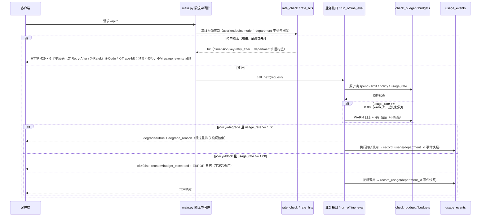

# 成本指标定义与部门维度数据模型规格

> **文档性质**：规格文档（Specification），定义「按项目 / 部门 / 调用维度统计 token 消耗与成本」的指标口径、维度模型、存储结构与预算策略。**不是上线交付版**，服务于企业内部知识库「开发框架骨架 + 可运行演示切片」（学习与面试讲解用）。
> **适用范围**：`webapp/` 演示切片（SQLite 替身）为主；`backend/` 生产骨架的对应关系单列，不混写为「已实现」。
> **本轮口径**：系统为「多用户多部门」，**暂不实现多租户**；多租户仅作为未来研发方向写入本文 §6。统计维度从 `tenant` 改为 `department` / `department_id`（口径依据 Part A、C18、C22-3、C23、C24、C26、C27 裁决与 Delta v3/v4）。
> **版本与裁决优先级**：本文为 **v2（#13 落地冻结后同步版）**。代码按用户任务 3 原文（用户 / 接口 / 模型调用**三维**限流）与主理人裁定落地，是最终态；规格原为编制时快照，9 项差异经主理人裁决**全部「改规格、不改代码」**。**§9 主理人裁定记录为后发裁决，优先级高于前文对应表述**。
> **单价免责（强制）**：本文出现的一切单价数字均引自 `webapp/observability.py:27-34` 的 `PRICES`，是**演示估算值，非任何供应商报价**；`PRICE_NOTE`（`observability.py:24`）固定随成本响应返回：「单价为演示估算值，非供应商报价；上线前必须用真实账单校准」。
> **纪律**：本文只定义规格、不修改任何源码；#13 的实际迁移由主理人执行，本文**不提供也不要求编写迁移脚本文件**。不触碰 `eval/`、`demo/`、`evalbench/`、`docs/CHANGELOG.md`；不新增校验脚本；不运行任何真实外部 LLM 调用。
> **三态标注**：下文以「**已实现**＝仓库有可运行代码」「**只设计**＝本文给出规格、代码未落地」「**未做**＝明确不在本期」区分，不得把只设计说成已落地。

---

## 0. 三态对照（先看边界）

| 能力 | 状态 | 依据 |
|---|---|---|
| 逐调用 token 台账 `usage_events`、五维统计聚合、`cost_of()`、`check_budget()`、`rate_check()` **三维**滑动窗口、统一 429 契约、离线评估 `comparable=false` | **已实现（演示级）** | `webapp/observability.py`、`webapp/db.py`、`webapp/main.py`；§9.1 / §9.2 |
| `tenant → department` 维度改写（主理人 #13） | **已落地并冻结** | C22-3 的 4 处同步点、`_migrate_tenant_to_department()`、A6 清零；对拍结论见 §9.5 |
| `usage_events.stat_date` 派生列、`(stat_date, department_id, model)` 复合索引 | **只设计** | 本文 §3 |
| `degrade` 预算档位、按部门/项目预算粒度、预算周期与多币种 | **只设计** | 本文 §4 |
| `usage_events.latency_ms` / `cache_hit` 列（平均延迟、缓存命中率的数据源） | **只设计** | 本文 §1.3、`backend/app/models/metrics.py::MetricEvent` 已有同类字段但 webapp 无 |
| 真实供应商 usage 全量回传、账单对账、按部门准入隔离的 429、全局并发闸、熔断 | **未做 / Won't** | `docs/enterprise-readiness.md` §5.2、§8；C18、U07 |
| 多租户（SaaS）双轨归集 | **未做（未来方向）** | 用户指令、C10；本文 §6 |

---

## 1. 指标定义

### 1.1 计量原语与指标清单（M01–M18）

> 数据来源字段均指 `webapp/db.py::usage_events`；`estimated` 的口径见 §1.2，不得含糊。

| 编号 | 指标名 | 定义 | 单位 | 计算式 | 数据来源字段 | 边界情况 |
|---|---|---|---|---|---|---|
| M01 | `prompt_tokens` | 单次调用输入 token 数 | token | 显式传入则用传入值；否则 `estimate_tokens(prompt_text)` | `prompt_tokens` | 空文本返回 0；估算按「中文 1 字符 = 1 token、其余 4 字符 = 1 token 且取上界 `max(1, ...)`」，**刻意不低估预算** |
| M02 | `completion_tokens` | 单次调用输出 token 数 | token | 显式传入则用传入值；否则 `estimate_tokens(completion_text)` | `completion_tokens` | 同 M01；流式输出被截断时按已生成文本估算 |
| M03 | `total_tokens` | 单次调用总 token | token | `prompt_tokens + completion_tokens` | `total_tokens`（写入时物化） | 必须等于 M01+M02；聚合时用 SUM，不重算 |
| M04 | `estimated` | 该行 token 的来源标志 | 布尔(0/1) | `1`＝字符估算；`0`＝供应商 usage 回传的真实 token 数 | `estimated` | **当前默认值为 1**（`record_usage(estimated=1)`）；口径缺陷见 §1.2 |
| M05 | `estimated_cost`（列名 `cost_cny`） | 单次调用的估算成本 | 元(CNY) | `round((prompt/1000)×price_in + (completion/1000)×price_out, 6)` | `cost_cny`、`model` | 单价来自 `PRICES[model]` 或 `PRICES["default"]`；未知模型走 default；embedding / reranker 的 `out=0.0`；**必须随响应带 `price_note`** |
| M06 | `price_note` / 单价口径 | 单价免责声明 | 文本 | 常量 `PRICE_NOTE` | `observability.py:24` | 每个成本响应（`check_budget()`、`usage_summary()`）必须携带；缺字段即判定失真 |
| M07 | `calls`（请求数） | 台账行数即调用次数 | 次 | `COUNT(*)` | `id` | 旁路写失败时 `record_usage()` 吞异常并仍返回 row，故「返回 row」≠「已落库」；以库内 COUNT 为准 |
| M08 | 五维分组聚合 | 按 `project` / `department_id` / `call_type` / `model` / `user_id` 分组的 token 与成本 | 各维一组 | `SELECT <dim>, COUNT(*), SUM(prompt_tokens), SUM(completion_tokens), SUM(total_tokens), SUM(cost_cny), SUM(estimated) FROM usage_events [WHERE user_id=?] GROUP BY <dim> ORDER BY cost DESC` | `usage_summary(dim)` | `dim` 必须命中 `DIMENSIONS` 白名单，否则回退 `project`；普通用户强制 `WHERE user_id=?`（**不查而非隐藏**）；空值分组展示为 `—` |
| M09 | `avg_latency_ms` | 平均端到端延迟 | 毫秒 | `AVG(latency_ms)`（或 `SUM/COUNT`） | **当前 webapp 无该列** → 只设计；`backend::MetricEvent.latency_ms` 已有 | 无 `latency_ms` 时返回 `null` 并标「未埋点」，**不得输出 0 冒充实测** |
| M10 | `cache_hit_rate` | 缓存命中率 | 比例 0–1 | `SUM(cache_hit)/COUNT(*)` | **当前 webapp 无该列** → 只设计；`backend::MetricEvent.cache_hit` 已有 | 演示切片只有 `chunk_embeddings` 向量缓存且未埋点；当前**不可计算**，必须返回 `null` + 「未埋点」，不得编造命中数 |
| M11 | `spend_cny` | 累计已用成本 | 元(CNY) | `COALESCE(SUM(cost_cny),0)` | `check_budget()` | 演示切片为**全表累计、不重置周期**；无时间窗、无部门过滤 |
| M12 | `usage_rate` | 预算使用率 | 比例 | `spend / limit`，`limit>0`；否则 1.0 | `check_budget()` | 分母为 0 时定义为 1.0（视为已超额）；前端进度条 ≥80% 转琥珀、超额转红 |
| M13 | `remaining_cny` | 剩余预算 | 元(CNY) | `max(0, limit - spend)` | `check_budget()` | 不允许为负；钳到 0 |
| M14 | `exceeded` | 是否超额 | 布尔 | `spend >= limit` | `check_budget()` | 用 `>=`（等于上限即超额），非 `>` |
| M15 | `estimated_rows` / 估算行占比 | 分组内估算行数及其占比 | 行 / 比例 | `SUM(estimated)`；占比 `SUM(estimated)/COUNT(*)` | `usage_summary().rows[].estimated_rows` | 必须能回答「本组多少行是估算」，用于把估算与真实 usage 分开呈现 |
| M16 | `cost_per_1k_tokens` | 每千 token 估算成本 | 元/1K token | `SUM(cost_cny)/NULLIF(SUM(total_tokens),0)×1000` | 派生 | 分母为 0 时返回 `null`；仅供相对比较，不可当报价 |
| M17 | `rate_limit_hits` | 限流命中次数 | 次 | `COUNT(*) FROM rate_hits [WHERE dimension=?]` | `rate_hits` | 只记命中，不记放行；用于观测而非计费 |
| M18 | `degraded_calls` | 预算降级次数 | 次 | `COUNT(*) FROM eval_logs WHERE event='budget_degraded'`（只设计） | `eval_logs` | 当前 `degrade` 档未实现，恒为 0 且须标「未做」 |

### 1.2 token 口径：估算 vs 真实 usage（不得含糊）

| 情形 | 当前实现 | 目标规格 |
|---|---|---|
| 未拿到供应商 usage | `record_usage()` 未传 `prompt_tokens`/`completion_tokens` 时按 `estimate_tokens()` 字符估算，逐条 `estimated=1`（`observability.py:44-50, 70-71`） | 保持；`estimated=1` |
| 拿到供应商 usage 并显式传入 token 数 | `record_usage(prompt_tokens=..., completion_tokens=...)` 会用真实值计算成本，但 **`estimated` 参数默认仍为 1**，除非调用方显式传 `estimated=0`（`observability.py:68`） | **`estimated` 必须由来源自动推导**：显式 token 来自供应商 usage → `0`；走 `estimate_tokens()` → `1`；禁止调用方手工传错 |
| 演示切片现状 | 绝大多数行为估算（`estimated=1`）；离线评估 `run_offline_eval()` 逐样本 `estimated=1`（`:452-455`）；真实 usage 回传仅在少数 provider 路径 | 不编造「少数」的具体条数；验收按「任一 `estimated=0` 行必须能追溯到 usage 来源」判定 |
| 成本口径 | `cost_cny` 一律是**估算成本**，与 token 是否真实无关（因为单价本身是演示估算） | 即使 `estimated=0`，`cost_cny` 仍须标「估算」，因为单价未校准 |

> 结论：**token 来源（估算/真实）与成本性质（估算/账单）是两件事**。当前演示切片两者都是估算；`estimated` 只描述 token 来源，不表示成本已与账单对齐。

### 1.3 演示估算单价表（引用，非报价）

来源 `webapp/observability.py:27-34`，单位「元 / 1K token」，**演示估算值，非供应商报价**：

| model | `in` | `out` | label |
|---|---|---|---|
| `default` | 0.004 | 0.012 | 通用（估算） |
| `minimax-m3` | 0.002 | 0.008 | minimax-m3（估算） |
| `deepseek-v4.1-flash-1017` | 0.004 | 0.012 | DeepSeek V4.1 Flash（估算） |
| `kimi-k2.6` | 0.004 | 0.016 | kimi-k2.6（估算） |
| `BAAI/bge-m3` | 0.0005 | 0.0 | bge-m3 embedding（估算） |
| `BAAI/bge-reranker-v2-m3` | 0.0005 | 0.0 | bge-reranker（估算） |

- `cost_of()` 保留 6 位小数（`observability.py:57-59`）；聚合展示取 4 位（`usage_summary()`、`check_budget()`）。
- `docs/enterprise-readiness.md` §5.1 明确：「单价表是演示估算值，非任何供应商报价；API 响应固定带 `price_note`；上线前必须用真实账单校准」。
- **真实账单校准属 U03 / Won't**，本期不做，也不得把上表数字写进任何对外成本结论。

---

## 2. 维度模型：`tenant → department`

### 2.1 命名约定（先消除歧义）

| 概念 | 目标命名 | 说明 |
|---|---|---|
| **维度名**（配置键、成本归因字段、API 逻辑名） | `department` | 用于 `CONFIG_KEYS` / `eval_configs` 键、`rate_check()` 的 `department` 形参、429 错误体的 `department` 归因标签。**不在** `RATE_DIMENSIONS` 与 `X-RateLimit-Dimension` 的三维枚举中（§9.1） |
| **物理列名**（承载维度值的列） | `department_id` | `usage_events.department_id`；与 `backend::users.department_id`、`audit_logs.department_id` 命名一致，且与本文建议的复合索引 `(stat_date, department_id, model)` 对齐（该索引为只设计项） |
| 演示切片取值 | 文本部门标识（如 `dept_rd`） | SQLite 替身无 UUID 类型；生产 PG 为 UUID 字符串 |
| 前端展示文案 | 「部门」 | 「租户 / 多租户」一律改「部门 / 多用户多部门」 |

> **命名裁决已确认**：主理人已采纳物理列名 `department_id`、维度名 `department`（#13 落地最终态，不再是默认假设）。

### 2.2 字段映射表（旧 → #13 落地最终态，共 18 行）

| 层 | 旧 | 新 | 位置 / 依据 |
|---|---|---|---|
| SQL 列 | `usage_events.tenant TEXT NOT NULL DEFAULT 'default'` | `usage_events.department_id TEXT NOT NULL DEFAULT 'default'` | `webapp/db.py:163` |
| SQL 索引 | `ix_usage_tenant ON usage_events(tenant)` | `ix_usage_department ON usage_events(department_id)` | `webapp/db.py:178`；旧库旧索引由 `_migrate` `:284` DROP |
| 新增派生列 | 无 | `stat_date TEXT NOT NULL`（`date(ts)`，UTC，写入时物化） | **只设计 / #13 不做**，本文 §3.1 |
| 新增复合索引 | 无 | `ix_usage_stat_dept_model(stat_date, department_id, model)` | **只设计 / #13 不做**，本文 §3.2 |
| 维度集合 | `DIMENSIONS = {"project","tenant","call_type","model","user_id"}` | `{"project","department_id","call_type","model","user_id"}` | `observability.py:36`；`usage_summary()` 先过白名单再拼 SQL（`:139-140`），故集合内必须是**物理列名** |
| 限流维度元组 | `RATE_DIMENSIONS = ("user","tenant","endpoint","model")` | **`("user","endpoint","model")` 三维**；`department` 仅成本归因，**不参与计数、不产生按部门 429** | `observability.py:39`；用户任务 3 原文；主理人裁定 §9.1 |
| 函数入参 | `record_usage(*, project, tenant, ...)` / `rate_check(*, tenant, ...)` / `run_offline_eval(*, tenant, ...)` | `record_usage(department_id=...)` / `rate_check(department=...)` / `run_offline_eval(department=...)` | `observability.py:67,206,427`；INSERT 列名同步 `:89-92` |
| 预算 scope 注释 | `budgets.scope: global\|tenant\|project` | `global\|department\|project` | `webapp/db.py:182` |
| 限流规则注释 | `rate_rules.dimension: user\|tenant\|endpoint\|model` | **`user\|endpoint\|model`（三维）** | `webapp/db.py:192`（代码侧注释由主理人同步修改）；§9.1 |
| 规则种子 | `defaults = {"user":(1200,60),"tenant":(3000,60),"endpoint":(900,60),"model":(600,60)}` | **3 条三维规则** `{"user":(1200,60),"endpoint":(900,60),"model":(600,60)}`；旧 `tenant` / `department` 规则行由 `_migrate` 的 `DELETE FROM rate_rules WHERE dimension IN ('tenant','department')` 收敛，**不迁移成 department 规则** | `webapp/db.py:341`、`:288`；§9.1 |
| 评估配置键 | `CONFIG_KEYS` 末位 `"tenant"`；`cfg = {... "tenant": "default"}` | `"department"` / `"department": "default"` | **C22-3 同步 4 处**：`webapp/observability.py:264`、`webapp/db.py:348`、`webapp/routers_chat.py:130`、`webapp/routers_evaltest.py:72` |
| API 参数 | `/api/evaltest/usage?dim=tenant` | `?dim=department_id`（物理列名，与 `DIMENSIONS` 白名单一致） | `webapp/static/index.html:519`（`<option value="department_id">部门</option>`）、`webapp/tests/test_evaltest.py:70`、`webapp/routers_evaltest.py:108` |
| 响应头 / 契约 | `X-RateLimit-Dimension: user\|tenant\|endpoint\|model`，4 个响应头 | **`X-RateLimit-Dimension: user\|endpoint\|model`（三维）**；`RATE_CODES` 三维；body 主干 `code`/`kind`/`message`/`detail`/`trace_id`/`policy` + 保留原扁平字段；**6 个响应头**（原 4 个 + `X-RateLimit-Code` / `X-Trace-Id`）；`detail` 仍为字符串 | `webapp/main.py:26-30,84-105`、`webapp/routers_evaltest.py:155-163,209-219`；§9.2 |
| 429 探针 | `rate_check(..., tenant="__probe__")` | `department="__probe__"` | `webapp/routers_evaltest.py:205` |
| 中间件调用 | `obs.rate_check(path=..., tenant="default", ...)` | **`department="default"` 演示占位**（webapp 未建部门树）；生产由 `principal` 派生 | `webapp/main.py:78`；§9.1 |
| 前端展示文案 | 「租户」「按租户」「多租户隔离」 | 「部门」「按部门」「多用户多部门」 | `webapp/static/app.js:1090,1273`、`index.html:519`；残留展示文案归文档纠偏（§9.5） |
| 测试断言 | `assert set(rules) == {"user","tenant","endpoint","model"}` | **`{"user","endpoint","model"}`** + `PRAGMA table_info(usage_events)` 断言（有 `department_id`、无 `tenant`）+ `eval_configs` 键断言（有 `department`、无 `tenant`）+ `?dim=department_id` | `webapp/tests/test_evaltest.py:54,57-60,70` |
| 文档措辞 | enterprise-readiness §3.1/§4.1/§5.1「租户」「按租户聚合」 | 「部门」「按项目/部门/调用类型/模型聚合」 | 文档纠偏范围（C23-8 / C24-5），不纳入 #13 口径不一致判定 |

### 2.3 事件快照、不回溯（成本口径）

- **写入规则**：`usage_events.department_id` = **事件发生瞬间** `principal.department_id` 的值，由服务端会话/依赖注入派生（C27-2 红线①），**不取自请求体、不取自 JWT**（C26-2/C27-3）。
- **不可变**：台账为 append-only，写入后**永不 `UPDATE` 该列**。用户转岗后：
  - 转岗前 N 笔仍归原部门；
  - 新事件用新部门；
  - 同一笔历史用量在转岗前后查询结果完全一致（A7 ③ / Delta v3 第 6 条）。
- **不回溯**：部门移动 / 合并 / 停用归档（C13）都不重写历史 `usage_events.department_id`；归档部门行仍可解析（C27-4）。
- **语义**：`department_id` 在成本台账里是**核算成本 / 归因维度**，不是准入隔离配额（C18、A7 ②「不断言 429 按部门隔离生效」）。

### 2.4 与「缓存 key 的授权快照」是两件事（不得混写）

| | 成本事件快照（`usage_events.department_id`） | 缓存授权快照（key 携带 `principal` 授权快照） |
|---|---|---|
| 载体 | SQLite 台账行（持久化、append-only） | Redis / 进程内缓存 key（可丢弃、可重建） |
| 内容 | 事件发生时所属部门 id | 用户身份 + 角色 + 部门 + 授权版本 |
| 转岗后 | **保留旧值**，历史不可变 | **旧 key 必须不可命中**，按新授权重建（A7 ④） |
| 方向 | 「留着旧的」 | 「不许用旧的」 |
| 共同点 | 都由服务端派生的同一 `principal` 产生；都不可由请求体伪造 | 同左 |
| 混写后果 | 若把缓存失效写成「回溯重写历史部门」，会破坏 A7 与 C2 事件快照；若把台账写成「随转岗更新」，账单不可回放 | — |

### 2.5 限流维度的语义边界（对齐用户任务 3，**三维为最终态**）

- **三维即全部配额本体**：用户任务 3 原文明确「用户 / 接口 / 模型调用三个维度」，故 `RATE_DIMENSIONS = ("user","endpoint","model")`，`rate_rules` 只种 3 条规则。任务 1 的「部门」是**统计 / 成本归因**维度，不是限流维度（主理人裁定 §9.1）。
- **`department` 不参与计数、不产生按部门 429**：`rate_check(*, department="default", ...)` 保留该形参，但 `keys` 字典、`for dim in RATE_DIMENSIONS` 计数循环、计数键 `(dim, keys[dim])` 均不含部门；仅在命中结果回传 `department` 供 429 错误体做成本归因（独立对拍已确认，§9.5）。
- 三维限流**仅存在于 webapp 演示切片**（C5、Delta v2 三）；`backend/` 生产骨架的 `middleware/rate_limit.py` 实际只按 IP、tenant 位是硬编码 `"global"` 命名空间，**不得把 backend 限流误当成已有租户级/部门级限流来改**（D.4 / E.1 实查纠偏）。
- **不做 429 按部门隔离断言**（A7 ② / C18）；按部门分级配额与全局并发闸仍属 Won't（C18、U07）。

---

## 3. 存储设计（规格，不含迁移脚本）

### 3.1 `usage_events` 目标 DDL（SQLite 演示替身）

```sql
CREATE TABLE IF NOT EXISTS usage_events (
    id                 TEXT PRIMARY KEY,               -- uuid4().hex，行级幂等键
    ts                 TEXT NOT NULL,                  -- UTC ISO8601，事件发生时刻
    stat_date          TEXT NOT NULL,                  -- 【新增·只设计】date(ts)，UTC，写入时物化
    project            TEXT NOT NULL DEFAULT 'default',
    department_id      TEXT NOT NULL DEFAULT 'default',-- 【改】原 tenant；事件快照、不回溯
    user_id            TEXT NOT NULL DEFAULT '',
    call_type          TEXT NOT NULL,                  -- chat|embedding|rerank|eval|search
    model              TEXT NOT NULL DEFAULT '',
    prompt_tokens      INTEGER NOT NULL DEFAULT 0,
    completion_tokens  INTEGER NOT NULL DEFAULT 0,
    total_tokens       INTEGER NOT NULL DEFAULT 0,
    cost_cny           REAL    NOT NULL DEFAULT 0,    -- 估算成本（演示单价）
    estimated          INTEGER NOT NULL DEFAULT 1,    -- 1=字符估算 0=供应商 usage 回传
    latency_ms         INTEGER,                       -- 【新增·只设计】M09 数据源
    cache_hit          INTEGER,                       -- 【新增·只设计】M10 数据源
    run_id             TEXT,
    detail             TEXT,                          -- 扩展位（§6 命名不堵死）
    created_at         TEXT NOT NULL
);
```

> `stat_date` 必须**写入时物化**，不可在查询时 `date(ts)` 现算 —— 否则复合索引与表达式索引都失效，且 SQLite/PG 对 `TEXT` 时间列做函数计算无法走普通 B-tree。`stat_date` 与 `backend::daily_stats.stat_date` 同口径（本产出已裁定 `daily_stats` 唯一键为 `(stat_date)`，全局日报一天一行；两者是不同表、不冲突）。

### 3.2 索引建议与「为什么按 `(stat_date, department_id, model)`」

| 索引 | 字段 | 服务查询 | 理由 |
|---|---|---|---|
| **`ix_usage_stat_dept_model`**（主） | `(stat_date, department_id, model)` | `WHERE stat_date BETWEEN ? AND ? AND department_id=? GROUP BY model`、按日×部门×模型的成本/token 聚合 | ① 最左前缀 `stat_date` 服务日期范围扫描；② 第二列 `department_id` 服务部门筛选与分组（本轮核心改动）；③ 第三列 `model` 服务模型分组，且三列联合可覆盖「按项目/部门/调用类型/模型」面板的主链路，避免回表；④ 与 `daily_stats` 的按日预聚合口径对齐，为未来按日分区预留 |
| `ix_usage_department` | `(department_id)` | 单维「按部门」聚合、`dim=department_id` | 主索引第二列不是最左前缀，单独按部门查需自有索引 |
| `ix_usage_project` | `(project)` | `dim=project`（默认） | 保留现状 `ix_usage_project`（`db.py:175`） |
| `ix_usage_user` | `(user_id)` | 普通用户强制 `WHERE user_id=?`（不查而非隐藏） | 权限过滤是主链路高频条件 |
| `ix_usage_run` | `(run_id)` | 按评估 run 对账、离线 comparable=false 稽核 | 现状无，建议加（只设计） |
| `ix_usage_ts` | `(ts)` | 时间排序、台账回放 | 保留现状 `ix_usage_ts`（`db.py:174`）；与 `stat_date` 索引职责不同 |
| 覆盖列（可选） | `(stat_date, department_id, model, cost_cny, total_tokens, estimated)` | 纯聚合免回表 | SQLite 可加宽索引、PG 用 `INCLUDE`；**默认不加**，避免写放大与索引过宽 |

> **不过度设计**：现状只有 3 个单列索引（`ts`/`project`/`tenant`）。目标保留 3 个等价（含 `department_id`）+ 1 个复合主索引 + 2 个建议索引；演示库数据量小，不为炫技铺覆盖索引。

### 3.3 `budgets` 粒度与唯一键

```sql
CREATE TABLE IF NOT EXISTS budgets (
    scope       TEXT NOT NULL,          -- global | department | project（【改】原 tenant）
    key         TEXT NOT NULL,          -- global→'default'；department→department_id；project→project 名
    limit_cny   REAL NOT NULL,
    policy      TEXT NOT NULL DEFAULT 'warn',   -- warn | degrade(只设计) | block
    updated_at  TEXT NOT NULL,
    PRIMARY KEY (scope, key)
);
```

- **唯一键保持 `(scope, key)` 不变**；`key` 的语义随 `scope` 变化，无需改结构。
- **当前唯一生效粒度**：`('global','default')`，`limit_cny=50.0`、`policy='warn'`（`db.py:314-316` 种子，`check_budget()` 硬编码查这一行）；`put_budget()` 也只写这一行（`routers_evaltest.py:136-140`）。
- **`('department', <id>)` / `('project', <name>)` 为只设计**：需 `check_budget()` 支持按 scope 查、并做「最严档位合并」判定（多 scope 命中时取最严策略），本期不做。
- 只设计的新增列：`warn_at` / `degrade_at` / `block_at`（阈值比例）、`period` / `period_start`（预算周期）、`currency`、`updated_by`、`last_state`（幂等去重用，§4.3）。当前「累计、不重置周期」是演示口径，生产须按月/按账期重置。

### 3.4 `rate_rules` / `rate_hits` 维度定义（**三维最终态**）

```sql
CREATE TABLE IF NOT EXISTS rate_rules (
    dimension   TEXT PRIMARY KEY,       -- user | endpoint | model（三维，【改】）
    limit_count INTEGER NOT NULL,
    window_s    INTEGER NOT NULL,
    enabled     INTEGER NOT NULL DEFAULT 1,
    updated_at  TEXT NOT NULL
);
CREATE TABLE IF NOT EXISTS rate_hits (
    id          TEXT PRIMARY KEY,
    ts          TEXT NOT NULL,
    dimension   TEXT NOT NULL,
    key         TEXT NOT NULL,          -- 该维度的计数键值；不含 department
    path        TEXT NOT NULL,
    limit_count INTEGER NOT NULL,
    window_s    INTEGER NOT NULL
);
CREATE INDEX IF NOT EXISTS ix_rate_hits_ts ON rate_hits(ts);
-- 建议（只设计）：ix_rate_hits_dim_ts(dimension, ts) 便于按维度看命中趋势
```

| 维度 | 计数键 | 默认限额 / 窗口（演示值） | 语义 |
|---|---|---|---|
| `user` | JWT `sub`（未登录 `anonymous`） | 1200 / 60s | 防单用户刷接口 |
| `endpoint` | 请求 path | 900 / 60s | 保护热点接口（如 `/api/chat/stream`） |
| `model` | `llm` / `settings` / `-` | 600 / 60s | 对应上游 RPM/TPM 共享配额 |

- **`department` 不在此表建规则行**：它只作为 429 错误体的成本归因标签（`webapp/main.py:96`），**不参与计数、不产生按部门 429**（§2.5、§9.1）。任务 1 的部门是统计维度，任务 3 的三维才是配额本体。
- **旧规则收敛（幂等）**：`_migrate_tenant_to_department()` 执行 `DELETE FROM rate_rules WHERE dimension IN ('tenant','department')`（`webapp/db.py:288`），把存量库的 tenant 规则行与任何 department 规则行一并清除；`_seed` 再按 `db.py:341` 补 3 条三维规则。全新库上该 DELETE 为空操作。
- 默认阈值刻意宽松，**不误伤 33 项端到端自测与 51 项 pytest**（`docs/enterprise-readiness.md:63`）；admin 可在页面下调阈值复现超限（V09 断言即把 user 调到 2/60s）。

### 3.5 SQLite 演示替身 vs PG 生产骨架差异

| 维度 | `webapp/` SQLite 替身 | `backend/` PG 生产骨架 | 规格要求 |
|---|---|---|---|
| 角色 | 唯一真值载体（演示可跑、离线闭环） | 唯一状态真值（生产） | 两套库**不互相替代**，不得把演示结果说成生产实现 |
| 时间列 | `ts` / `created_at` 为 TEXT ISO8601 | `TIMESTAMPTZ` + `server_default now()` | 生产用带时区类型；`stat_date` 用 `DATE` |
| 部门 id | TEXT（如 `dept_rd`） | `UUID` + FK `departments(id) ON DELETE RESTRICT` | 演示切片无 FK；生产按 C13 用 `status` 停用归档、不物理删除，FK 永不触发 |
| 聚合 | `usage_summary()` 直接拼 SQL、`GROUP BY` 单维 | `daily_stats` 预聚合表 + `MetricEvent` 明细 | 生产按日预聚合（`refresh_daily_stats()`），不在热路径全表扫明细 |
| 指标字段 | 仅 token/成本；`latency_ms`/`cache_hit` 缺 | `MetricEvent` 已有 `latency_ms`/`ttft_ms`/`cache_hit` | 演示补齐 M09/M10 数据源（只设计），或明确返回 `null` |
| 预算 | `budgets` 单行、累计不重置、仅 CNY、只拦离线评估 | 无 budget 表 / 成本闸门（C22-1 实查） | 生产须接供应商 usage + 账单对账 + 网关层配额（未做） |
| 限流 | 进程内滑动窗口，`_rate_lock` 单实例有效 | `middleware/rate_limit.py` 只按 IP | 生产换 Redis 令牌桶 + 网关层；不做全局并发闸（Won't） |
| 并发控制 | `db._lock` 仅用于 `init_db()`；预算读写无锁 | PG 事务 + 行锁 | 见 §4.3，当前存在超卖窗口 |
| 索引 | 单列 + 建议复合 | B-tree / 分区 / 覆盖索引 | 生产按 `(stat_date, department_id, model)` 建并按月分区（只设计） |

---

## 4. 预算三级策略（warn / degrade / block）

> **现状诚实说明**：`webapp/` 当前只有 `warn` 与 `block` 两档（`check_budget()` `:124`、`put_budget()` 白名单 `routers_evaltest.py:130`）。**`degrade` 是本文新增规格（只设计/未做）**，不得写成已落地。

### 4.1 触发条件与数值阈值

| 档位 | 触发条件（`usage_rate = spend / limit`） | 动作 | `allowed` | 状态 |
|---|---|---|---|---|
| 正常 | `< 0.80` | 无额外动作 | `true` | 已实现 |
| **warn（告警）** | `>= warn_at = 0.80` | 写 `eval_logs` WARN `budget_exceeded` + `db.log_action()` 审计 + 前端琥珀进度条；**不拒绝调用** | `true` | 已实现（当前 `>=1.0` 才触发，本文建议前移到 0.80 预警，属只设计调整） |
| **degrade（降级）** | `>= degrade_at = 1.00` 且 `policy='degrade'` | 跳过 rerank / 降级为关键词检索 / 收窄 top_k，响应带 `degraded=true` + `degrade_reason`；写 INFO 日志 `budget_degraded` | `true` | **只设计** |
| **block（阻断）** | `>= block_at = 1.00` 且 `policy='block'` | `allowed=false`；`POST /api/evaltest/run` 返回 `{"ok":false,"reason":"budget_exceeded"}` + ERROR 日志 `eval_rejected_budget`；不发起付费调用 | `false` | 已实现 |

- 阈值常量（演示值，建议写入 `observability.py` 常量或 `budgets` 列）：`warn_at=0.80`（沿用 `enterprise-readiness.md:141` 的 80% 琥珀口径）、`degrade_at=1.00`、`block_at=1.00`（与现状 `spend >= limit` 即超额一致）。
- 若需降级后留缓冲，可把 `block_at` 配到 `1.20`；默认 `1.00`。
- `limit<=0` 时 `usage_rate=1.0`（`check_budget()` 现状），等价于「上限为 0 即视为已超额」，V10 的 `limit=0, policy=block` 断言依赖此语义。
- **边界**：预算只拦本页发起的**离线评估运行**；真实外部模型调用的成本拦截需接供应商 usage 与网关层配额（未做，`enterprise-readiness.md:142`）。

### 4.2 执行顺序（严格、短路）



| 步 | 判定 | 短路行为 |
|---|---|---|
| 1 | 限流中间件（对所有 `/api/` 读写请求，静态资源直通） | 命中即返回 429，**不进入业务层、不写 `usage_events`、不查预算** |
| 2 | 业务层读预算状态 | 只读，无副作用 |
| 3 | `usage_rate >= 0.80` | 写告警（边沿触发），继续 |
| 4 | `policy='degrade'` 且 `>= 1.00` | 降级执行，仍 `allowed=true` |
| 5 | `policy='block'` 且 `>= 1.00` | 拒绝，写 ERROR 日志，**短路后续调用与用量记录** |
| 6 | 其余 | 放行并在调用后 `record_usage()` |

### 4.3 幂等与并发

| 项 | 现状 | 目标规格（只设计） |
|---|---|---|
| 判定幂等 | `check_budget()` 为只读；`record_usage()` 用 `id=uuid4().hex` 行级幂等 | 保持；禁止在判定函数里写业务数据 |
| 告警幂等 | 当前每次 `exceeded` 都写一条 WARN（`observability.py:119-123`），高频请求会刷屏 | 改为**状态跃迁边沿触发**：`budgets.last_state`（`normal/warn/degrade/block`）或按 `(event, state, stat_date)` 去重，同一状态每天只留一条 |
| 离线 run 幂等 | `run_offline_eval()` 每次生成新 `run_id`（`:437`），不幂等 | 可接受：每个 run 是独立快照；但 `eval_runs.comparable` 必须恒为 0 |
| 并发（读-改窗口） | `check_budget()` 先 `SUM(cost_cny)` 再在业务层决定是否执行，中间**无锁**；`db._lock` 只用于 `init_db()`，`rate_check` 才有 `_rate_lock` → 并发请求可双双在阈值下通过（超卖） | 演示切片：`BEGIN IMMEDIATE` 把「读 spend + 预留额度 + 写 usage」放单事务，或加进程内 `_budget_lock`；生产：PG `INSERT ... ON CONFLICT DO UPDATE` 原子计数器 / Redis Lua。**明确标注当前未实现** |
| 旁路失败 | `record_usage()` / `log_event()` 吞异常（`except Exception: pass`） | 保持「审计旁路不得影响业务主流程」，但须在文档写明「返回 row ≠ 已落库」，验收以库内 SQL 为准 |

### 4.4 前端反馈契约（状态与字段，非 UI 设计）

| 档位 | 响应字段 | 前端反馈 |
|---|---|---|
| 正常 / warn | `usage_rate`、`exceeded`、`allowed=true`、`price_note` | ≥80% 进度条转琥珀；banner「预算接近上限（演示估算，非供应商报价）」 |
| degrade | 上述 + `degraded=true`、`degrade_reason` | 黄色 banner「已降级：跳过重排 / 使用关键词检索」；结果页标注降级，不假装用了完整链路 |
| block | `allowed=false`、`reason=budget_exceeded`、`spend_cny`/`limit_cny` | 进度条转红；禁用触发按钮并说明原因；**不发起付费调用** |
| 429 | body 主干 `code`/`kind`/`message`/`detail`/`trace_id`/`policy` + 原扁平字段 + `department` 归因标签；**6 个响应头**（原 4 个 + `X-RateLimit-Code` / `X-Trace-Id`） | 「请求过于频繁，请稍后重试」+ 退避提示；**不叠加预算字段** |

所有成本响应固定携带 `price_note`（M06），普通用户只读预算时 `prices` 被移除（`routers_evaltest.py:117-120`），但 `price_note` 不移除。

### 4.5 与限流 429 的先后关系（**统一 429 契约已落地**）

1. **429 在中间件层先执行**（`webapp/main.py:56-106`），命中即短路；预算检查在业务层（`run_offline_eval()` 与 `/api/evaltest/*` 接口），**同时命中时 429 优先**。
2. **本轮落地的统一 429 契约**：`RATE_CODES` 按三维命中维度给业务错误码（`main.py:26-30`），body 主干含 `code/kind/message/detail/trace_id/policy`（`:84-91`），保留原扁平字段 `dimension/key/path/limit/window_s/retry_after/current`（`:93-95`）与 `department` 归因标签（`:96`）；6 个响应头 = 原 4 个 + `X-RateLimit-Code` + `X-Trace-Id`（`:98-105`）。`detail` 保持字符串，前端 `app.js:56/66` 直接读 `j.detail`。
3. **拒绝语义不同，不可混为一类**：429 是频率/配额（`rate_limit_exceeded` 可退避 1/2/4s + 抖动、尊重 `Retry-After`、最多 3 次；`quota_exceeded` 不重试）；**预算耗尽仍是 HTTP 200 + `{ok:false, reason:"budget_exceeded"}`**（`observability.py:438`）—— **阻断生效，但错误码未统一**，本轮保留现状（§9.2）。预算 `block` 是业务体拒绝，**不是 429**，不得并入 `quota_exceeded` 的 429 分类（`enterprise-readiness.md:82`）。
4. 命中 429 的请求不写 `usage_events`（调用未发生），故不影响 `spend_cny`；`rate_hits` 与 `eval_logs` 仍留痕。
5. `degrade` / `block` 都不改变 429 的**三维**计数逻辑；`department` 不参与计数（§2.5）。

### 4.6 默认必须是 `warn`

- 种子与回退都是 `policy='warn'`、`limit_cny=50.0`（`db.py:314-316`、`observability.py:104-105`）；`put_budget()` 白名单 `("warn","block")`（`routers_evaltest.py:130`）。
- 只有 admin **显式**改成 `block`（或未来的 `degrade`）才改变行为；`warn` 超额只告警 + 留痕，`allowed=true`。
- 目的：默认路径不拒绝任何调用，**避免打断 33 项 selftest 与 51 项 pytest**（`enterprise-readiness.md:63`）；V10 的 block 验收必须在用例内改配置并在结束时复原（现有 `test_evaltest.py:125` 已如此）。
- 引入 `degrade` 时须同步扩展 `put_budget()` 白名单与 `budgets.policy` 注释，且**默认种子仍为 warn**。

---

## 5. 可量化验收（V01–V12）

> 命令均为既有工具，不新增校验脚本；冻结边界按 C24-3/C25-1 用 `git diff --exit-code -- eval/ demo/` 与 `python demo/selftest.py`（内置断言）。涉及 API 的命令需先启动本地演示服务（默认 8765 端口）；不涉及真实外部 LLM 调用（离线评估零外部 API）。**可变基线**（webapp pytest / selftest / backend 测试计数）按 A12 单独冻结，不可变基线（demo 16/16、`run_id=RUN-095a2a4a40c6`、`config_snapshot`、`eval/` 冻结对象）不变。

| 编号 | 指标定义 | 阈值 | 验证命令或 SQL | 通过判定 |
|---|---|---|---|---|
| V01 | 维度清零：`webapp/` 现行口径 `tenant` 标识符残留（A6） | 0 处 | **判定依据改为 `webapp/tests/test_evaltest.py:57-60` 的 `PRAGMA table_info` 与 `eval_configs` 键断言**；辅以 `git grep`，但须注明「**排除 `_migrate_tenant_to_department` 函数体与反向断言后零命中**」，不再使用永远通不过的裸 `git grep` 零命中口径 | 列名 / 枚举 / 配置键 / 函数形参 / 响应头 / SQL / 断言等**现行口径标识符 0 残留**；`_migrate` 内 11 处迁移字面量与 `test_evaltest.py` 3 处反向断言为**必需保留项、不计入**；PLUGINS 展示文案、规则集文案、docs/ 与 CHANGELOG 历史条目归文档纠偏（§9.5） |
| V02 | 目标表结构：`usage_events` 去 `tenant`、有 `department_id`；**`stat_date` 为只设计项、不纳入本轮通过判定** | 列集合精确匹配 | `PRAGMA table_info(usage_events);`（须在 `_migrate` 执行后的**最终态**上查；运行态库不存在时可用内存 SQLite 复现 `SCHEMA→_migrate→_seed`，不写磁盘） | 无 `tenant` 列；**存在 `department_id`**；`estimated` 默认 1、`policy` 默认 warn；`stat_date` 未落地不判失败 |
| V03 | **复合索引存在性**（§3.2；编号统一：**V03 = 复合索引**，429 契约见 V09） | 1 条 | `SELECT name,sql FROM sqlite_master WHERE type='index' AND tbl_name='usage_events';` | `ix_usage_department` 存在；**`ix_usage_stat_dept_model(stat_date, department_id, model)` 明确标「只设计 / 不纳入本轮通过判定」**，未落地不判失败 |
| V04 | 事件快照不回溯（A7 ③ / C27-4） | 历史行 0 变更 | `SELECT id, department_id FROM usage_events WHERE user_id='U' ORDER BY ts;` 记录转岗前 N 笔 → 转岗 → 再发 1 笔 → 重跑同一 SQL | 前 N 笔 `department_id` 逐字节不变；新事件为新部门；归档部门后历史行仍可按 `department_id` 解析（无悬空） |
| V05 | 估算 / 真实 usage 分清（§1.2） | 每个分组可回答占比 | `SELECT SUM(estimated) AS est_rows, COUNT(*) AS calls FROM usage_events [WHERE ...];` + `GET /api/evaltest/usage?dim=department_id` | 每组返回 `estimated_rows`；任一 `estimated=0` 行可追溯到供应商 usage 来源；离线 run 的行全为 `estimated=1`；`price_note` 非空 |
| V06 | **成本单价不得声称是供应商报价**（强制） | 0 处失真 | `git grep -n 'PRICE_NOTE' -- webapp/observability.py`；`git grep -ni -E '真实价格\|供应商报价\|real price' -- docs/ webapp/`；`GET /api/evaltest/budget`、`GET /api/evaltest/usage` 检查响应 | `PRICE_NOTE` 常量存在且文案含「非供应商报价」；两个成本响应均带 `price_note`；单价表每项 label 含「（估算）」；无任何把演示单价表述为真实报价的文案 |
| V07 | 五维**统计**聚合正确性（M08；**统计五维 ≠ 限流三维**，两者互不相干） | 5 维均可查且与 SQL 一致 | 依次 `GET /api/evaltest/usage?dim=project\|department_id\|call_type\|model\|user_id`；与 `SELECT <dim>, SUM(cost_cny), SUM(total_tokens) FROM usage_events GROUP BY <dim>` 对拍 | 每维返回 `rows`/`totals`/`price_note`/`derivation`；分组合计 = `totals`；普通用户强制仅本人范围（`scope="仅本人调用"`）；`dim` 未命中 `DIMENSIONS` 白名单时静默回退 `project` |
| V08 | 默认 `policy=warn` 不打断回归（§4.6） | 全绿且 `allowed=true` | `python -m pytest webapp/tests -q`；`python webapp/selftest.py`；`GET /api/evaltest/budget` | 命令全绿（新计数单独冻结）；默认 `limit_cny=50.0`、`policy=warn`；`spend>=limit` 时 `allowed` 仍为 `true`、无 `eval_rejected_budget` 日志 |
| V09 | **429 契约与优先级**（三维配额 + 统一错误体；编号统一：**V09 = 429 契约**，复合索引见 V03） | 第 3 次即 429 | `PUT /api/evaltest/ratelimit {"rules":[{"dimension":"user","limit_count":2,"window_s":60}]}` → 连发 3 次；`SELECT dimension,key FROM rate_hits` | 第 3 次 429；**6 个响应头齐全**（`Retry-After` / `X-RateLimit-Dimension` / `X-RateLimit-Limit` / `X-RateLimit-Window` / `X-RateLimit-Code` / `X-Trace-Id`）；body 含 `code`/`kind`/`message`/`detail`/`trace_id`/`policy` 且 `dimension ∈ {user,endpoint,model}`；`rate_hits` 有命中行；**预算耗尽仍 HTTP 200 `ok=false`，不得判成 429**（§9.2）；结束后复原 1200/60 |
| V10 | `block` 硬拦（§4.1） | 1 次拒绝 + 1 条 ERROR | `PUT /api/evaltest/budget {"limit_cny":0,"policy":"block"}` → `POST /api/evaltest/run`；查 `SELECT event FROM eval_logs WHERE level='ERROR'` | 返回 `ok=false, reason=budget_exceeded`；有 `eval_rejected_budget` ERROR 日志；**复原** `limit_cny=50, policy=warn`（现有 `test_evaltest.py:125` 已做） |
| V11 | **离线 `comparable=false` 的 run 不得写入质量基线**（强制） | 0 条污染 | `SELECT run_id,mode,comparable FROM eval_runs WHERE source='webapp';`；读 `evalbench/runs/<run_id>/summary.json` 与 `config_snapshot.json`；`GET /api/evaltest/metrics`（不指定 run）；`git diff --exit-code -- eval/ demo/` | 全部 `comparable=0` 且 `mode='offline'`；两个 JSON 均 `"comparable": false` 且 note 含「不写入质量基线」；`run_metrics()` 默认**不选中**离线 run（只选 `source='evalbench' and comparable`）；`eval/` 与 `demo/` 零 diff |
| V12 | 冻结边界与 demo 不变（C11 / A9 / A10） | 0 变更、16/16 | `git diff --exit-code -- eval/ demo/`；`python demo/selftest.py` | 零 diff；16/16 `DEMO_READY`、`run_id=RUN-095a2a4a40c6` 与 `config_snapshot` 逐字段一致；`__TBC__` / `NOT_COMPARABLE` / `real_api` 未动 |

> **补充口径**：V06 与 V11 是本轮强制项，任一不通过即判定本次维度改写不可验收。V08/V09/V10 属**可变基线**，用例数变化按 A12 写入 CHANGELOG（由主理人/文档纠偏负责，本文不改 CHANGELOG）。**编号固定：V03 = 复合索引存在性，V09 = 429 契约**，不得互换（主理人裁决 §9.5）。

---

## 6. 多租户作为未来研发方向（当前不做）

- **本期结论**：按用户指令与 C10，`tenants` 表与 `tenant_id` 列整体移除、**不留数据列占位**；`departments` 为顶层根。多租户仅作为未来研发方向写在本文，不实现、不预留占位列、不写双口径。
- **未来 SaaS 的「双轨归集」设计（只设计）**：同一笔调用事件需要**同时**记两个互不替代的维度 —— `department_id`（组织内成本归因 / 部门核算）与 `tenant_id`（跨组织计费 / 账单对账）。二者不是二选一，也不是把 `department_id` 改回 `tenant_id`：
  1. 事件发生时按 `principal` 派生两个快照值，写入后都不回溯；
  2. 历史行（启用 SaaS 之前）`tenant_id = NULL`，不回填、不重算（与 §2.3 事件快照一致）；
  3. 预算与限流增加 `scope='tenant'` 粒度，`budgets` 唯一键演进为 `(tenant_id, scope, key)` 或新增维度列，当前 `(scope,key)` 不变；
  4. 成本聚合支持「按 tenant 汇总 → 下钻 department」两级，避免用部门相加反推租户总额（与 `daily_stats` 全局日报不可分解指标同理）。
- **字段命名不堵死（本期就要守住的约束）**：
  | 做法 | 说明 |
  |---|---|
  | 用 `department_id`，不用 `tenant_legacy` / `tenant` / 复用旧列名 | 不把新列绑死在已废弃语义上（C10、C23-6 双口径方案彻底否决） |
  | `DIMENSIONS` / `RATE_DIMENSIONS` 保持可扩展集合 | 未来加 `tenant_id` 维度是「新增一项」，不是「替换一项」 |
  | `budgets.scope` 用枚举字符串而非固定列 | 未来加 `scope='tenant'` 不改表结构 |
  | `usage_events.detail` 保留 TEXT 扩展位 | 可暂存维度扩展信息，但**不得**把结构化维度长期塞进 detail（避免无法索引） |
  | 未来通过新增迁移加 `tenant_id UUID NULL` + 索引 `(tenant_id, stat_date, department_id)` | 向前兼容、可回滚；历史行 NULL |
  | **严禁现在加 `tenant_id` 占位列或 `tenant='default'` 默认值** | C10 明确不留占位；`WHERE tenant_id=:const` 无意义且产生两套心智模型（D1） |
- 反向迁移代价（D.7）：重新 SaaS 化需回补 tenant 全维度（列 / Mixin / Repository / key / 审计 / Milvus partition key / expr 首条件 / 角色层级），属全量反向迁移；若产品路线仍保留 SaaS 可能性，应先确认再动工。本期文档只写方向，不排期。

---

## 7. 执行层默认假设（非停工前置）

| # | 事项 | 默认假设 |
|---|---|---|
| 1 | 物理列名 `department_id` vs `department` | **已确认采纳** `department_id`（物理列名）/ `department`（维度名）；#13 落地最终态，不再是待对齐假设 |
| 2 | `degrade` 档位 | 只设计、本期不实现；`put_budget()` 白名单与 `budgets.policy` 注释在引入时同步扩展，默认仍 `warn` |
| 3 | `stat_date` / `latency_ms` / `cache_hit` 新列与复合索引 | **只设计 / #13 不落地**，V02 / V03 不纳入本轮通过判定；未落地前 M09/M10 返回 `null` + 「未埋点」 |
| 4 | `estimated` 自动推导（§1.2） | 目标规格；当前默认 1，若本期不改代码，验收 V05 以「任一 `estimated=0` 行可追溯 usage 来源」判定 |
| 5 | 按部门 / 项目预算粒度、周期重置、多币种 | 只设计；当前唯一生效 `('global','default')`、累计不重置、仅 CNY |
| 6 | 真实供应商 usage 回传比例、压测基线 | 运行时数据，本文不编造具体条数；按 C23-7「附默认假设、不构成停工前置」 |
| 7 | 预算并发超卖窗口（§4.3） | 当前未加锁，明确标注；生产方案为只设计，不在本期修复 |
| 8 | 可变 / 不可变基线 | 33 selftest / 51 pytest / backend 测试计数可变（A12）；demo 16/16、`run_id`、`config_snapshot`、`eval/` 冻结对象不可变（C11） |

---

## 8. 交付边界

- 本次规格同步**仅写入 `docs/cost-metrics-spec.md` 这一个文件**；未修改任何源码、未写迁移脚本、未改 `docs/CHANGELOG.md`。代码侧 5 处注释失真、429 新契约测试断言、`_migrate` 半迁移态由主理人另行处理（§9.4），本文只记录不改码。
- 未触碰 `eval/`、`demo/`、`evalbench/` 及其中冻结对象（`__TBC__` / `NOT_COMPARABLE` / `real_api`），未改 demo `run_id=RUN-095a2a4a40c6` 与 `config_snapshot`。
- 未运行任何真实外部 LLM 调用；本文所有验证命令均为既有工具与离线路径（`run_offline_eval()` 零外部 API）。
- 单价数字全部引自 `webapp/observability.py:27-34`（并在 §5.1 由 `docs/enterprise-readiness.md` 佐证），**均标注「演示估算、非供应商报价」**。
- 严格区分「已实现 / 只设计 / 未做」：不得把 `degrade` 档位、复合索引、新列、按部门预算、双轨归集说成已落地。

---

## 9. 主理人裁定记录（#13 落地冻结后，后发裁决，优先级高于前文对应表述）

> **总裁决**：独立口径对拍（#25）发现的 9 项「规格 vs 实现」差异，**全部「改规格、不改代码」** —— 代码按用户任务 3 原文（三维限流）与主理人裁定落地，是最终态；规格是编制时快照。本节记录 4 条裁定与对拍结论；代码侧改动由主理人自行处理，本文不改任何源码。

### 9.1 三维限流的依据与边界

- **依据**：用户任务 3 原文明确「用户 / 接口 / 模型调用**三个维度**」。任务 1 的「部门」是**统计 / 成本归因**维度，不是限流维度；两者不得混为一谈。
- **最终态**：`RATE_DIMENSIONS = ("user","endpoint","model")`；`rate_rules` 只种 3 条规则（1200 / 900 / 600 per 60s）。`rate_check(*, department="default", ...)` 保留 `department` 形参，但**不进入 `keys` 字典、不进入计数循环、不进入计数键**，仅在命中结果回传 `department` 供 429 错误体做成本归因。
- **边界**：**不产生按部门的 429 隔离**（A7 ② / C18）；`_migrate` 用 `DELETE FROM rate_rules WHERE dimension IN ('tenant','department')` 收敛旧规则行，不迁移成 department 规则。
- **演示占位**：`main.py:78` 传 `department="default"` 是演示占位（webapp 未建部门树）；生产由服务端 `principal` 派生，与 §2.3 事件快照口径一致。

### 9.2 统一 429 契约本轮落地，但预算耗尽仍 HTTP 200

- **已落地**：`RATE_CODES` 三维业务错误码；429 body 主干 `code/kind/message/detail/trace_id/policy`；保留原扁平字段（`dimension/key/path/limit/window_s/retry_after/current`）；`department` 归因标签；**6 个响应头** = 原 4 个 + `X-RateLimit-Code` + `X-Trace-Id`；`detail` 保持字符串以兼容前端 `app.js:56/66`。
- **本轮保留现状**：预算耗尽仍是 **HTTP 200 + `{ok:false, reason:"budget_exceeded"}`**（`observability.py:438`）—— **阻断生效，但错误码未统一**。它是业务体拒绝，不是 429，不得并入 `quota_exceeded` 的 429 分类；§4.5 与 V09 按此最终态理解。
- 由此，`degrade` / `block` 都不改变 429 的三维计数逻辑。

### 9.3 backend 骨架错误码本轮不改

- `backend/app/core/constants.py` 的 `ERROR_CODES` 中 `QUOTA_EXCEEDED → 413` **本轮不改 backend 生产骨架**，与 webapp 演示切片的 429 分类**留作下期对齐**。
- 当前 webapp 的 `quota_exceeded` 语义来自 `webapp/providers.py::classify_429()`（额度耗尽、不重试），与 backend 的 413 不同源。文档**不得写成已统一**，也不得把两者混为同一条链路。

### 9.4 半迁移态边界已由主理人补齐（代码侧，本文只记录）

- **对拍发现**：旧库若**同时存在 `tenant` 与 `department_id` 两列**（半迁移态），原 `_migrate` 条件 `"tenant" in cols and "department_id" not in cols` 不成立 → 不 RENAME、不 DROP `ix_usage_tenant`，旧列与旧索引**静默残留**（业务按 `department_id` 工作不会立即报错）。
- **主理人补齐方案**：「**先按旧列存在与否清理旧索引，再在 `department_id` 缺失时补列**」，避免静默残留。**代码由主理人修改**，本文 §3.1/§3.2 的目标 DDL 与索引规格不受影响；对拍时指定的「全新库 / 含 tenant 旧列的存量库」两种输入已实测幂等（§9.5）。

### 9.5 对拍结论与 9 项规格同步记录

- **独立对拍结论（#25，已采纳）**：映射表**实为 18 行**（此前称 17 行系计数差异）；**不一致 0 行**；V01 通过（`webapp/` 内 21 处 `tenant` 分为迁移逻辑必需 11、反向断言必需 3、展示/文档文案 7、应清零未清零 **0**）；全新库与存量库经 `SCHEMA→_migrate→_seed` 后**最终态完全相同**、各自二次执行幂等（`A_equals_B=True`）；`department` 未进入计数；`usage_summary(dim)` 白名单先收窄再拼 SQL，注入面关闭。
- **编号统一**：**V03 = 复合索引存在性，V09 = 429 契约**，不得互换。
- **9 项差异已逐条同步至本文**：① §2.2 行 6 / §2.5 / §3.4 / §4.2 / §4.5 / V07 / V09 改三维；② §2.2 行 10 改三条种子并补 DELETE 收敛；③ §2.2 行 13 / §4.4 / §4.5 / V09 补统一 429 契约与 6 头；④ §2.2 行 14 改演示占位；⑤ §2.2 行 17 改三维断言 + PRAGMA / 键断言；⑥ §2.2 行 9 / §3.4 改三维注释（代码侧注释由主理人改）；⑦ §5 V01 判定依据改 `test_evaltest.py` PRAGMA / 键断言并排除迁移函数与反向断言；⑧ §5 V02/V03 把 `stat_date` 与复合索引标「只设计 / 不纳入本轮通过判定」；⑨ §5 与本节统一 V03/V09 编号。
- **文档纠偏范围（不纳入 #13 口径不一致判定）**：`observability.py` PLUGINS 展示文案、`routers_evaltest.py` 规则集文案、`docs/` 与 `docs/CHANGELOG.md` 历史条目；代码侧 5 处「四维」注释失真与 429 新契约测试断言由主理人处理。
