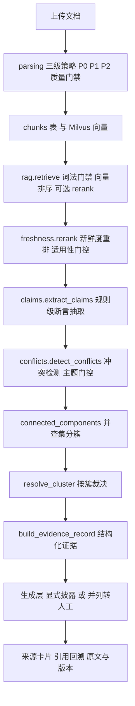

# 04 · 入库新鲜度与事实冲突检测 · 设计说明

> 定位：P5 企业级知识库「知识治理专题」设计篇，配套 `knowledge/` 纯函数包。
> 本项目是**开发框架骨架 + 可运行演示切片**，用于工程演示，**不是上线交付版**。
> 编制：`kb-researcher-a` ｜ 日期：**2026-11-14** ｜ 事实依据：逐文件实读 `knowledge/`（见 §0.3）。
> 同目录分工：`01-research.md` 工业实践调研、`02-candidates.md` 候选清单——**本设计篇不重复三者结论**。
> 变更范围：本次只修订本文件；未改任何 `.py` / `.html` / `.js` / `.yml`，未动冻结区 `eval/` `demo/` `evalbench/`，未碰 `parsing/`、`docs/parsing/`、`01/02/03`。

## 0. 阅读约定

### 0.1 三态标注（全文统一）

| 标注 | 含义 |
|---|---|
| `已实现` | 仓库里有可运行代码 + 离线单测支撑（含演示级 / 规则级），不等于上线级 |
| `只设计` | 有字段、契约、接口约定或架构预留，但功能逻辑尚未接通 / 正在接入 |
| `未做` | 代码与设计里都没有，或明确列在本期之外 |

> 本设计篇沿用项目统一三态「已实现 / 只设计 / 未做」，与 `02-candidates.md` §0.1、`docs/parsing/01-overview.md` §0 一致。
> `01-research.md` §0.1 的「已具备基础 / 需补齐 / 本期不建议做」是**调研篇专用的落地判断图例**，两者维度不同、不互相覆盖、不换算。

### 0.2 英文键名与中文说明（本文新增部分，余者见 `01-research.md` §0.2）

| 英文键名 | 中文说明 |
|---|---|
| `FreshnessPolicy` | 新鲜度策略（`enabled` 开关 / `half_life_days` 半衰期 / `blend` 融合权重 / `demote_floor` 降权下限 / `stale_alert_ratio` 过期占比告警线） |
| `DocMeta` | 文档时效与适用性元数据（`valid_from` 生效 / `expires_at` 到期 / `last_verified_at` 最后复核 / `indexed_at` 索引 / `authority` 权威等级 / `scope` 适用范围 / `checksum` 内容指纹） |
| `FreshnessResult` | 单文档判定（`effective_score` 有效分 / `original_rank` 原始名次 / `reason` 原因 / 适用性标志位） |
| `Claim` / `Claim.key` | 事实断言（主体 / 属性 / 值 / 极性 / 适用范围 / 支持原文）；`key` = `subject\|attribute\|` + 排序后 `scope`，决定哪些断言在说同一件事 |
| `Conflict` / `EvidenceRecord` | 冲突簇（`kind` 类型 / `resolution` 裁决 / `winner_id` 胜者 / `needs_review` 需人工复核）；证据记录为生成层的正式结构化输入（含 `conflict_signal`、`selected_claim_ids`、`excluded_claim_ids`、`warnings`、`resolution_log`） |
| `topic_similarity` / `connected_components` | 主题相似度（中文二元组 + 英文整词 Jaccard，主题门控用）；冲突图连通分量（并查集求簇） |

### 0.3 事实依据（本次逐文件实读，不凭调研推测）

| 依据 | 实读结论 |
|---|---|
| `knowledge/contracts.py` | 6 个数据类 + 过期动作 / 冲突类型 / 裁决结果常量，字段与分派说明一致 |
| `knowledge/freshness.py` | `parse_ts` / `age_days` / `decay_factor` / `evaluate` / `rerank` / `summary` / `meta_from_row` 均已落地 |
| `knowledge/claims.py` | 三条规则正则 + 属性词典 + `_norm_value` 归一 + 防误报 + `topic_similarity` 均已落地 |
| `knowledge/conflicts.py` | `detect_conflicts` / `connected_components`（并查集）/ `resolve_cluster` / `build_evidence_record` / `detect_and_build` 均已落地 |
| `knowledge/tests/test_knowledge.py` | **23 个离线单测**（含 `test_state_asymmetry_detects_conflict` 否定不对称用例），零外部调用、零模型流量，是 §5 验收断言的一手依据 |
| `knowledge/__init__.py` | 统一导出 29 个符号，目录地图自解释 |
| `webapp/` 接入层 | #41 已全部落地、#43 实跑：`db.py` 6 个时效列 + `_migrate_knowledge_columns()` 幂等迁移、`routers_knowledge.py` 四端点、`rag.py::_apply_freshness()`、`routers_chat.py::_source_dict()`、前端第 13 视图、`knowledge/samples.py`；按 team-lead 最终口径标 `已实现（演示级）` |

> 按 team-lead 最终确认，接入层与前端「知识治理」视图标 **`已实现（演示级）`**；但保留两条限定：`webapp/rag.py` 新鲜度重排**默认关闭**（`WEBAPP_FRESHNESS_ENABLED=1` 才开，避免打断 33 项端到端自测），**生成层注入 `EvidenceRecord` 仍为 `只设计`**（证据已就绪、未注入 prompt）。遵循 `docs/kb-capability-checklist.md` §0.4：**文档与源码有出入以源码为准**。

### 0.4 不编造声明

1. 本篇**不产出任何实测数字**：未执行测试、未跑压测、无准确率 / 延迟 / 吞吐 / 价格 / SLO 数值。
2. §5 的「验证命令 / 断言」是**判定条件**，对应 `test_knowledge.py` 里真实存在的函数；本篇未执行测试、不写「已通过 N 条」，23 项离线单测由主理人在 #43 统一实跑，结果见 `docs/knowledge/04-design.md` 的验收条件与 `knowledge/tests/`。
3. 所有阈值（`half_life_days=90`、`stale_after_days=365`、`blend=0.65`、`demote_floor=0.10`、`stale_alert_ratio=0.10`、`topic_sim_min=0.30`、`min_confidence=0.5`）均为**代码里的演示默认经验起始值，非压测结论，需用真实语料校准**。
4. 凡引用 `01-research.md` 的公开经验值（如「一般知识过期占比 > 10% 触发重建」等），一律标注**公开经验值 / 案例参考，非本项目实测**。
5. 接口地址、鉴权、配额、价格一律不写，沿用项目 `__TBC__` 占位纪律。

## 1. 为什么单独一个 `knowledge/` 包

三层职责必须分开，否则「选哪段文字」和「该不该信这段文字」会被搅在一起：

| 层 | 落点 | 管什么 | 不管什么 |
|---|---|---|---|
| 解析层 | `parsing/` + `backend/app/services/parser.py` | **字节 → 结构化文本**：分页、表格、OCR、质量门禁、三级策略 | 不管证据是否互斥、是否过期 |
| 治理层 | `knowledge/`（本篇） | **哪些证据适用、是否互斥、如何裁决**：新鲜度、适用性、`Claim`、冲突、`EvidenceRecord` | 不做向量召回、不改分块 |
| 检索 / 生成层 | `webapp/rag.py`、`webapp/routers_chat.py` | 词法门禁 → 向量排序 → 可选 rerank → SSE 生成 → 来源卡片 | 治理判定由 `knowledge/` 以纯函数给出 |

**不塞进 `parsing/` 的理由**：`parsing/` 的下游契约是 `ChunkSpec(page_no, section_path, block_type, confidence, source_level, parent_seq) → chunks 表 / Milvus / 引用`，`docs/parsing/01-overview.md` 明确「完全不动」。治理判定发生在**检索之后**，需要的是 `rag.retrieve()` 的 hit（含 `score` / `doc_id` / `chunk_id`）与文档时效元数据，而不是解析期的页级信号。若塞进解析层，就得改 `ChunkSpec`、动 P0/P1/P2 三级策略与质量门禁，口径全乱。

**不塞进 `rag.py` 的理由**：新鲜度与冲突是可独立复算、可独立单测、可被前端逐条展示的判定，不是检索排序的一个 `if`。塞进去会让 `retrieve()` 同时承担召回、衰减、claim 抽取、冲突裁决四件事，既不可测也不可解释。

**纯函数包的好处**（与 `parsing/` 01「脱离 FastAPI 单独 import、单独跑单测」同构）：`knowledge/` 不依赖 FastAPI / 数据库 / 向量库 / 外部模型，全部判定落到可序列化、可复算的字段上；`contracts.py` 先定契约再写策略；`tests/` 零外部调用可离线跑。前端「知识治理」视图能逐条展示「为什么这一条被降权 / 为什么这一簇转人工」，正是因为它拿到的是结构化结果而非黑盒日志。

**下游契约零改动**：`ChunkSpec`、`chat_sources` 引用卡片、`rag.retrieve()` 返回结构均不变；`rerank()` 只在 hit 上追加 `freshness` 与 `effective_score` 字段，属于**附加元数据**，不改原有键。

## 2. 分层与数据流



| 步 | 落点文件 | 主要产出 | 三态 |
|---|---|---|---|
| ① 上传 → 解析 → 分块 | `parsing/`、`webapp/rag.py` | `chunks` / `chunk_embeddings` | `已实现`（既有链路） |
| ② 检索召回 | `webapp/rag.py::retrieve()` | hit：`score` / `doc_id` / `chunk_id` / `text` | `已实现` |
| ③ 新鲜度重排 | `knowledge/freshness.py::rerank()`、`webapp/rag.py::_apply_freshness()` | `effective_score` + `FreshnessResult` | `已实现`（演示级，默认关闭） |
| ④ 断言抽取 | `knowledge/claims.py::extract_claims()` | `Claim[]`（含 `text` / `chunk_id` / `key`） | `已实现` |
| ⑤ 冲突检测 | `knowledge/conflicts.py::detect_conflicts()` | `Conflict[]`（未裁决） | `已实现` |
| ⑥ 分簇与裁决 | `connected_components()` / `resolve_cluster()` | 带 `resolution` / `winner_id` / `needs_review` 的 `Conflict[]` | `已实现` |
| ⑦ 证据记录 | `build_evidence_record()` | `EvidenceRecord` + `conflict_signal` | `已实现` |
| ⑧ 生成层契约 | `webapp/routers_chat.py` | 显式披露 / 并列两版本 / 转人工 | `只设计`（证据已就绪，未注入 prompt） |
| ⑨ 来源卡片 | 前端「知识治理」第 13 视图 | 开关前后排序对照、逐条 `reason` | `已实现`（演示级） |

> 两条触发路径：**在线**为 ②→⑨（每次查询）；**离线入库**可复用 ④⑤ 对新文档做冲突预标记，把「待审核」挡在正式索引之前（`01-research.md` §3.2 的两阶段）——该预标记流水线本期仍属 `只设计`。

## 3. 新鲜度设计取舍

### 3.1 契约字段

`FreshnessPolicy`（新鲜度策略）：`enabled`（开关）/ `half_life_days=90`（半衰期）/ `stale_after_days=365`（过期线）/ `expired_action`（过期处置，取值 `demote` / `exclude` / `warn`）/ `demote_floor=0.10`（降权下限）/ `blend=0.65`（融合权重）/ `stale_alert_ratio=0.10`（告警线），`as_dict()` 附带「演示默认经验起始值，非压测结论，需用真实语料校准」。`DocMeta`（文档元数据）：`doc_id` / `title` / `revision`（修订号）/ `valid_from` / `expires_at` / `last_verified_at` / `indexed_at` / `authority`（权威等级）/ `scope`（适用范围字典）/ `checksum`；时间统一 ISO-8601 UTC 字符串，`parse_ts()` 对无效输入返回 `None`，绝不把异常抛给上传链路。

### 3.2 半衰期公式：为什么是 `0.5 ** (age/H)` 加下限

```
decay = max(demote_floor, min(1.0, 0.5 ** (max(0, age_days) / half_life_days)))
```

- **为什么用指数衰减**：每过一个半衰期折半，可复算、可在前端轨迹里逐条解释；比「线性扣分」更贴近「越老越快地失去时效」的直觉，且不会在某一阈值处断崖。公式与 `01-research.md` §2.2 写法 A 对齐（`0.5^(t/H)`），**不与写法 B `e^(−t/halfLife)` 混用**——两者参数量纲差约 1.44 倍，落地只认一种。
- **为什么加 `demote_floor`**：极老文档 `decay → 0` 会让高度相关的权威老文档彻底消失（「旧合同仍适用某群体」场景）。下限保住一个最低可见度，体现「新鲜度是软信号，不是删除令」。
- **为什么 `H=90`**：只是演示默认经验起始值（`stale_after_days=365` 同理），**非来自公开经验值的直接搬用，非压测结论，需用真实语料校准**；不同 `document_class`（内容类型）应有不同半衰期，本期未做（见 §7.3）。

### 3.3 blend 公式：为什么是乘性保底而不是线性相加

```
effective = base_score * (1 - blend + blend * decay)
```

| 情形 | `decay` | `effective`（取 `blend=0.65`） | 说明 |
|---|---|---|---|
| 刚复核 `age=0` | 1.0 | `base × 1.0` | 不惩罚 |
| 一个半衰期 `age=H` | 0.5 | `base × 0.675` | 降权但仍可见 |
| 极老 `age→∞` | 0.10（下限） | `base × 0.415` | 保底不归零 |
| `blend=0` | 任意 | `base` | 等价于只按相关性 |
| `blend=1` | 0.10 | `base × 0.10` | 几乎完全由新鲜度决定 |

> 上表为**纯算术示意算例，参数为代码默认值，非本项目实测**。**为什么乘性**：新鲜度是对相关性打折扣而非相加；`α·cos+(1−α)·w` 那类线性相加会让相关性为 0 的文档因「足够新」拿到正分被召回，乘性形式保证 `base=0 → effective=0`，**不把不相关内容硬凑进来**，与 `webapp/rag.py`「词法门禁」口径一致；`1−blend` 为保底项、`blend·decay` 为衰减项，两项之和恒在 `[1−blend, 1]`，边界可证。

### 3.4 为什么 `age` 优先用 `last_verified_at` 而不是 `created_at`

`age_days()` 取值优先级：**`last_verified_at`（最后人工复核）→ `indexed_at`（索引时点）→ `valid_from`（生效时点）→ 都没有则 0 天**。理由：

- `created_at` 只回答「何时创建」，一份三年前创建、上周刚复核确认仍有效的制度，用创建时间算会被误判为过期；
- `last_verified_at` 才回答「内容还被认为正确」，是**新鲜度**而非**年龄**；
- `indexed_at` 是次优代理（重索引通常伴随内容变更）；`valid_from` 兜底；
- 三者皆无按 0 天处理，避免「缺元数据被误杀」（`meta_from_row()` 也容忍缺字段与 JSON 字符串 `scope`）。

### 3.5 适用性门控是硬约束，不受 `enabled` 开关影响

这是本设计最重要的一条纪律（代码里 `evaluate()` 先判 `valid_from` 未来、再进 `enabled` 分支）：

- `valid_from` 在未来 → `not_yet_effective=True`、`excluded=True`、`effective_score=0`，且**不标 `is_expired` / `is_stale`**（「尚未生效」不是「过期」）；
- `expires_at` 已过 → 按 `expired_action` 处置；
- **开关 `enabled=False` 只关时间衰减，不关适用性门控**：`effective` 回退为 `base_score`、动作标 `warn`，但未来生效 / 已过期文档仍按硬约束处置。否则「关掉新鲜度」会变成「允许未来政策进上下文」，是正确性事故而非体验开关。

根因是**双时态（bi-temporal）**：`indexed_at`（事务时间，何时录入）与 `valid_from` / `expires_at`（有效时间，事实何时为真）是两个维度，不能互相替代。

### 3.6 为什么「最新 != 适用」

| 反例 | 靠什么字段挡住 |
|---|---|
| 下月才生效的新制度 | `valid_from` 在未来 → 硬排除 |
| 旧合同仍适用于某群体 | `scope` + `expires_at` 未过 → 不因时间戳旧被误杀 |
| 总部通用规则 vs 上海地区细则 | `scope` 进入 `Claim.key`，不同范围不比较、不覆盖 |
| v1 / v2 套餐的「100 次」与「500 次」 | `scope`（`product_version` / `plan`）隔离，属适用性差异而非事实冲突 |

`scope` 不只用于过滤，还进入 `Claim.key = subject|attribute|排序后 scope`——**把「适用范围」编码进「哪些断言在说同一件事」**，从根上避免把两份各自成立的地区细则误判为冲突。

### 3.7 硬过滤 vs 分层排序：两者都用，不二选一

- **硬过滤**（适用性门控、`excluded` 剔除）处理「对 / 错」类条件，可解释、可审计，且必须在打分**之前**——下游再怎么 rerank 也修不好已被召回的未来政策；
- **分层排序**（`effective_score` 重排）处理「好 / 更好」类偏好，连续、可复算；
- 不硬压成一个万能公式：业务规则用硬过滤 + 分层比加权求和更容易向审核方解释（`01-research.md` §2.2）。

### 3.8 过期三种处置的适用面

| `expired_action` | 行为 | 适用面 |
|---|---|---|
| `exclude` | `effective=0`、`excluded=True`，**仍在 `results` 报告里留痕** | 合规 / 法务 / 已废止版本，绝不能进上下文 |
| `demote` | `effective *= demote_floor`，动作标 `demote`，回答里标注 | 一般参考材料，降权但保留可解释性 |
| `warn` | 不改分，仅告警 | 只做观测、不干预排序的灰度期 |

**被排除的仍留在报告里**：`rerank()` 返回的 `results` 是**全部候选**的判定（含被排除者），`kept` 才是不含排除项的排序列表。这既满足「删除作为一等事件 / 软删保留审计」，也让前端能展示「这一条为什么不在答案里」。

### 3.9 可观测与开关前后对照

- `summary()` 给年龄分布桶（`0-30d` / `31-90d` / `91-365d` / `>365d`）、`stale` 占比、`expired` 数、`not_yet_effective` 数、`excluded` 数、`alert` 判定。注意它统计的是**检索结果里的文档年龄**，不是索引全量文档年龄——语料漂移要看「被召回的是什么」（`01-research.md` §2.5）。`stale_alert_ratio=0.10` 对应公开经验值「一般知识过期占比 > 10% 触发重建」，**非本项目实测，需用真实语料校准**。
- `rerank()` 保留 `original_rank` / `base_score` / `effective_score`，供前端做「开启 vs 关闭」排序前后对照；关闭开关时 `effective=base_score`，排序恢复原状。这是可讲要点的「可解释、可对照、可回滚」，而不是一句「我们加了时间衰减」。

## 4. 冲突检测设计取舍

### 4.1 claim 级 vs 文档级

两本长手册可能大部分一致、只在一个操作限值上打架；文档级比较太粗。`Claim` 抽取「主体 / 属性 / 值 / 极性 / 适用范围 / 生效期 / 权威度 / 支持原文 / `chunk_id`」，`key` 决定分组。归一化（`_norm_value`）只用于**比对**，不改原文；`text` 与 `chunk_id` 原样保留，保证引用能回溯到具体片段。

### 4.2 规则级 vs 模型级

`claims.py` 是**纯标准库、规则级**：`_ASSIGN`（X 是 / 为 / = / ：Y）、`_TABLE_ROW`（Markdown 表格行）、`_STATE_STMT`（句末状态谓语，抓「不再需要 / 已废止」这类否定不对称）；`_attr_of()` 用属性词典把「婚假天数」→ `duration_days`、「接口超时」→ `timeout`。规则不命中的句子直接跳过，**不硬凑**。

**模型级只作告警线索、不自动裁决**（`01-research.md` §3.3）：结构化事实用字段解析比模型更可靠、每一步可在前端展示；NLI（自然语言推理）模型级矛盾识别本期 `未做`（§7.3）。

### 4.3 防误报四条

| # | 措施 | 挡住什么 |
|---|---|---|
| 1 | **年份 1900–2099 且无单位 → 置信度压到 0.2** | 「2023 年报 / 2024 年报」不被当成数值冲突 |
| 2 | **裸小整数 1–9 且无单位 → 置信度 0.5** | 「第 1 步 / 第 2 步」「阶段数为 3」不触发冲突 |
| 3 | 单位 / 否定词 / `scope` 原样保留，归一化只用于比对 | 不把「10 天」与「10 秒」误判为同值；不抹掉解释差异的条件 |
| 4 | 每条 claim 保留 `text` 支持原文与 `chunk_id` | 引用可回溯，低置信度 claim 不单独触发冲突（`min_confidence=0.5`） |

> 第 1、2 条来自 `01-research.md` §3.3 的公开实践（年份 1900–2099、小整数 1–9），在本项目里由 `_norm_value()` 落地为置信度降级而非丢弃，保留可解释性。

### 4.4 主题门控与「同值不报冲突」

- `topic_similarity()` 是中文相邻二元组 + 英文整词的 Jaccard，`topic_sim_min=0.30`（**经验起始值，非压测结论**）用于跨 `key` 的否定不对称检测门控，避免「退款期限 10 天」与「接口超时 30 秒」被误判；
- **同一 `key` 但归一化值完全相同 → 视为互相印证，不报冲突**；只有「归一化值互斥」或「肯定 / 否定极性相反且主题相近」才报。这直接对应 `01-research.md` §3.7 的「重复副本不应改变结果」。

### 4.5 冲突分类与裁决结果（不一刀切）

| 分类常量 | 中文说明 | 判定顺序 |
|---|---|---|
| `KIND_AUTHORITY` | 值不同且来源权威度不同 | ① 权威度不同 |
| `KIND_FRESHNESS` | 值不同且生效期不同，可能是版本更替 | ② 生效期不同 |
| `KIND_NEGATION` | 一方含否定 / 废止方向词 | ③ 极性相反 |
| `KIND_NUMERIC` | 同一字段互斥数值 | ④ 含数值 / 版本 / 日期 |
| `KIND_UNRESOLVED` | 权威性相当、适用范围相同，无法裁决 | ⑤ 兜底 |

| 裁决常量 | 中文说明 | `needs_review` |
|---|---|---|
| `RESOLVE_AUTHORITY` | 按业务注册表取高权威来源 | `False` |
| `RESOLVE_RECENCY` | 新版本优先（**只是先验**） | `True` |
| `RESOLVE_ESCALATE` | 并列呈现两版本 + 转人工 | `True`，`severity=block` |

分类不为「一刀切取最新」服务：互补信息应合成、观点分歧应并列、错误信息应升级（`01-research.md` §3.4 的 CONFLICTS 五类，本包实现为其中可规则判定的五类子集）。

### 4.6 冲突图连通分量：按簇独立裁决

`connected_components()` 用**并查集**把「共享任一 claim」的冲突并入同一簇，`resolve_cluster()` 对**每个簇独立**裁决。若图省事「整批只留时间最新的一份」，会误删其它独立簇里仍有效的信息——这正是 `01-research.md` §3.5 的 `cluster-aware recency`（按簇时效裁决）。被淘汰的 claim **不删除**，只在 `EvidenceRecord.excluded_claim_ids` 里标排除。

### 4.7 权威注册表属于治理流程，不是代码常量

`resolve_cluster()` 只读 `DocMeta.authority` 并给出「按业务注册表取高权威来源」的解释；**注册表本身（各领域来源等级、覆盖关系、审批流）由业务负责人定义，不在代码里写全局常量**（`01-research.md` §3.5）。本期只实现「读取 + 解释 + 留痕」，注册表的业务审批流程属 `未做`（§7.3）。这与项目「`decide()` 为唯一授权真值」「配置外置」取向一致，但权威度是知识治理层，不要与解析层的 `source_level` / `confidence` 混用。

### 4.8 新版本优先为什么必须 `needs_review`

权威性相当但 `valid_from` 不同时，取较新者进主上下文，但打 `RESOLVE_RECENCY` + **`needs_review=True`**，`warnings` 明确写「新版本优先只是先验，需人工确认」。理由：生效期新不等于内容正确，也不等于已走完审批；自动采信等于把知识治理责任甩给一次时间戳比较（`01-research.md` §2.3 的反例之一）。

### 4.9 无法裁决时的生成层契约

权威性相当、适用范围相同、无可裁决的生效期差异 → `RESOLVE_ESCALATE`、`winner_id=None`、`severity=block`、`needs_review=True`，理由是「并列呈现两个版本并转知识负责人审核，**不发明 tie-breaking 规则**」。落到 `EvidenceRecord`：

- `conflict_signal=True`（只要 `conflicts` 非空）；
- `warnings` 明写「检测到 N 组事实冲突，**回答必须显式披露，不得自行挑选一个值**」「存在无法裁决的冲突：并列呈现来源与原文，转知识负责人审核」；
- `selected_claim_ids` / `excluded_claim_ids` / `resolution_log`（含逐簇 `reason`）三者齐备，`as_dict()["note"]` 再次声明契约；
- `claims` **保留全部断言**（含冲突双方），引用绑定到具体 claim 与其 `text`；
- 拒答 / 披露时**只呈现用户有权访问的证据**，不泄露受限文档标题或内容（`01-research.md` §3.6）。

## 5. 可量化验收标准（16 条）

> 全部为**待执行的判定条件**，非运行结果。验证命令统一为 `pytest knowledge/tests/test_knowledge.py -q`（离线、零外部调用）；下表「验证断言」列引用该文件中真实存在的测试函数 / 断言表达式。
> **本篇未执行测试**，23 项离线单测由主理人在 #43 统一实跑，结果见 `docs/knowledge/04-design.md` 的验收条件与 `knowledge/tests/`；本篇不产出通过 / 失败数字。
> 表中阈值一律为**演示默认经验起始值，非压测结论，需用真实语料校准**。

| 编号 | 指标定义 | 阈值 / 判定 | 验证命令或断言 |
|---|---|---|---|
| A01 | 时间衰减半衰期与下限 | `decay(0)=1.0`、`decay(90,90)=0.5`、`decay(180,90)=0.25`、`decay(9999)=0.10` 不归零 | `test_decay_is_half_life_and_floored` |
| A02 | `age` 优先最后复核时间 | `indexed_at=300d`、`last_verified_at=10d` → `age_days≈10` | `test_age_uses_last_verified_before_indexed` |
| A03 | 适用性硬门控（未来生效） | `not_yet_effective=True`、`excluded=True`、`effective=0`，且 `is_expired/is_stale` 均为假 | `test_not_yet_effective_is_excluded_not_judged_stale` |
| A04 | 过期三档处置互异 | `exclude` 归零 / `demote` 介于 0 与 `warn` 之间 / `warn` 只标不改分 | `test_expired_actions_are_distinct` |
| A05 | `stale` 不完全压过相关性 | `age=800d` → `is_stale=True`、`decay=0.1`、`effective_score>0.3` | `test_stale_does_not_override_relevance_completely` |
| A06 | 开关前后排序对照 | 开启 → `["new","old"]`（`future` 排除、`new` 反超 `old`）；关闭 → `future` **仍被排除**（适用性门控不受开关影响）、`old` 因不再衰减回到 `new` 之前；`original_rank` / `base_score` 保留 | `test_rerank_keeps_before_after_evidence`（断言已按「门控不随开关关闭」修正） |
| A07 | 年龄分布桶与告警线 | 4 桶计数正确、`stale` 数正确、`0.25 < 0.3` 时 `alert=False` | `test_summary_reports_age_distribution_and_alert` |
| A08 | 元数据行容错 | 缺字段、JSON 字符串 `scope`、字符串 `authority` 均能转 `DocMeta` | `test_meta_from_row_tolerates_missing_and_json_scope` |
| A09 | 带单位 claim 抽取与原文保留 | 「婚假天数为 10 天」→ `value_norm="10"`、`unit="天"`、`attribute="duration_days"`、`text` 非空 | `test_extract_numeric_claim_with_unit` |
| A10 | 年份 / 裸小整数防误报 | 「2026 年」→ `confidence<0.5`；「阶段数为 3」→ `confidence<1.0` | `test_year_and_small_integer_are_not_conflict_fuel` |
| A11 | 否定极性 / 否定不对称 / 表格行 / 主题门控 | 「不再需要」→ `polarity=-1`；否定不对称检出冲突；表格行抽 `30 秒`；相关主题 `≥0.3`、无关主题 `<0.3` | `test_negation_sets_polarity`、`test_state_asymmetry_detects_conflict`、`test_table_row_is_a_claim`、`test_topic_similarity_gates_unrelated_topics` |
| A12 | 同值不报冲突 / 数值冲突检出 | 两份「10」→ `detect_conflicts()==[]`；「10」与「15」→ 1 组冲突、值集 `{"10","15"}` | `test_same_value_is_corroboration_not_conflict`、`test_numeric_conflict_detected` |
| A13 | `scope` 适用性隔离 | 同字段、`region=CN` 与 `region=GB` → `key` 不同、不报冲突 | `test_different_scope_is_not_conflict` |
| A14 | 低置信度不触发冲突 | 两条 `confidence=0.4` 的互斥值 → `detect_conflicts()==[]` | `test_low_confidence_does_not_trigger_conflict` |
| A15 | 权威度裁决 / 新版本需复核 | 权威 1 vs 3 → `RESOLVE_AUTHORITY`、`needs_review=False`；生效期不同 → `RESOLVE_RECENCY`、`needs_review=True` | `test_authority_wins_without_review`、`test_recency_wins_but_requires_review` |
| A16 | 无法裁决并列 + 证据记录保留双方 | `RESOLVE_ESCALATE`、`winner_id=None`、`severity="block"`、`warnings` 含「不得自行挑选」；`EvidenceRecord` 保留全部 `claims`、含 `selected/excluded/resolution_log`、`conflict_signal=True` | `test_equal_authority_escalates_without_inventing_tiebreak`、`test_evidence_record_keeps_both_sides_and_logs_decision`、`test_end_to_end_from_text_to_evidence` |

> 补充覆盖：A16 的端到端用例还验证「两段文本里接口超时一致时不误报冲突」，对应 `01-research.md` §3.7 的重复副本 / 证据一致性要求。前端「排序前后对照」已由「知识治理」视图提供，本篇只给 A06 的数据层断言。

## 6. 与既有架构的边界

| 既有能力 | 关系（不互相打乱口径） |
|---|---|
| `parsing/` 三级策略（P0/P1/P2）+ 质量门禁 | `knowledge/` 在**检索之后**介入，`ChunkSpec` 下游契约零改动，P0/P1/P2 与 `needs_upgrade` 逻辑无需改动；`source_level`(L1/L2/L3) / `confidence` 是解析质量信号，与治理层 `authority` 语义不同，禁止互相顶替 |
| 90:10 预算闸门（`VISION_ESCALATION_RATIO=0.10`） | 它是解析阶段「最贵链路最多占 10% 页」的**熔断线**；`knowledge/` 是纯标准库规则计算，**不调用任何外部模型、不消耗 P2 名额、不复用同一常量、不合并成一个「预算」**；本期无模型级冲突调用，故不存在配额冲突 |
| 三维限流（按 IP / 用户 / 租户维度） | `knowledge/` 是纯函数，不发起网络请求、不增加限流维度；接入层若新增 API，沿用既有中间件，不改限流口径 |
| C33（10 具名 `data-view` + 6 具名 loader 存在性检查） | 前端「知识治理」为**第 13 个 `data-view`**（已落盘），只新增视图、不改动既有 10 个具名 view 与 6 个具名 loader 的存在性检查 |
| 冻结区 `eval/` `demo/` `evalbench/` | **零改动**；§5 验收走 `knowledge/tests/`，不进 `eval/`，不触碰 `__TBC__` / `NOT_COMPARABLE` / `real_api` 阻断口径；金标 / 金丝雀集若将来引入，须走 `eval/config/objects/` 版本化对象新增 |
| 低思考档（DeepSeek V4.1 Flash） | `knowledge/` 不调 LLM，与生成模型档位无关；`EvidenceRecord.conflict_signal` 只是交给生成层的结构化输入，不改变提示词档位 |
| P2 视觉能力（已接通、双图功能连通性实测） | 治理层不消费视觉端点、不改 `image_url` 契约；P2 仍是「功能连通性、非质量基线」，本设计篇不改该判定 |
| `backend` 13 步去 tenant 数据模型改造 | **方案已定、代码尚未改造**（`docs/parsing/01-overview.md` §7、`docs/kb-capability-checklist.md` §4.3）；本期 `knowledge/` 是独立纯函数包，不依赖、不推动、不代表该改造已落地 |
| `docs/parsing/05` 三态图例与诚实边界 | 本篇三态是设计判断，与 `eval/` 冻结口径相互独立、不绕过；沿用「成本与延迟只做定性、不写实测数字」 |

## 7. 三态表

### 7.1 已实现（有代码 + 离线单测支撑）

| 能力 | 落点 | 证据 |
|---|---|---|
| 数据契约（6 个数据类 + 常量） | `knowledge/contracts.py` | `FreshnessPolicy` / `DocMeta` / `FreshnessResult` / `Claim` / `Conflict` / `EvidenceRecord` |
| 时间衰减、适用性门控、过期三档、重排、汇总、行转换 | `knowledge/freshness.py` | 7 个函数，`test_knowledge.py` 前 8 个用例 |
| 规则级 claim 抽取、属性词典、归一化、防误报、主题相似度 | `knowledge/claims.py` | 3 条正则 + `_norm_value` + `topic_similarity` |
| 冲突检测、并查集分簇、按簇裁决、证据记录 | `knowledge/conflicts.py` | `detect_and_build` 一步到位 |
| 离线单测（零外部调用） | `knowledge/tests/test_knowledge.py` | 23 个测试函数（含否定不对称用例） |
| 统一导出 | `knowledge/__init__.py` | 29 个符号 |
| 演示场景与前端可视化 | `knowledge/samples.py`、`webapp/static/`「知识治理」视图 | `DEMO-FRESHNESS-CONFLICT-001` 合成场景（6 份文档 / 2 个冲突簇：`freshness`+`needs_review=True` 与 `authority`+`needs_review=False` 各一 / 3 条负向对照）、开关前后排序对照、逐条 `reason` |

> 讲解口径：**规则级 / 演示级已实现**，可讲「纯函数可复算、判定可解释、离线可跑、接入层可演示」；**不能讲**「生产级准确率达标、已在默认问答链路全量生效、已通过真实语料评测」——`webapp/rag.py` 新鲜度重排默认关闭。

### 7.2 已实现（演示级）与仍待设计的边界

按 team-lead 最终确认，#41 接入层已全部落地、#43 实跑，以下 6 项标 `已实现（演示级）`：

- `webapp/db.py`：6 个时效元数据列 + `_migrate_knowledge_columns()` 幂等迁移
- `webapp/routers_knowledge.py`：`/api/knowledge/status|policy|scenario|detect` 四个端点，写接口仅 admin
- `webapp/rag.py`：`_apply_freshness()` 可选叠加，hit 带 `freshness` / `effective_score`
- `webapp/routers_chat.py`：`_source_dict()` 透传到 SSE 来源
- `webapp/static/`：「知识治理」视图（第 13 个 `data-view`）
- `knowledge/samples.py`：`DEMO-FRESHNESS-CONFLICT-001` 合成场景（6 份文档、2 个冲突簇、3 条负向对照）

**两条限定（不夸大完成度）**：`webapp/rag.py` 的新鲜度重排**默认关闭**（`WEBAPP_FRESHNESS_ENABLED=1` 才开，避免打断 33 项端到端自测）；**生成层注入 `EvidenceRecord` 仍为 `只设计`**——证据记录已就绪，但尚未注入 prompt，故「显式披露 / 并列两版本 / 转人工」的生成层契约未落地。离线入库预标记流水线同属 `只设计`。**若源码已变以源码为准**（§0.3）。

### 7.3 未做（明确点名，不写成已完成）

1. 真实压测与全量回归报告（P95 首 token / 整答 / 错误率）
2. 监控告警大盘 / Prometheus / SLO（`stale_alert_ratio` 只是纯函数里的判定，未接告警通道）
3. NLI（自然语言推理）模型级矛盾识别
4. 来源权威注册表的**业务审批流程**（本期只实现读取 `authority` 与解释）
5. 金标集 / 金丝雀集回归（`01-research.md` §2.5 的可观测闭环）
6. 真实语料阈值校准（`H=90` / `blend=0.65` / `topic_sim_min=0.30` 等均为演示默认）
7. 真实腾讯云上线 / 主备切换演练 / 备份校验；近重复去重、逐句 grounding 判定器、查询改写等（属 `02-candidates.md` 范畴，不在本篇落地）

### 7.4 口径对齐

本篇三态与 `01-research.md`（调研篇专用三态）、`docs/kb-capability-checklist.md`（四档：已实现 / 演示级 / 架构预留 / 未做）、`docs/parsing/05`（三态图例）**相互独立**：本篇不改写任何既有文档的状态列，引用既有能力时沿用原词。§7.2 按 team-lead 最终口径标 `已实现（演示级）`，但生成层 prompt 注入仍 `只设计`；凡 `只设计` 项一律说「留了扩展点、能讲清为什么现在不做、什么条件下才做」，不说成已落地。

## 8. 诚实边界

- 本篇是**设计说明**；「已实现」含 `knowledge/` 纯函数包、23 项离线单测，以及按 team-lead 最终口径确认的 `#41 接入层（演示级）`。但 `webapp/rag.py` 新鲜度重排默认关闭、生成层注入 `EvidenceRecord` 仍 `只设计`，**不等于功能已在默认问答链路全量生效**。
- §5 的 16 条是**判定条件**，本篇未运行 `pytest`、不产出「已通过 / 失败」数字；23 项离线单测由主理人在 #43 统一实跑，结果见 `docs/knowledge/04-design.md` 的验收条件与 `knowledge/tests/`；阈值全是演示经验起始值，非压测结论。
- 所有算术示例（§3.3）为**假设 / 代码默认参数的纯算式演示**，非本项目语料、非评测结论。
- 引用 `01-research.md` 的公开经验值、CONFLICTS 分类、RAGAS 指标等，均按 §0.4 处理为**公开经验值 / 案例参考，非本项目实测**；未独立核实的论文结论不作依据。
- 不写价格、接口地址、鉴权、配额、错误码、P95 / 吞吐 / 耗时等本项目未实测数字。

> 收尾：这一层把「新鲜度」做成可复算的软信号、把「冲突」做成显式状态与结构化证据，而不是让模型在无序片段里赌一个答案；适用性门控不受开关影响、新版本必须复核、无法裁决诚实并列，是三条不可让渡的正确性底线。本期交付纯函数包、接入层演示切片与设计说明，**不声称任何上线级能力已落地**。
