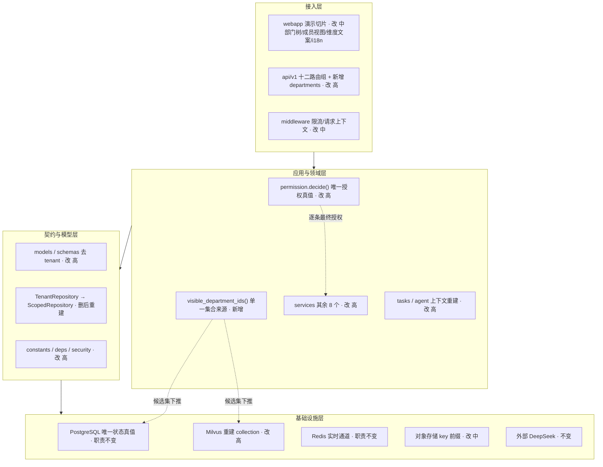

# 需求变更调整方案：多租户架构 → 多用户多部门

> 编制：2026-11-13 ｜ 适用：`P5企业级知识库项目`（A/B 档开发框架骨架 + 面试讲解版）
> **性质**：设计评审与改造方案。本次**未修改任何项目源码、未执行迁移、未改动 `eval/` 冻结对象与 demo 的 `run_id`**，仅新增本方案文档。
> 事实源：`docs/CHANGELOG.md` §6、`docs/enterprise-readiness.md`、`docs/permission-model.md`、`docs/kb-capability-checklist.md`、`backend/app/**`、`webapp/**`，以及全栈架构交付专家团八位成员的独立产出与主理人裁决 C1–C35。
> 三态纪律：全文严格区分「**已实现 / 只设计 / 未做**」，不把设计说成落地、不把演示替身说成生产实现。

---

## 0. 上次任务完成情况与尚未完成事项

### 0.1 上次任务完成情况（本轮实查，非推断）

| 项 | 结果 |
|---|---|
| Git | 分支 `demo/v1`，HEAD `3005197`；上轮两处改动已入库：`e18709b`（改进日志 + `v=11` 静态资源对齐 + README 索引）、`3005197`（复核记录）。开工前 `git status` 干净 |
| 全套回归（上轮实跑，本轮复核命令仍有效） | `pytest webapp/tests` 51/51、`webapp/selftest.py` 33/33 `DEMO_READY`、`demo/selftest.py` 16/16（`run_id=RUN-095a2a4a40c6` 未变）、`backend pytest` 16/16、`eval` 14 OK、`evalbench` 16 OK、`node --check` ×3 全过 |
| 冻结边界 | `git diff main..HEAD -- eval/` 为空；`git grep -E 'sk-[A-Za-z0-9]{20,}'` 零命中；`eval/`、`demo/` 全目录 `tenant\|租户` 零命中 |
| 运行环境 | 本轮复查 8765 端口无响应，演示服务进程已退出，属**运行状态**而非代码缺陷，可随时用 `python -m uvicorn webapp.main:app --port 8765` 拉起 |
| 残留底数 | 当前仓库执行 `git grep -n -i -E 'tenant|multi.?tenant|租户|多租户'` 命中 **615 行**（口径见 §5.11） |

**本轮追加的离线复核（用户提示「上次大模型跑完流量了」，全程未触发任何真实模型调用）**：`pytest webapp/tests` **51 passed**、`backend pytest` **16 passed**、`eval` unittest **14 OK**、`evalbench` unittest **16 OK**、`demo/selftest.py` **16/16**（`run_id=RUN-095a2a4a40c6` 未变）；`git diff --exit-code -- eval/ demo/` 返回 0（冻结区零改动）；复核时 `git status` 三项未提交（`MEMORY.md` 修改、`2026-11-13.md` 与本方案新增），本轮已一并入库；8765 端口仍无响应，属服务进程未拉起，非代码缺陷（`python -m uvicorn webapp.main:app --port 8765` 可拉起）。本轮据实查结果修正方案内 4 处事实偏差（详见 §10.2），并把 i18n 生成链、Q-NEW3/4、R-NEW1 全部收口为不留待确认的口径。

### 0.2 尚未完成事项清单（三份事实源）

| 来源 | 未完成事项 |
|---|---|
| `docs/CHANGELOG.md` §6 **待补充 5 项** | 正式发布版本号 / 发版说明 / 变更人；首日各改进项精确时刻；真实供应商计费单价与账单校准；质量基线冻结与阈值（`eval/` 仍 `comparable=false` / `NOT_COMPARABLE`，`real_api` 被契约门禁阻断）；视觉对比度的屏幕阅读器实测 |
| `docs/CHANGELOG.md` §6 **已确认未落地 4 项** | 多租户行级隔离与部门树 / 逐段落 ACL；全局并发闸、压测、容灾演练、监控告警、灰度回滚；内容安全 PII 脱敏、SSO/OIDC、审计留存合规；逐句 grounding 高亮、Milvus 真实向量库 |
| `docs/enterprise-readiness.md` §3/§4/§5 | webapp 切片未做部门树、跨租户 expr 过滤、审计留存合规与脱敏检索；限流为进程内滑动窗口、单实例有效；预算只拦离线评估运行；token 与单价为演示估算 |
| `docs/kb-capability-checklist.md` §4.3 / Top10 | 20+ 条越权用例集（E8）、RAGAS/MRR/NDCG 与质量基线（E4）、评测 CI 闸门（E5）、trace→span（E7）、按组织配额与全局并发闸（F1）、缓存 key 带身份与配置快照（F2）、监控告警 SLO（G2）、容量压测与灰度回滚（G6）、逐段落 ACL 开关、SSO/SCIM |

### 0.3 按新口径重新归类（本次变更的影响）

| 类别 | 条数 | 处置 |
|---|---|---|
| **仍有效** | 16 条 | 与 tenant 无关，去掉 tenant 后照样欠着，**不因本次变更自动进入 MVP**（U01–U05、U07–U09、U12–U14、U16–U18、U21–U22） |
| **自动失效 / 不再需要** | 7 类 | 纯 tenant 概念随单组织单库消失：多租户行级隔离、物理隔离多租户、跨租户 expr 过滤、越权用例中的跨租户/缓存串租户/任务跨租户三类、按租户分级配额、缓存 tenant 前缀、`decide()` 第 0 步 tenant-mismatch 与 platform_admin 跨租户特权 |
| **需改写为部门口径** | 10 条 | U06-c 部门树状态、U10 webapp 补齐、U11-b expr、U15-b 越权用例集、U19-b 用量、U20-b 缓存 key、U23 表结构根节点、U24-b 角色与枚举、U25 限流四维、U26 CHANGELOG 修订记录 |
| **文档标注失真（新增 Must）** | 6 类 | ① 把已移除能力仍标「已实现」；② 把已实现的部门树仍标「架构预留/未做」；③ 演示切片四维限流与生产骨架架构预留口径混写；④ `milvus_client.py:1-4` docstring 与 `permission.py:89` 注释级失真；⑤ 把 partition key 误述为硬隔离；⑥ 演示对齐话术仍称「单租户 default」 |

> **范围纪律**：「列出尚未完成」不等于「本次要补完」。A/B 档明确「只设计 / 未做」的上线级事项（U16/U17/U18/U21/U22 等）留在本期之外，拉进本期等于范围蔓延且必然把「只设计」说成「已落地」。

---

## 1. 需求变更理解与成功标准

### 1.1 一句话结论

把 `tenant` 从**跨组织硬隔离边界**降维删除，让原本的次级维度 —— 部门树（`Department` + 物化路径） —— **升格为唯一组织边界**，并同时承担组织结构与访问控制两项职责。这不是字段删除，而是**边界职责重分配**：`tenant_id` 在现存代码里同时承担「隔离边界」与「命名空间 / 成本归集维度」两种职责，前者可删，后者必须有替代者。

### 1.2 一个改变方案性质的核查发现

`backend/` 生产骨架里**已经实现**完整的多用户多部门模型：

- `Department` 部门树（`parent_id` 自关联 + 物化路径 `path` + `level`）、`User.department_id`、`ACLGrant`（`subject_type = user|department|role`，`scope = kb|document|chunk`）、五角色、敏感度偏序、`Visibility`、`decide()` 里的「同部门 / 部门子树 / owner」判定、`/api/v1/users/departments` 接口、HQ/RD/MK 三个种子部门。
- 真正「未建部门树」的是 **`webapp/` 演示切片**（单租户 `default` + `admin/user` 两级 + owner 过滤）。

**所以本次不是「从零做多用户多部门」，而是三件事**：删一层 tenant → 把五个维度词改挂 department → 把 backend 已有能力下沉到演示切片讲通并测住。影响面：`tenant_id` 在 `backend/` 的 py 文件出现 490 次 / 49 文件（`tenant_id` 字面量精确口径），`tenant` 词根全口径约 595 行 / 71 文件，`webapp/` 仅 3 处字面量（按 `tenant` 维度键口径为 38 处 / 11 文件）。

### 1.3 成功标准（可度量）

单组织单库下，任一用户的可见范围可完全由「部门 / 子树 / 角色 / owner / 显式授权」判定并**在检索前生效**；A13 七条断言全绿；20+ 条部门口径越权用例 100% 拦截；六条回归命令全绿；`eval/` 冻结对象与 demo `run_id` 逐字节不变；四份事实源无一处把已移除能力标为「已实现」。

### 1.4 仍需用户拍板的业务事实（方案已给默认假设，不构成停工前置）

| # | 业务事实 | 本方案默认 |
|---|---|---|
| 1 | 是否永久放弃 SaaS / 多组织路线 | 是（降维近似不可逆，反向回补约需本次 1.5–2 倍工作量） |
| 2 | 部门层级是否可能 > 10 | 不会；`MAX_DEPT_DEPTH=10` 为配置级单一真值源 |
| 3 | 库中是否已有真实数据、Milvus 现有向量条数、可接受的冻结写入时长 | 演示 / 开发库，可重建、无 SLA 停机窗口；执行前实采 |
| 4 | 真实供应商单价、压测基线（QPS / P95） | 沿用演示估算值，**不编造**；压测基线留待后续迭代 |

---

## 2. 需求范围

### 2.1 用户故事

| # | 故事 | 档 | 验收要点 |
|---|---|---|---|
| S1 | 部门成员检索与问答只返回本部门内容 | Must | 他部门文档**不进候选集**（不是返回后隐藏），`decide()` 返回 deny |
| S2 | 部门管理员自动管到本部门及所有子部门 | Must | 按 `path` 前缀 allow；兄弟部门 deny；显式 deny 优先于子树 allow |
| S3 | 把单篇文档显式授权给别的部门或某人 | Should | document 级 allow 仅限该文档；deny 优先；其他文档仍不可见 |
| S4 | 组织管理员全组织可见并能维护部门树与授权 | Must | 4 角色矩阵；无 tenant-mismatch 分支；非 admin 写接口 403 |
| S5 | 越权拦截与授权变更可追溯 | Could | **本期仅「只设计 + 文档标注」**，不做成可验收用例（审计留存合规属 C 档） |

### 2.2 MVP（Must）

S1/S2/S4；tenant 整体移除与角色 / 枚举合并；五条硬约束重定义；限流 / 用量 / 缓存 / 对象 key 维度改造；webapp 补齐最小可演示能力；部门口径越权用例集（20+）；**四份事实源标注纠偏**；六条回归命令全绿；`eval/` 与 demo `run_id` 不变。

### 2.3 本期明确不做（Won't）

逐段落 ACL 打开（`FINE_GRAINED_ACL_ENABLED` 保持 False）；真实 RAGAS / MRR / NDCG 质量基线；评测 CI 闸门；trace→span；全局并发闸、压测容灾、监控告警 SLO、灰度回滚；内容安全 PII / SSO / 审计留存合规；逐句 grounding 与 Milvus 真实库；屏幕阅读器实测；真实账单校准；正式发版。

### 2.4 分层补齐裁决（C5）

- `backend/` 承担**完整部门 ACL**（本已实现，去 tenant 后成为唯一边界）。
- `webapp/` 演示切片**必须补齐最小可演示能力**：users 带 `department_id`、部门树（至少两层）、登录用户归属部门、文档 / 会话按部门过滤、`admin` 全组织可见、侧栏「部门与成员」视图。
- **不要求** webapp 实现完整 `ACLGrant` / 子树 / 逐段落（这些留在 backend，文档明确标「只设计」）。理由：面试讲解版讲不出部门场景则变更不可验证；但 SQLite + 进程内队列是替身，不宜承担完整 ACL。

---

## 3. 系统架构与选型

### 3.1 目标架构（分层与变更面）



**红线链路**：`Principal`（服务端从 DB 实时构造）→ `visible_department_ids()`（纯拓扑、只缩候选）→ ① PG 列表过滤 + ② Milvus expr 粗筛 → 召回 → `filter_candidates()` 逐个 `decide()` 二次校验 → 重排 → **才进模型**。

### 3.2 技术选型裁决表（含被否决方案）

| # | 决策点 | 采纳 | 被否决 | 理由 |
|---|---|---|---|---|
| D1 | tenant 占位 vs 移除 | **彻底移除** `tenants` 表与所有 `tenant_id` 列，仅保留配置级静态 `ORG_NAMESPACE`（非每行一列） | 保留 `tenant_id` 列恒为常量 / 保留字段但忽略 | 恒值占位让读者误以为仍是多租户；`WHERE tenant_id=:const` 是无意义条件；半吊子移除产生两套心智模型 |
| D2 | 角色层级 | `PLATFORM_ADMIN` + `TENANT_ADMIN` → 单一 `ADMIN`；Role 5→4 值；`Visibility` → 两值 `dept|organization`；删 `ResourceType.TENANT` | 保留 platform_admin 作超管 | 单组织下「能跨不存在边界」的角色是死逻辑与悬空提权面；角色层次应与数据边界一一对应 |
| D3 | 隔离方式 | 共享 Schema + 应用层行级过滤；`ScopedRepository`；SQL 由 `visible_document_clause()` 生成 | 每部门独立 Schema / 表；PG RLS 作主隔离 | 部门层级且可变，schema-per-dept 让 DDL 随组织变动；「全组织 / 子树 / 显式授权」需跨 schema union 恰命中主场景；RLS 会把权限逻辑**分裂到 DB policy 与应用两处**，破坏单一判定源且难讲解（仅作「只设计」纵深防御） |
| D4 | 部门树 | 保留 `Department.path` 物化路径 + `level`，子树改**路径前缀匹配** | `WITH RECURSIVE` 递归 CTE；闭包表 | 子树可见性读多写少，物化路径把递归成本从「每次读」转移到「部门变动时一次写」；闭包表要加表 + 双写，对 1 人项目过度设计。**诚实代价**：部门移动需 O(子树规模) 批量更新 path、树深 ≤10、分隔符转义 |
| D5 ★ | tenant 维度替代 | **按职责分治**：① 成本归集 → `department_id` **事件快照、不回溯**；② 命名空间 → 静态 `ORG_NAMESPACE`，`department_id` 只作可选标签；③ 缓存 → **先按 `decide()` 过滤再写**，key 带 principal 授权快照 | 把 386 处 `tenant_id` 机械全局替换成 `department_id` | `tenant` 静态/平级/互斥，`department` 动态/层级/可变。机械替换致：转岗后 SSE 进度快照读不到、历史对象 key 与用量台账错位、部门重组后前缀失效；更严重的是**原 tenant 前缀兼做缓存隔离**，删除后若按部门分片，A 部门可能命中 B 部门缓存造成越权 |
| D6 | Milvus 分区键 | 去 `is_partition_key=True`、删 `MILVUS_NUM_PARTITIONS=32`、重建 collection；expr 首条件换 `dept_id in [...]` | 把 `dept_id` 设为新 partition key | 实查 `milvus_client.py:36` 的 `tenant_id` 是 schema 级 partition key，**不可 ALTER**，删列必须重建 + 全量 reindex；部门动态可变、分区数固定、热点部门易倾斜 |
| D7 | 迁移 | `0001` 基线冻结不动，新增 `0002_single_org_departments.py` 显式迁移（含 upgrade/downgrade） | 直接改 `0001` / 删库重建 | 项目约定「从 0002 起必须写显式迁移」；面试讲解版要演示迁移演进；删库重建会丢种子数据 |
| D8 ★ | 可见集合来源 | 新增单一 `visible_department_ids()`，由 `visible_document_clause()` / `build_permission_expr()` / 列表侧共同复用 | 三处各自维护部门集合 | **实查三处口径已不一致**（SQL 只本部门 or NULL；`allowed_dept_ids()` 只本部门；`decide()` 子树用字符串 path 包含），另有 `document.py:25-36` 的 `apply_filters()` 是**第四处**。多租户时靠 `tenant_id` 硬过滤掩盖，删掉后会放大成「列表看不到但检索能召回」或反向越权 |

### 3.3 五条硬约束的修订

| 原约束 | 修订后 |
|---|---|
| ① `tenant_id` 只由 DI 产生、查询走 `TenantRepository` | **① `Subject` 字段一律由服务端会话 / DI 从 DB 构造**（JWT 只带 `sub`，删 `tenant_id`/`department_id`/`role`）；**② 请求体 `department_id` 只作筛选目标或授权客体，须经 `decide()` 复核**（七类合法入参不受影响：`POST /users`、`PATCH /users/{id}`、`POST /departments`、`/move`、`/members`、`GET /users?department_id=`、`POST /acl-grants`）；**③ 候选逐条过 `decide()`**；查询走 `ScopedRepository` |
| ② 权限判定收敛到 `decide()` 纯函数 | **不变，并强化为最终且唯一权威**（向量层只粗筛） |
| ③ 先按权限过滤，再重排、再进模型 | **不变，重要性上升**；expr 首条件为可见部门候选集 + `is_deleted`，最终授权以 `decide()` 为准 |
| ④ PG 是状态真值，Redis 只是实时通道 | 不变 |
| ⑤ 缓存 / 进度 / 对象 key 一律带 tenant 前缀 | 改为：一律带**静态组织命名空间**；**先过滤后缓存**，检索缓存 key 携带 principal 授权快照；成本 / 用量台账按 `department_id` **事件快照** |

> **隔离强度的诚实表述**：`is_partition_key=True` 只是按字段值散列到固定 32 个分区的**查询路由 / 性能机制**，从不构成「一租户一分区」硬隔离；原隔离本来就落在 `build_permission_expr()` 里显式写死的 `tenant_id == "..."` 应用层表达式（`milvus_client.py:71-72`）。因此真实下降不是「硬隔离被移除」，而是 **expr 首条件从「静态、互斥、全库唯一的 `tenant_id`」换成「动态、层级、可变、由拓扑计算出的部门 id 列表」**：候选集是超集，算错 / 算空的影响面从跨组织扩大为跨部门乃至全库，必须靠 `decide()` 逐条复核兜底。这也是 A13 成为第一验收项的原因。

---

## 4. 数据库设计摘要

### 4.1 目标模型

`departments` 为**顶层根**（无 `tenants` 父节点），`parent_id` 自关联 + `path` 物化路径 `/祖先id/父id/自己id/`；`users.department_id` 为归属；`knowledge_bases`/`documents`/`chunks` 的 `(department_id, owner_id, visibility, sensitivity)` 与 `acl_grants` 共同决定可见性；`audit_logs` 新增 `department_id` **事件快照列**（不设 FK、不加 NOT NULL、只追加）。

- **17 张含 `tenant_id` 的表**须删列：`departments`、`users`、`refresh_tokens`、`acl_grants`、`audit_logs`、`knowledge_bases`、`categories`、`tags`、`documents`、`document_versions`、`chunks`、`batch_uploads`、`upload_sessions`、`upload_chunks`、`ingest_jobs`、`metric_events`、`daily_stats`。**`document_tags` 不在其中**（纯关联表，加 NOT NULL 必致 INSERT 失败，不得误改）。
- **`DailyStat` 唯一键裁定 `(stat_date)`**（单组织全局日报、一天一行），不采用 `(department_id, stat_date)`：`active_users` / `p95_latency_ms` / `ingest_success_rate` 等核心指标按部门拆行后相加不能还原全局值，且 `by_department()` 已有按部门视图写入 `breakdown`。
- **`visibility` 的物理落点只有 `knowledge_bases.visibility`**；值映射 `tenant → organization`、`public → organization`、`dept → dept`。`Sensitivity.PUBLIC` 等敏感度偏序**与 Visibility 同名但不同物，不可混改**。
- **部门不做物理删除、改停用 / 归档**：`departments.status = active|inactive|archived` + `archived_at`，**不用 `SoftDeleteMixin.is_deleted`**（否则 `ScopedRepository` 自动过滤会让历史统计 JOIN 丢行、看似悬空）；补 `FK ON DELETE RESTRICT`。
- 索引：`ix_departments_path` 重建为 `(path text_pattern_ops)`（普通 btree 在非 C collation 下 `LIKE 'prefix%'` 不走索引）；`ix_metric_events_tenant_created` 是 `0001` 用 `op.execute` 显式建、**不在 `Base.metadata`**，0002 必须显式 DROP、downgrade 必须显式 CREATE（最易漏）。

### 4.2 `0002_single_org_departments.py` 七阶段

| 阶段 | 动作 |
|---|---|
| 0 前置校验 | `alembic_version == 0001`；`SELECT DISTINCT tenant_id` **> 1 则中止**；撞键预检（email / 标签 / 分类 / 部门同名）；孤儿值预检 |
| 1 加新列 | `audit_logs.department_id UUID NULL`、`departments.status`（DEFAULT 'active'）、`archived_at`；全部 nullable 或带默认值 |
| 2 数据平铺与值映射 | `role` 5→4；`visibility` 三值→两值；`path`/`level` 一次性递归 CTE 回填（**迁移期离线，与 D4 否决运行时递归不冲突**）；`audit_logs.department_id` 用当前 users 归属回填并**在 docstring 标注「非事件当时真值」**；`object_key` / `progress_*` 历史值**不回溯重写** |
| 3 DROP 命名约束 / 索引 | 16 个含 tenant 列的唯一键 / 索引逐条 `IF EXISTS` |
| 4 DROP COLUMN / TABLE | 17 张表逐表 `DROP COLUMN tenant_id`（级联删单列索引）；最后 `DROP TABLE tenants`；`0001` 的 `pg_trgm` 扩展与全文触发器不动 |
| 5 重建唯一键 | `uq_dept_name(name,parent_id)`、`uq_user_email(email)`、`uq_category_name`、`uq_tag_name`、`uq_daily_stat(stat_date)`；`uq_doc_version`/`uq_chunk_seq`/`idempotency_key`/`token_hash` 不动 |
| 6 重建 / 重排索引 | `text_pattern_ops` path 索引、`ix_audit_department_created`、`ix_metric_events_created(created_at DESC)`、`ix_acl_lookup`、`(department_id, kb_id, status)` 等；全部 GIN 索引原样保留 |
| 7 收尾 | `MAX_DEPT_DEPTH` 在应用层为单一真值源（**不设 DB 硬编码 `CHECK (level BETWEEN 1 AND 10)`**，否则改配置到 12 时 DB 仍拦 10，形成双真值源）；可加低基数 `ck_knowledge_bases_visibility CHECK (visibility IN ('dept','organization'))`；可选 FK；`ANALYZE` |

**downgrade：结构可逆、数据语义不可逆**。可逐对象还原到 0001 基线（空库 `upgrade→downgrade→upgrade` 可往返验证），但 `tenant_id` 值分布、角色区分、visibility 三值、audit 补值、JWT 载荷语义、0002 后新写入的 `ORG_NAMESPACE` key 均不可还原。**因此运维侧实际回滚预案是「重建基线库 + 重灌」，不依赖 downgrade 恢复业务**。

### 4.3 Milvus collection 重建（蓝绿方案 A）

目标 8 字段（删 `tenant_id`，保留 `dept_id`/`kb_id`/`doc_id`/`sensitivity`/`version_no`/`is_deleted`/`embedding`）；**不新增 visibility 标量**（会成第二真值源、破坏 A13）。`department_id IS NULL` / 全局可见文档在 `dept_id` 统一写哨兵 **`__ORG__`**（不用空串）。

| 步 | 动作 | 回滚点 |
|---|---|---|
| 1 | 冻结写入（暂停 ingest），采集现有向量条数 | 随时恢复 |
| 2 | 新 collection 名（如 `kb_chunks_v2`）按新 schema 建库、HNSW + 4 个 Trie、`load()` | **旧 collection 完整保留 = 主回滚点** |
| 3 | 优先从旧库导出 `chunk_id + embedding + 标量` 零重算写入；备用路径才重新 embedding（须登记向量版本） | 失败仅 drop v2，旧库无损 |
| 4 | 条数对拍、抽样 expr 检索、`filter_candidates()` 无漏放 | 不通过则回配置指针 |
| 5 | **先由独立脚本建好并灌完 v2，再把 `MILVUS_COLLECTION` 指向 v2**（逻辑单点切换） | 回滚 = 指回旧名 **+ 一次性重启全部 backend 进程**，零数据损失 |
| 6 | 验收后再 drop 旧 collection | 此后 PG 回滚链路切断 |

> Alembic `0002` **不管理 Milvus**：PG 迁移与向量回滚是两条独立链路，须分别写进 runbook。

---

## 5. 需要修改的内容（用户第②问核心）

### 5.1 删除（实体级；**不删除任何源文件**）

`Tenant` 模型整类与 `tenants` 表；`TenantMixin`；`TenantRepository`（由 `ScopedRepository` 取代）；`Role.PLATFORM_ADMIN`/`TENANT_ADMIN`、`Visibility.TENANT`/`PUBLIC`、`ResourceType.TENANT` 及天花板 / 写角色对应条目；`LoginRequest.tenant_slug`、`UserOut.tenant_id`、`MeOut.tenant_name`；`login` 的 Tenant 查找分支与「租户不存在」报错；bootstrap 的 Tenant 创建与响应 `tenant` 字段；JWT payload 的 `tenant_id`/`department_id`/`role`；`Subject`/`Resource.tenant_id`；`decide()` 第 0 步 tenant-mismatch、第 3 步 platform-admin、第 6 步 tenant-admin、第 8 步 tenant/public 可见分支；`_grant_applies()` 的 tenant 比较；`_load_grants()` 的 tenant 过滤；Milvus 的 `tenant_id` 标量 + `is_partition_key` + `MILVUS_NUM_PARTITIONS=32`；`object_key()` / `tenant_key()` 的 `tenant_id` 形参；`tenant-visible`、`tenant-mismatch` 等字符串。

### 5.2 修改（按模块；括号内为实查 tenant 命中量级）

| 模块 | 关键文件 | 等级 |
|---|---|---|
| 模型 / 契约 | `models/identity.py`(5)、`knowledge.py`(9)、`pipeline.py`(2)、`metrics.py`(1)、`schemas/auth.py`(3) 及 `common/knowledge/search/stats/upload` | 高 |
| 数据访问 | `db/base.py`(3) 删 Mixin；`db/repository.py`(7) 重建 `ScopedRepository` | 最高 |
| 请求上下文 | `core/deps.py`(7) **`Principal` 去 tenant_id、`deps.py:67` 从 DB 实时读 `user.department.path` 原样保留、docstring 改写为三条约束**；`core/security.py`(2) JWT 只带 `sub`；`core/constants.py`(3) 4 角色 + 两值 + `ORG_NAMESPACE`；`core/config.py` 新增 `MAX_DEPT_DEPTH`、删 `MILVUS_NUM_PARTITIONS`、`MAX_CONCURRENT_INGEST_PER_TENANT` → **`MAX_CONCURRENT_INGEST`** | 高 |
| 权限 | `services/permission.py`(17) 判定步重排、新增 `visible_department_ids()`、`filter_candidates()` **批量回查 PG 补齐 `owner_id`/`visibility`/`acl`（回查失败一律 deny）**；`document.py:25-36` 的 `apply_filters()` 第四处口径收敛 | 最高 |
| 检索 / 向量 | `services/search.py`(7)、`integrations/milvus_client.py`(10) 含 `:1-4` docstring、`:133/:136-139` 硬编码 `tenant_id == "..."` | 高 |
| 业务编排 | `services/upload.py`(30)、`progress.py`(32)、`stats.py`(37)、`document.py`(18) 含 `:250` 的 `visibility="tenant"`、`audit.py`(4)、`version.py`(9) | 高 |
| 异步任务 | `tasks/ingest.py`(41，全仓最高)、`maintenance.py`(13)：`_base_ctx` 显式携带 `department_id + owner_id + actor{department_path, grants_snapshot}` | 最高 |
| Agent | `agent/state.py`(1)、`orchestrator.py`(4)、`tools.py`(2) 含 `:55` 的 `visibility="tenant"`；七节点 `DEFAULT_ORDER` 与 `blocked→break` 不变 | 中 |
| 路由 | `api/v1/auth.py`(21)、`users.py`(13)、`documents.py`(17) 含 `:59` 的**对象 key 前缀越权校验**与 `:117` 的 `visibility="tenant"`、`uploads.py`(14)、`knowledge_bases.py`(8)、`categories.py`(9)、`versions.py`(8)、`tasks.py`(6)、`stats.py`(5)、`search.py`(1 但语义关键)、`audit.py`(1) | 高 |
| 中间件 | `middleware/rate_limit.py`(2)：`tenant_key("global",...)` → `org_key(...)`；`request_context.py` 不变 | 中 |
| webapp | `db.py`(6)、`observability.py`(12)、`main.py`(2)、`routers_chat.py:129`、`routers_evaltest.py`(5)、`tests/test_evaltest.py`(2)、`rag.py:286`、`README.md:229`、`static/app.js`/`i18n.js`/`index.html` | 高 |
| 文档 | `permission-model.md`(15)、`kb-capability-checklist.md`(16)、`enterprise-readiness.md`(14)、`async-upload.md`(7)、`operations.md`(4)、`evaluation-report.md`/`agent-extension.md`/`next-version...md`/`learning-roadmap.md`/`CHANGELOG.md` | 高 |

### 5.3 新增

`0002_single_org_departments.py`；`ScopedRepository`；`visible_department_ids()`（建议下沉 `core/visibility.py` 独立模块，输入纯值，避免 `repository ↔ permission` 循环依赖）；`Role.ADMIN` / `Visibility.ORGANIZATION` / `ORG_NAMESPACE` / `MAX_DEPT_DEPTH`；`api/v1/departments.py`（CRUD / subtree / members / move 四端点，**注册为第 13 个路由模块**）；可选 `services/department.py`（path 批量更新事务、深度校验）；`DepartmentPatch` / `DepartmentMove` / `MemberAssign` / `GrantOut` schema；`audit_logs.department_id` 快照列；`departments.status/archived_at`；webapp 侧栏「部门与成员」视图；`backend/tests/test_permission.py` 扩 20+ 用例；`docs/CHANGELOG.md` 新增一条修订记录（**历史条目不回改**）。

### 5.4 五个高危收口点（签名级）

| 收口点 | 改造前 → 改造后 | 职责边界 |
|---|---|---|
| `TenantRepository` | `TenantRepository(db, tenant_id)` → `ScopedRepository(db, principal)` | 只做「软删 + 可见部门 SQL where」下推，**不产生 allow/deny**；`add()` 补的 `department_id` 只从 principal 取 |
| `decide()` | 签名不变（仍是纯函数）；`Subject`/`Resource` 删 `tenant_id` 字段；判定步删四个 tenant 分支 | **最终且唯一授权真值**；向量层只粗筛 |
| `object_key()` | `object_key(tenant_id, *parts)` → `object_key(*parts)`，一级前缀静态 `ORG_NAMESPACE` | 唯一入口；`department_id` 不做一级分片键；`api/v1/documents.py:59` 的前缀越权校验同步改 |
| `tenant_key()` | → `org_key(domain, *parts)`；`progress_channel`/`progress_snapshot_key` 去 tenant 形参 | Redis 仍只是实时通道，**不作为权限真值** |
| `build_permission_expr()` | 去 `tenant_id` 形参与首 clause；`clauses[0] = dept_id in [集合 ∪ {__ORG__}]`、`clauses[1] = is_deleted == false`（二者均不可被 `extra` 覆盖），其后 sensitivity / kb_ids / 白名单 extra | `extra` 改**结构化白名单**：禁 `or`/`not`/嵌套括号、禁权限字段名、括号后 `and` 追加、校验异常硬失败不降级为无 expr |

### 5.5 权限判定与检索链路（红线③）

1. `visible_department_ids(principal)` 是**纯部门树拓扑查询**：只按 `Department.path` 算「本部门 + 子树（仅 `dept_admin`，C8 不放宽）」的 id 列表；**不读 ACLGrant、不判 owner / 角色 / 敏感度 / visibility、不产生 allow/deny**。哨兵 `__ORG__` 由 expr 组装时补入，不进函数返回值。
2. SQL where 与 Milvus expr **只把它当超集下推**；`admin` 走 `scope="all"` 不加部门条件。
3. `filter_candidates()` 逐个 `decide()` 二次校验（`semantic_search()` 内、`hybrid_search()` 融合后各一次）；**列表侧目前没有这一步，是本次必须新增的 Must 缺口** —— 候选集是超集，列表若只靠 SQL 条件返回会直接返回越权文档。
4. 最终授权五类叠加：部门 / 子树、owner、`ACLGrant` 显式授权、角色、敏感度上限 —— 「唯一组织边界 ≠ 唯一可见范围来源」，一个都不能丢。
5. **跨部门显式授权采用方案 A 定向补召回（本期 Must，C35-13）**：`explicit_grant_doc_ids(principal)` 与 `visible_department_ids()` **物理分离**，只查 `ACLGrant` 产出 `doc_id` 集合、不产出 allow/deny；`semantic_search()` 追加一次 `doc_id in [...] and is_deleted == false` 查询，列表侧用 `or_(dept_id.in_(visible_ids), Document.id.in_(grant_doc_ids))` 补齐；**合并去重后统一再过一次 `filter_candidates()`（含 PG 属性回查）并全局重排**，显式 deny 仍由 `decide()` 第 1 步拦住。被否决：入库标记哨兵（污染 `dept_id`、授权变更需重灌向量）、让集合函数读 `ACLGrant`（第二真值源）。降级标注仅作兜底，不是本期选择。
6. **`Resource` 属性完备性是硬前提**：实查 `filter_candidates()` 构造时缺 `owner_id`，召回 dict 与 Milvus `output_fields` 也不含 `owner_id`/`visibility`/`acl`；tenant 硬隔离在时该缺陷被掩盖，删掉后 `decide()` 升格为唯一权威即会漏放。裁决：二次校验前按 `chunk_id`/`doc_id` 批量回查 PG 补齐，**回查失败一律 deny、不静默放行**。

### 5.6 接口契约

- `/auth/login` 删 `tenant_slug`，按 email 全局唯一查 User；`/auth/me` 删 `tenant_name` 增 `department_path`；bootstrap 删 Tenant 建表与响应 `tenant`，三用户 role 改 `admin`/`dept_user`/`viewer`；刷新轮换、cookie `kb_refresh` 完全不动。
- 其余端点统一删响应体 `tenant_id`，新增可选 `department_id` / `include_subtree` / `visibility` 查询参数；`record(tenant_id=...)` → `department_id` **事件快照**；`TenantRepository` → `ScopedRepository`；stats 删 tenant 参数（`by_department()` 已有可复用）。
- **保持不动**：`/api/v1` 前缀与既有 12 个路由模块路径、`/auth/*` 五端点、SSE 事件结构 `type/seq/batch_id/file/ts`、`ERROR_CODES` 全表（部门移动冲突复用 409、树深 / path 越界复用 422，**不新增码**）、幂等键结构（只去 tenant 段）。
- **C22-3 四处同步（缺一即坏）**：`webapp/observability.py:252 CONFIG_KEYS`、`webapp/db.py:325 defaults`、`webapp/routers_chat.py:129`、`webapp/routers_evaltest.py:72` 的 `cfg.get("tenant","default")` 同时改为 `department`，否则 `set_config()` 白名单拒绝或旧键读不到。这四处与冻结的 `config_snapshot_hash` 是**两条独立链路**，改名不触碰任何 `run_id`。

### 5.7 异步任务与 key 分治（C2 落地范例）

| 数据性质 | key 组成 | 随权限变化 |
|---|---|---|
| 检索结果缓存（**权限相关**） | `ORG_NAMESPACE + authz_snapshot + user + query 摘要`，`authz_snapshot = hash(role, department_id, department_path, sorted(visible_department_ids()), grant_version, ORG_NAMESPACE)`；**先过滤后写**，命中后再轻量复核 `decide()` | **是**：转岗 / 部门移动 / ACLGrant 变更后旧 key 不命中 |
| 进度快照（**任务状态**） | `ORG_NAMESPACE + "progress-snapshot" + batch_id`（全局唯一 UUID）；订阅资格由端点 `decide()` 把关；PG 为真值、Redis 失效可重建 | **否**：key 恒定，SSE 断连重连照常命中 |
| 对象 key | `ORG_NAMESPACE` 一级前缀 + UUID parts；历史值不回溯重写 | 否 |
| `chunk_embeddings.cache_key` | **不改**：它只含 provider + 模型名（向量模型命名空间，与权限正交），改的是候选集来源（先按部门过滤再查 / 写） | 否 |

> 两类 key 按数据性质分治，因此「旧 key 不命中新权限数据」与「转岗后 SSE 仍读到进度快照」**同时满足**。**明确禁止**把进度 key 按 `department_id` 分片或挂授权快照。

### 5.8 webapp 演示切片（C5 / C31）

- **C33 的真实约束（主理人实查 `webapp/selftest.py:369-377`、`webapp/static/app.js:146-163`）**：C33 冻结的是 **10 个具名 view**（`home/chat/docs/search/tasks/eval/admin/audit/settings/system`）与 **6 个具名 loader**（`Overview/Tasks/Eval/Audit/Settings/System`），断言 `nav_ok==10 and loaders_ok==6`，是**存在性检查**而非总数检查。`index.html` 实际有 **11 个 `data-view`**（第 11 个 `evaltest` 不在 C33 清单内），`VIEW_META` 11 键、`LOADERS` 9 键、`ADMIN_VIEWS` 3 个（`admin`/`audit`/`settings`）。因此**新增第 12 个 `data-view="departments"` 不会让 C33 失败**，只要不删改那 10 个 view 名与 6 个 loader 名；**不需要修改断言数字**（文件中不存在 `expected` 变量）。项目记忆里的「10 视图 / 6 个 loadXxx」应理解为 C33 的冻结清单，而非侧栏总数。
- `view-departments` 挂「系统」组、**全部登录用户可见**；内容分级：普通用户只读「我的部门」卡与部门筛选，不显示成员名单 / 转岗 / 停用等管理控件；`admin` 可见完整部门树、成员列表与转岗。不破坏「写接口仅 admin」约定。
- C31-2「挂 admin 专属第三组、普通用户不可见」**已由 C35-10 作废**，此处只保留裁决留痕，不是实施口径；唯一实施口径是本节首条 `view-departments` 描述。
- `view-departments` 的两个下拉**分置、不合并**（Q-NEW4 收口）：`visibility` 是写库用的数据枚举（`dept` / `organization`），`department_id` 是查询筛选条件，合并会让「数据取值」与「筛选目标」共用同一控件，既容易误提交也违背 §5.4 对目标入参的约束。
- 检索侧：不改 hybrid 机制、不改 `effective_embedding()` 的 `cache_key`；在 `_load_ready_chunks()` 之后、embedding 计算与词法门禁之前按登录用户部门裁剪候选（先过滤后算 / 后写）；改 `rag.py:286` 的 `search_debug()` 说明字符串。
- **i18n 字典是手写文件、无生成器（主理人离线复核实查修正，见 §10.2）**：`webapp/static/i18n.js` 共 944 行，结构为 `(function(){ 'use strict'; var EN = { '中文原文': 'English', ... }; ... })()`，中文原文即 key；全仓 `gen_dict.py` / `KB_DICT` / `md5` **零命中**，不存在「由生成器从 `index.html` + `app.js` 抽取」这条链路。成员产出中的机械四步（改中文源 → `python gen_dict.py` → 新 md5 → 升版本）**作废**，改为等效手工同步四步：① 改 `index.html` / `app.js` 里的中文原文；② 同步把 `i18n.js` 的 `EN` 字典中**成对的中文 key 与英文值**一起改写或新增，并删掉旧 key（不能只改其中一侧）；③ `node --check webapp/static/i18n.js` 校验语法，且切回中文必须逐字回到新原文；④ `index.html` 四处 `?v=11` 统一升 `?v=12`。硬约束保留并强化：**禁止只改 `i18n.js` 的英文显示值而留下旧中文 key**（切回中文会跳回旧文案）；「租户」「成本与租户」「按项目 / 租户 / 调用类型 / 模型聚合」等 5 处本身就是 key 的一部分，必须随原文一起改。无 value 的 `<option>` 仍先固化中文原文到 value（不改提交值）。本方案不引入生成器。
- 静态资源版本：`index.html` 四处 `?v=11`（`theme.js` / `i18n.js` / `style.css` / `app.js`）**统一升 `?v=12`**；三份 localStorage、6 主题色 × 明暗正交、`theme.js` 在 `<head>` 同步执行、`kb-boot` 防闪烁、`SKIP_SELECTORS` 全部不变。
- 三态标注：webapp 的 `ACLGrant` / `path` 子树 / 逐段落 ACL / Milvus expr 双重过滤 / `decide()` 唯一权威一律标「**只设计**」，避免把演示替身说成生产实现。

### 5.9 文档纠偏清单（Must，不是文档美化）

| 类型 | 位置与处置 |
|---|---|
| ① 把已移除能力仍标「已实现」 | `kb-capability-checklist.md` §2 A5 状态 `已实现` → 「**已实现 → 本次移除**」并在 CHANGELOG 留痕（不静默删除）；§4.1 第 3 条、C3/E8/F1/F2、§5 Top10 #1/#7/#8、§4.2/§4.3；`permission-model.md` §1 红线三处 / §2 判定顺序 / §3 表结构 / §5 整节；`enterprise-readiness.md` §1 边界声明 / §4.1 六层隔离第 1 层 / §6 插件 / §9 / §10.4 |
| ② 把已实现的部门树仍标「未做」 | `CHANGELOG.md` §6、`enterprise-readiness.md` §4.1「未建部门树…待建 org 树」 → 按 backend 实际改标「已实现」，并注明 webapp 是「演示级·本次新增」；须有 selftest 用例支撑，**不得先改标后补测** |
| ③ 口径混写 | `enterprise-readiness.md` §3.1 与 checklist F1/§4.2 把「演示切片四维限流」与「生产骨架架构预留」混写，一并校准 |
| ④ 注释 / 字面量级失真 | `milvus_client.py:1-4` docstring、`permission.py:89` docstring、`docs/permission-model.md:75` 与 `docs/agent-extension.md` 的 `allowed_roles: ["tenant_admin"]` → `admin` |
| ⑤ 因果错误 | `permission-model.md` §5 改写为「单组织应用层部门逻辑隔离」并**明写隔离强度下降的正确因果**（见 §3.3 引文），不得只换词；R-NEW1 以 **C26-1 / §3.3 为准**，不采用「从跨组织硬隔离 → 单组织应用层逻辑隔离」这一已被证伪的因果（partition key 本就只是查询路由） |
| ⑥ 演示话术 | 登录页 hero 区与 `view-system`「系统设置与边界」页（`index.html` 实查「关于 / about」零命中，**webapp 没有独立关于页**，Q-NEW3 收口为这三处）、`webapp/README.md` 账号表、`docs/demo/*`、`routers_evaltest.py` 规则集：统一「单组织 + 部门树逻辑隔离」，不再出现「单租户 default」「多租户隔离」；`CHANGELOG.md` 历史条目**不回改**，只在 §7 新增一条修订记录 |

### 5.10 绝对不动清单

`eval/` 目录 14 个版本化对象（`eval/config/objects/*.json` + `registry.json`）；`__TBC__` 字面量及周边文字（含 `docs/evaluation-plan.md` 第 706 行 `EMBEDDING_SERVICE_ACCESS__TBC`、第 733 行 `EMBEDDING_CACHE__TBC`）；`NOT_COMPARABLE` / `comparable=false` / `real_api` 阻断口径；`demo/` 的 `run_id=RUN-095a2a4a40c6`、`config_snapshot`、`demo/selftest.py` 16/16；`evalbench/` 全部（实查零 tenant 命中、不 import backend，**无需适配层**）；`0001_initial.py` 基线；刷新令牌轮换语义；SSE 事件结构；`ERROR_CODES`；`FINE_GRAINED_ACL_ENABLED=False` 与 `ACLScope` 预留；`Sensitivity` 敏感度偏序；DeepSeek 超时 60s / 模型层无重试 / **两层降级链路**（安全层规则拦截 + provider 级抽取式降级，详见 §7.3）。

### 5.11 残留清零与处置顺序（A6）

**五组 `git grep`（均在仓库根执行，逐字取自架构师原文）**：底数（词根全口径）、标识符与字段（`\btenant_id\b|TenantMixin|TenantRepository|tenant_key|object_key\(|is_partition_key`）、枚举与角色值（`platform_admin|tenant_admin|Visibility\.TENANT|...`）、key / 命名空间 / 配置名、文档与展示层文案。词根兜底组**必跑**（`document.py:250` 的 `visibility="tenant"` 与 i18n 纯文案只有它能抓到）。

**排除区**：基线 = `eval/`、`demo/`、`evalbench/`、`eval/config/` + `docs/evaluation-plan.md` 含 `__TBC__` 的第 706/733 行；**主理人补充排除区**（单列标注，非架构师原文）= `evalbench/runs|cache|out`、`docs/demo/`、`node_modules/`。

**13 步自底向上**：① 跑 `git diff --exit-code -- eval/ demo/` 留基线 → ② `core/constants.py` → ③ `models/*` + `schemas/*` → ④ `db/base.py` + `repository.py` → ⑤ `services/permission.py` → ⑥ `deps.py`/`security.py`/`middleware/*`/`config.py` → ⑦ `integrations/*`（含重建 collection）→ ⑧ `services/*` 其余 / `tasks/*` / `agent/*` → ⑨ `api/v1/*`（含新增 departments 与注册）→ ⑩ `0002` → ⑪ `webapp/` 全链路 → ⑫ `docs/*` → ⑬ 测试重写与计数冻结。

**三个底数口径并存、不混用**：主理人实跑 615 行（当前仓库词根口径）、后端实跑 523 行（词根限定 `-- backend webapp docs`）/ 433 行（高危符号）、架构师分组估算 ~595 行 / 71 文件；另主理人 `tenant_id` 字面量精确口径 490 处 / 49 文件。**禁止 `sed` 全局机械替换**（C2/D5）。

---

## 6. 里程碑与排期

> **人力假设**：1 名自学转行者（正在学 FastAPI/数据库）；A/B 档骨架、非上线交付、无 SLA；不含部署 CI/CD、压测环境、真实数据迁移与 Milvus 重灌停机窗口。以下为**相对量级估算，不是工期承诺**。

| 里程碑 | 内容 | 依赖 | 量级 | 关键路径 |
|---|---|---|---|---|
| M0 冻结声明 | 列禁止清单、跑零 diff 基线、备份演练 | — | 低 | ✅ |
| M1 五个收口点 | `ScopedRepository` / `decide()` / `object_key()` / `org_key()` / `build_permission_expr()` + `constants`/`security`/`deps` | M0 | 中 | ✅ |
| M2 模型与契约 | 17 表去列、schema 字段、判定步重排、`visible_department_ids()`、列表侧逐条复核、`Resource` 属性补齐 | M1 | 高 | ✅ |
| M3 数据迁移 | `0002` 七阶段 + 空库往返 + 种子库验证 | M2 | 高 | ✅ |
| M4 向量重建 | 蓝绿 collection、零重算导出 / 备用重灌、配置指针切换 | M3 | 高 | ✅ |
| M5 任务与 key | `_base_ctx`、进度 key、缓存授权快照、SSE 断连重连 | M1 | 中 | 可与 M3 并行 |
| M6 演示切片 | webapp 部门树 / 成员视图 / 维度改名 / i18n 重生成 / `v=12` | M1 | 中 | 可与 M3 并行 |
| M7 文档纠偏 | §4.4 六类失真、CHANGELOG §7 修订记录 | M2 | 中 | ✅ |
| M8 回归与准出 | A1–A13、20+ 越权用例、三分区回归、新计数冻结 | M3–M7 全部 | 高 | ✅ |

---

## 7. 部署上线方案

### 7.1 执行顺序（PG 与 Milvus 两条链路解耦）

冻结声明与零 diff 基线 → 代码与测试改造（M1/M2/M5/M6）→ `pg_dump -Fc` 并**在临时库实跑 `pg_restore` 验证可恢复** → 前置预检（多 tenant 中止、撞键、孤儿值、`SELECT DISTINCT visibility`）→ `0002` upgrade（枚举与字面量**同批切换**）→ Milvus 蓝绿重建与配置指针切换 → 应用重启（`ORG_NAMESPACE` 生效）→ 回归验收。

#### 7.1.1 部署现实（主理人实查 + 运维回执，决定执行顺序）

| 约束 | 实查证据 | 对执行顺序的影响 |
|---|---|---|
| **配置无热更新、多进程各持一份** | `config.py:141` `@lru_cache` 的 `get_settings()`、`:146 settings = get_settings()` 在模块导入时求值；compose 有 api(2 workers) / worker-light / worker-heavy / beat 多个独立进程 | `MILVUS_COLLECTION` 改指针**不是全局原子切换**，必须「冻结写入 → 改配置 → 一次性重启全部 backend 进程」逼近原子；`ORG_NAMESPACE`、`MAX_DEPT_DEPTH` 同样需重启 |
| **lifespan 会自动建库** | `main.py:24` lifespan、`:42 get_vector_store().ensure_collection()`；`milvus_client.py:32` `has_collection` 为真才 return | 若先改指针再重启，lifespan 会建出**空 v2 库**，导致条数对拍假绿或索引缺失。顺序固定：独立脚本建好 v2 并灌完、校验通过 → 再改指针并重启 |
| **0002 禁用 ORM 读写数据** | `migrations/env.py:9` 会 `import app.models`，加载到的是**改造后的新模型定义**（已无 `tenant_id`）；`0001` 的索引/触发器由 `op.execute` 创建、不在 metadata | 数据平铺、值映射、path 回填、audit 补值一律用 `op.execute` 原生 SQL / `op.get_bind()` 显式列名，**严禁 import 模型 ORM 类读写数据**；发现即中止迁移 |
| **往返只下探到 `0001_initial`** | `0001.downgrade()` 用 `Base.metadata.drop_all` | 新模型已发布时 `drop_all` 按新 metadata 解析会语义漂移，空库往返**降到 `0001_initial` 即止，不降到 base** |
| **SSE 订阅把关必须与 key 切换同批发布** | 进度 key 改为静态 `ORG_NAMESPACE + batch_id` 后，现状「channel/快照查询强制带 `tenant_id`」的隐式隔离消失 | 端点 `decide()` 订阅校验与进度 key 切换**必须同一批次发布**，否则任何登录用户可订阅任意 `batch_id`（越权读取进度）。列为发布一票否决门禁 |
| **`grant_version` / `authz_version` 是本次新增能力** | 全仓 `grep -rIn 'grant_version\|authz_version' backend/ webapp/ --include='*.py'` **零命中** | 必须在代码发布中确认就位（组织级单键计数器 + 三触发点 `INCR`）后才允许切换缓存 key；缺失即不得切换 |
| **对象 key 按库存字符串直读** | `upload.py:168/229` 把完整 key 字符串落库 | 旧 tenant 前缀历史对象在新代码下仍可读；复验改造后未被改成「按当前部门重算 key」，否则历史文件 404 |
| **Redis 分库 + `noeviction`** | `REDIS_CACHE_DB=0 / BROKER_DB=1 / RESULT_DB=2`；compose `maxmemory-policy=noeviction` | **严禁 `FLUSHALL`**；只按变更 key 前缀做定向失效 |
| **密钥与在途上下文** | `JWT_SECRET_KEY` 变更会使全部已签发 token 失效；`parsed_key`/`chunks_key` 是运行时生成并写进 Celery ctx 的短生命周期 key | 本次**不轮换** `JWT_SECRET_KEY`；S1 必须排空在途 ingest / SSE 批次，且 ctx 始终携带已生成的完整 key 字符串、不重算 |
| **成组回滚** | 四个 backend 进程 + webapp 独立发布单元 | schema / 代码 / 配置 / Milvus 指针 / key 前缀**必须成组回退**，不接受「只回一半」的中间态；webapp 不在 compose 编排内，属独立发布单元 |

> 项目**当前只有一层环境**；四层环境、蓝绿流量、双 upstream、备份自动校验、回滚脚本、Prometheus 告警均为「只设计未做」，不得写成已落地。


### 7.2 回滚

| 链路 | 回滚动作 | 可回滚窗口 |
|---|---|---|
| Milvus | `MILVUS_COLLECTION` 指回旧名 **+ 一次性重启全部 backend 进程**（零数据损失） | 直到旧 collection 被 drop |
| PG | **实际预案 = 重建基线库 + 重灌**；`0002.downgrade()` 只保证 schema 逐对象还原，**不用于恢复业务** | 依赖备份 |
| 代码 / 配置 | 回退到上一版本 + `security.py`/`deps.py` 同批回退（JWT 载荷语义不可逆，须一起回） | 与 PG 回滚联动 |
| 缓存 / 进度 | 新 key 自然过期；旧 key TTL 86400s 内不迁移、不双读 | 自动 |

> **R5 之后（旧 collection 已 drop）PG 回滚链路切断**，必须在 runbook 显著位置标注。

### 7.3 配置与密钥

| 配置项 | 现值 | 目标 | 生效方式 |
|---|---|---|---|
| `ORG_NAMESPACE` | — | 新增静态常量 `"org"`（`core/constants.py`，非每行一列） | 重启 |
| `MAX_DEPT_DEPTH` | — | 新增 `10`（`config.py` 单一真值源，应用层 422 校验） | 重启 |
| `MILVUS_NUM_PARTITIONS` | `32` | 删除（连同 `num_partitions` 参数） | 重建 collection |
| `MAX_CONCURRENT_INGEST_PER_TENANT` | `4` | `MAX_CONCURRENT_INGEST`（标 Won't / 组织级并发闸预留，**不新增调用点**） | 重启 |
| `DEEPSEEK_TIMEOUT_SECONDS` | `60` | **不变**；`llm.py:63/:74` 仅 `raise_for_status()`、模型层无重试；两层降级链路沿用现状（见下表） | — |
| `MILVUS_COLLECTION` | 迁移前实采（不编造） | 指向 `kb_chunks_v2` | 逻辑单点切换 + **一次性重启全部 backend 进程**才生效（`get_settings()` 是 `@lru_cache` 单例） |

**两层降级必须分开标注（后端 v2 实查精确化，C35-16）**：

| 层 | 触发条件 | 落点 | 行为 | 影响组件 |
|---|---|---|---|---|
| 安全层规则拦截 | `INJECTION_PATTERNS` 命中、问题为空、候选集被权限过滤为空 | `agent/orchestrator.py:36/91/93-94/128`；`state.blocked → NodeRegistry.run() break` | 返回带 `block_reason` 的拒答，**全程不调用模型**；PII 复述在 `verify_node` 做 `[已脱敏]` | 编排层、审计 `result="blocked"` |
| provider 级抽取式降级 | `DEEPSEEK_API_KEY` 为空且 `LLM_FALLBACK_TO_EXTRACTIVE=True`（`config.py:65/:70`） | `integrations/llm.py:89` `ExtractiveFallbackLLM`（`model_name="extractive-fallback"`），由 `get_llm_client()`（`:108/:113-114`）注入 | **只列召回片段、不编造生成内容**，输出「未配置 LLM 密钥，当前为抽取式降级回答」 | 生成层、`usage_events` 仍按 department 事件快照 |

两者职责不同、互不替代：前者是**安全门禁**（拦住不该进模型的输入），后者是**可用性兜底**（模型不可用时仍给可核查的检索片段）。`llm.py:63/:74` 只有 `resp.raise_for_status()`，模型层**没有重试**；`webapp/providers.py` 的 429 分类（`rate_limit_exceeded` 退避 / `quota_exceeded` 不重试）属演示切片侧，**本次都不改**（C22-1）。


密钥仍只进 `.env`（已 gitignore）；webapp provider 开关一律 `WEBAPP_` 前缀 —— 因为 backend 的 `EMBEDDING_PROVIDER` 枚举是 `stub|openai_compatible`，与 webapp 的 `offline|local|external` 互斥，共用扁平命名会让 backend 启动校验失败。改 `.env` 键名必须同步 `webapp/tests/conftest.py`（强制离线）与 `webapp/live_smoke.py`。

---

## 8. 测试与验收清单

### 8.1 A1–A13（判定命令与通过标准）

| # | 验收项 | 判定要点 | 命令 |
|---|---|---|---|
| A1 | 部门成员只看本部门 | 他部门文档负例返回集为空且 `decide()` deny；「不查而非隐藏」；身份不可伪造 | `pytest backend/tests -q`、`pytest webapp/tests -q` |
| A2 | 部门管理员管子树 | `path` 前缀 allow、兄弟部门 deny、显式 deny 优先 | 同上 |
| A3 | 跨部门显式授权 | document 级 allow 仅该文档；deny 优先 | 新增 `ACLGrant` 用例（Should） |
| A4 | 管理员全组织可见 | 4 角色矩阵单测与 Visibility 两值**拆开测**；无 tenant-mismatch；非 admin 写接口 403 | `webapp/selftest.py` |
| A5 | 红线③部门口径 | expr 首条件为部门候选集 + `is_deleted`，`filter_candidates` 二次校验仍在，「过滤→重排→模型」顺序不变 | 双重过滤对拍 |
| A6 | tenant 残留清零 | §5.11 五组检索式（排除区外）**全部 0 命中**；含 `milvus_client.py:1-4` docstring、`permission.py:89`、i18n 5 处 | `git grep` |
| A7 | 维度改写 | 四维 `user\|department\|endpoint\|model` + 响应头枚举；`usage_events.department` 映射正确；**不断言 429 按部门隔离生效**；转岗后历史记录不回溯、旧授权快照缓存不命中 | `pytest webapp/tests -q`、`demo/selftest.py` |
| A8 | 文档口径 | §4.4 六类失真全部修正；CHANGELOG 历史未回改、§7 有修订记录 | 逐条核对 |
| A9 | 冻结边界 | `eval/` 与 `demo/` **零改动** | `git diff --exit-code -- eval/ demo/`；`eval/tests` 14 OK、`evalbench/tests` 16 OK |
| A10 | demo 不变 | 16/16 且 `run_id=RUN-095a2a4a40c6` 与 7 字段逐字段一致（`demo/selftest.py:158` 的 `config_hash`、`:221` 的 `config_snapshot_hash`、`:225` 六步一致断言已内置，**无需新增校验脚本**） | `python demo/selftest.py` |
| A11 | 前端与密钥 | 3 个 JS 语法通过；无密钥入库 | `node --check` ×3、`git grep -E 'sk-[A-Za-z0-9]{20,}'` |
| A12 | 新基线冻结 | 新增 / 改写用例计数写入 CHANGELOG | 全绿后记录 |
| **A13** | **列表集合 ↔ 检索召回集合一致性对拍（第一验收项，7 条断言）** | 见 §8.2 | `pytest backend/tests -q` |

### 8.2 A13 七条断言

Given 同一用户、同批 12 篇文档（本部门 2 / 兄弟部门 2 / 子部门 2 / `department_id` 为 NULL 1 / owner 为本人但属他部门 1 / 显式 allow 他部门 1 / 显式 deny 本部门 1 / 敏感度超上限 1 / 全组织可见他部门 1），角色覆盖 `dept_user`/`dept_admin`/`admin`/`viewer` 各跑一遍，另加请求体伪造 `department_id` 与 JWT 注入旧 `role`/`department_id` 两类负例；When 分别走文档列表与检索召回，记录**最终返回集合**（非候选集）。

1. 两入口集合差集为空；
2. 两集合都不含显式 deny / 敏感度超限 / owner 不符 / 兄弟部门无显式授权 的文档；
3. **判定收敛证明**：构造「在候选集内但 `decide()` 应拒绝」的文档，两入口都过滤掉它 —— 列表侧若缺复核此条必然失败；
4. **双向覆盖**：列表看不到却检索召回、列表看得到却检索召不回，各至少一条；
5. **身份不可伪造（Subject 构造）**：请求体伪造 `department_id` 与 JWT 旧身份两类负例，返回集合与服务端实时构造的 `Subject` 一致；
6. **expr 首条件不可移除**：构造通过 `extra` 试图覆盖 / 删除首条件的请求，验证 `dept_id in [...]` 与 `is_deleted == false` 均被服务端强制下推；
7. **部门树变动后可见集合即时重算**：移动部门后两入口集合立即按新 `path` 变化，旧授权快照缓存不命中。

**配套**：P1–P5 判据（`R−L=∅`、`L−R=∅`、`L==R==GT`、`∀d: decide(d)==allow`、显式 deny 文档 ∉ 两集合）；**GT 取「可查询授权文档集合」**（同一 principal、同一授权快照，跨列表 / 检索 / 直查三入口统一取 GT，不猜 `decide()` 放行集，避免 oracle 退化成被测实现）；**变异测试**（把任一处集合临时换回旧 `allowed_dept_ids()`，对拍必须失败）；**明确不测「分区层硬隔离」**（该机制原本不存在）。

### 8.3 越权用例集（30 条）与 A13 数据矩阵

| 类别 | 用例 | 覆盖 |
|---|---|---|
| 跨部门 / 子树 / 树深 | E01–E06 | 兄弟部门 deny、dept_admin 子树、子树越界、树深 422、`MAX_DEPT_DEPTH` 单一真值源、超限原因明确 |
| 敏感度 / 显式授权 | E07–E12 | 敏感度上限、显式 deny、显式 allow 越界、allow 仅限单文档、`Resource` 属性完备性、owner |
| 缓存 / 任务 / Agent | E13–E18 | 缓存串部门、进度 key 不含部门、任务跨部门、worker actor 上下文、Agent 只读工具、空候选拒答 |
| 身份与写权限 | E19–E24 | 伪造 `department_id`、JWT 旧 role/department_id、viewer 写、admin 门禁、403 边界、七类合法入参不被误禁 |
| 组织变动 / 归档 | E25–E30 | 部门移动即时重算、旧授权快照不命中、转岗即时生效、历史台账不回溯、归档后 `department_id` 可解析、无部门哨兵 `__ORG__` |

**北极星**：30/30 越权请求被拦截，且必须**同时覆盖列表与检索两个入口**（只测 `decide()` 不算通过）。

**A13 数据矩阵**：12 篇文档 D01–D12（本部门 / 兄弟部门 / 子部门 / `department_id IS NULL` / owner 属他部门 / 显式 allow 他部门 / 显式 deny 本部门 / 敏感度超限 / 全组织可见 / 部门移动触发者等）× 4 角色（`dept_user` / `dept_admin` / `admin` / `viewer`）逐格给 expected set。D10（本部门显式 deny）与 D11（本部门敏感度超限）是「候选集内但应拒绝」的核心；**`ADMIN` 对 D11 allow**（`ROLE_SENSITIVITY_CEILING[ADMIN]=3` 与最高敏感度 3 相等，`level > ceiling` 恒不成立，第 5 步不会 deny）。另设 F01–F06 六类伪造 / 变异负例（请求体伪造、JWT 注入、`extra` 覆盖、`clauses[0]` 变异、集合回退到旧 `allowed_dept_ids()`、缓存串部门）。

**明确剔除 X01–X11**：tenant-mismatch、platform_admin/tenant_admin、跨租户 expr、缓存串租户、任务跨租户、按租户配额、物理隔离多租户、`Visibility.TENANT`/`ResourceType.TENANT`、tenant 注入伪造、public/tenant-visible 分支、**「分区层硬隔离」断言**（该机制原本不存在）。

### 8.4 基线与三分区回归

- **可变基线**：webapp 51 项 pytest、33 项 selftest、backend 16 项 pytest（因扩充越权用例，计数纳入可变区）、eval 14、evalbench 16。判定为「命令全绿 + 新计数单独冻结写入 CHANGELOG」，**不得要求仍等于 51/33/16**。
- **不可变基线**：demo 16/16、`run_id=RUN-095a2a4a40c6`、`config_snapshot`、`eval/` 冻结对象零字节改动。
- **回归三分区**（架构师逐字原文口径）：不可变区 I1–I3（`git diff --exit-code -- eval/ demo/` + `python demo/selftest.py` + 14/16 OK）/ 可变区 M1–M7（webapp pytest、selftest、backend pytest、新计数冻结 + 三项 0 命中判定）/ 新增回归 N1–N10（A13 七断言、30 条用例、缓存串部门、任务跨部门、部门移动、A6 变异测试等）。顺序 I → M → N → 残留清零 → 新计数冻结 → Go/No-Go。
- **不设 QPS / P95 / 准确率 / 幻觉率达标率**（`comparable=false`、阈值全 null、U16/U17/U21 Won't），报告不出现编造的延迟数字；不新增独立校验脚本，用例写入既有 `backend/tests/test_permission.py`。

### 8.5 六个一票否决项与缺陷分级

| # | 一票否决 | 判定 |
|---|---|---|
| 1 | A13 任一断言未通过 | A13 报告非 7/7 全绿即 No-Go |
| 2 | `eval/` / `demo/` 非零 diff | `git diff --exit-code` 非 0 即 No-Go |
| 3 | 30 条权限用例任一漏放 | 越权拦截率 < 100% 即 No-Go |
| 4 | tenant 残留（排除区外）非零 | 五组检索式任一命中即 No-Go |
| 5 | 三态标注失真未修 | §5.9 六类任一未修即 No-Go |
| 6 | 缓存串部门命中 | 旧授权快照可命中即 No-Go |

**缺陷分级**：越权 / 数据丢失 → P0（立即停）；回归失败 → P1（不可变区回归失败升 P0）；一般文档措辞 / 展示层 → P2/P3。准出为 Go（六项全过 + P0=0）/ 有条件 Go（仅 P2/P3 且书面记录）/ No-Go（任一票否决或 P0 未清）。

### 8.6 十项执行口径已由主理人一次性裁决（C34，不留待确认）

| 项 | 裁决 |
|---|---|
| D11 对 ADMIN | allow（ceiling=3、最高敏感度=3，`level>ceiling` 恒不成立） |
| D08 / D12 候选集超集 | 并入 C30-9：**本期采用方案 A 定向补召回（Must）**，独立函数只产 id 集合、不产出 allow/deny；`__ORG__` 哨兵覆盖无部门 / 全组织可见文档；合并后统一复核 |
| 两列表路径不等 | 取并集作列表集合且**不等即对拍失败**，不另立基准 |
| `Decision.reason` 目标态 | 删 5 处，`platform-admin→admin`、`public` + `tenant-visible→organization`，其余 11 个不动；精确串以实施后 `decide()` 输出为准并记入 CHANGELOG，不预先编造未落地字符串 |
| A13 用例落点 | 写入既有 `backend/tests/test_permission.py`，不新建独立测试脚本 |
| Milvus 分片 | 每片 ≤256 `dept_id`、`top_k*3`、合并去重后统一再过滤 + 全局重排；不设长度阈值断言 |
| 向量数据量 / 重灌窗口 | 演示库可重建、优先零重算导出；只验条数对拍 + expr 抽样 + 无漏放，不设停机窗口数值 |
| `authz_version` 可观测性 | 以「旧授权快照不命中」行为断言为准，不依赖内部版本号 |
| 615 行底数 | 仅作本次可复跑基线，验收恒为「排除区外零命中」，复跑另记当期底数 |
| webapp 是否补 A13 对拍 | 不补；A13 落 backend，webapp 只补 C5 最小能力 |

### 8.7 三项展示层口径已按默认假设收口（不留待确认）

| 编号 | 成员提出的开放项 | 主理人裁决（实施直接照此执行） |
|---|---|---|
| Q-NEW3 | 「关于页」指哪一处 | webapp 无独立关于页（实查 `index.html`「关于 / about」零命中）。落点固定为：登录页 hero 区、`view-system`「系统设置与边界」页、`webapp/README.md` 账号表 |
| Q-NEW4 | `visibility` 下拉与 `department_id` 筛选下拉是否合并 | **分置两个控件**。前者是写库的数据枚举，后者是查询筛选目标，合并会破坏 §5.4 对目标入参的约束 |
| R-NEW1 | 隔离强度话术是否沿用补充指令里的「从跨组织硬隔离 → 单组织应用层逻辑隔离」 | **不沿用**。以 C26-1 / §3.3 为准：partition key 本就是查询路由，真实下降是 expr 首条件从静态唯一值变成动态超集；保留「主动说明隔离强度下降、不能只换词」的要求 |

> 三项均为「方案内可自决、无需外部输入」的展示层口径，按 §1.4 的默认假设纪律直接收口，实施阶段不再回问。

---

## 9. 风险清单（风险 / 概率 / 影响 / 应对）

| 风险 | 概率 | 影响 | 应对 |
|---|---|---|---|
| 机械把 490 处 `tenant_id` 全局替换为 `department_id`，致对象 key / 用量台账 / SSE 快照错位 | 高 | 高 | C2/D5 分治；禁止 `sed`；P1–P3 按职责分别处置 |
| 三处（实为四处）可见集合口径不一致，删 tenant 后放大成越权或漏召回 | 高 | 高 | 单一 `visible_department_ids()` + 路径前缀匹配；**A13 双向对拍为第一验收项**；`document.py:25-36` 一并收敛 |
| **列表侧缺 `decide()` 逐条复核**，候选集是超集时越权文档直接进响应 | 高 | 高 | 列表接口逐条过 `check()`；补「候选集内但应拒绝」负例；A13 第 3 条 |
| `filter_candidates()` 的 `Resource` 属性不完备，`decide()` 升格后 owner / ORGANIZATION / 显式 deny 判定拿到兜底值 | 高 | 高 | 二次校验前按 `chunk_id`/`doc_id` 批量回查 PG 补齐，回查失败一律 deny |
| `milvus_client.py:36` 的 `tenant_id` 是 `is_partition_key=True`，不可 ALTER，删列必须重建 collection + 全量 reindex | 高 | 高 | 蓝绿方案 A + 配置指针切换；旧库保留至验收；现有向量条数执行前实采 |
| 失去 tenant 前缀天然缓存隔离，A 部门命中 B 部门缓存 | 中 | 高 | 先过滤后缓存；`authz_snapshot` key；命中后复核 `decide()`；缓存串部门用例 |
| `0002` DROP COLUMN 后 downgrade 只能重建结构，数据语义不可逆 | 中 | 高 | 迁移前 `pg_dump -Fc` + 临时库实跑验证；实际回滚走重建基线库 + 重灌 |
| `visibility="tenant"` 四处硬编码与 `decide()` 两个废弃分支未同批切换 → A6 失败或 AttributeError | 中 | 高 | 与 0002 值映射同批切换；纳入 A6 清零与 0002 生效前置依赖 |
| 部门重组期间 path 批量更新与并发写冲突，路径错乱导致短暂越权 | 中 | 高 | 单事务 + 组织级 advisory lock + 期间检索降级为「仅本部门可见」 |
| 后台任务删 `tenant_id` 后未补权限上下文，worker 内 `decide()` 拿空主体 | 中 | 高 | `_base_ctx` 显式携带 `department_id + owner_id + actor` 授权快照；改写 `deps.py` docstring 不丢约束 |
| 硬约束①被机械照搬成「`department_id` 一律禁止来自请求体」，误禁七类合法业务入参 | 中 | 中 | 按 §3.3 区分「主体归属（DI）」与「筛选 / 授权目标（可入参但须 `decide()` 校验）」 |
| `deps.py:67` 被误改成「从 JWT 读 `department_path`」，转岗后权限残留 | 低 | 高 | 明确列为不可删行；JWT 收敛为只带 `sub` |
| 文档三态失真：把 A5「多租户逻辑隔离 已实现」直接删掉、或把已实现的部门树仍标未做 | 中 | 中 | §5.9 六类纠偏；A5 改「已实现 → 本次移除」并在 CHANGELOG 留痕 |
| 隔离强度下降却仍对外表述为「多租户隔离」，作品集讲解被质疑 | 中 | 中 | 统一「单组织 + 部门树逻辑隔离」，按 §3.3 主动说明正确因果，不隐藏取舍 |
| 把 `CONFIG_KEYS` 误当 `eval/` 冻结口径而不敢改名，或反过来误改冻结对象 | 中 | 中 | C22-3 两链路区分；四处调用点同步；`git diff --exit-code -- eval/ demo/` |
| C28-4 跨部门显式授权文档在 expr 超集中漏召回（A13 方向②） | 中 | 中 | **本期采用方案 A 定向补召回（Must，C35-13）**：独立 `explicit_grant_doc_ids()` 只产 `doc_id` 集合，追加一次 `doc_id in [...]` 查询，合并去重后统一再过 `filter_candidates()` + 全局重排；代价由 `grant_version` 缓存、≤256 分片、空集短路缓解。降级标注仅作兜底 |
| 先改 `MILVUS_COLLECTION` 指针再重启，lifespan 自动建出空 v2 库 | 中 | 高 | 独立脚本先建库灌数并校验，再改指针 + 一次性重启全部 backend 进程；条数对拍为零即中止 |
| 0002 通过 ORM 读写旧 `tenant_id` 数据（env.py 已加载新模型） | 中 | 高 | 全部数据操作用 `op.execute` 原生 SQL / 显式列名；代码评审列为中止项 |
| SSE 订阅把关与进度 key 切换不同批发布 | 中 | 高 | 两者同一批次发布；发布门禁逐项打勾，缺一不放行 |
| `grant_version` 未就位即切换缓存 key / 误用 `FLUSHALL` | 中 | 高 | 组织级单键计数器 + 三触发点 `INCR` 确认后才切；Redis 分库且 `noeviction`，只做定向失效 |


---

## 10. 决策与权衡

### 10.1 被否决方案汇总

| 被否决方案 | 否决理由 |
|---|---|
| 保留 `tenant_id` 列恒为常量 | 恒值占位让读者误以为仍是多租户；`WHERE tenant_id=:const` 无意义；破坏教学意义 |
| 保留 `platform_admin` 超管层级 | 单组织下「能跨不存在边界」是死逻辑与悬空提权面 |
| 每部门独立 Schema / PG RLS 作主隔离 | 部门层级且可变，DDL 随组织变动；跨 schema union 恰命中主场景；RLS 会分裂权限真值源 |
| 递归 CTE / 闭包表替代物化路径 | 把递归成本压到读多写少的热路径；闭包表对 1 人项目过度设计 |
| `tenant_id` 机械全局替换为 `department_id` | 静态互斥维度 → 动态层级维度，必然造成 key 错位与缓存越权（D5 三条硬理由） |
| 把 `dept_id` 设为新 partition key | 部门动态可变、分区数固定、热点部门倾斜；partition key 不可 ALTER |
| 「底层保留 tenant、展示层映射 department」双口径 | 会让 A6 清零永远无法达成，且与「不再做多租户」直接冲突；Q14 已证伪该条件分支 |
| 直接改 `0001` / 删库重建 | 违反项目迁移约定；会丢 HQ/RD/MK 种子数据 |
| Milvus 新增 `visibility` 标量 | 会把部分授权语义分裂到向量层，形成第二真值源、破坏 A13 |
| `DailyStat` 唯一键改 `(department_id, date)` | 核心指标按部门拆行后相加不能还原全局值；等于把 C18 的 Won't 说成已落地 |
| DB 硬编码 `CHECK (level BETWEEN 1 AND 10)` | 与 `MAX_DEPT_DEPTH` 形成双真值源，改配置到 12 时 DB 仍拦 10 |
| backend `metric_events`/`ingest_jobs` 新增 `department_id` | 成本归集已有 webapp `usage_events` 与 `audit_logs` 快照出口；新增等于把 Won't 说成已落地 |
| 放宽 `dept_user` 子树可见 | 会破坏 S1/S2 两条 Must 故事与既有角色表；正确出口是显式授权 |
| `MAX_CONCURRENT_INGEST_PER_DEPARTMENT` 命名 | 暗示「按部门并发闸已实现」，与 C18 Won't 冲突；改用 `MAX_CONCURRENT_INGEST` |

### 10.2 冲突裁决记录（C1–C35）

专家团八位成员独立产出之间、以及成员产出与主理人实查之间共出现 35 组冲突 / 增量，全部由主理人显式裁决并记录，不做和稀泥。关键几组：

- **C2/D5 分治 vs 假设③全改 department** → 采纳分治，禁止机械替换。
- **C3 硬约束① vs PM「department_id 一律禁止来自请求体」** → 区分主体归属与目标入参。
- **C5 webapp 部门树：PM 列为 Must vs 架构师「webapp 不实现部门 ACL」** → 分层补齐（webapp 最小可演示 / backend 完整 ACL）。
- **C6/Q14 冻结边界** → `CONFIG_KEYS` 与 `config_snapshot_hash` 是两条独立链路，改底层字段名 + 同步断言，不采用展示层映射。
- **C23-1 集合定义 vs 成员「并集」表述** → 纯部门树拓扑查询，不读 ACLGrant、不产出 allow/deny。
- **C23-2 列表侧缺 `decide()` 复核** → 本轮最重要的执行发现，升为 Must。
- **C26-1 隔离强度因果** → 主理人实查推翻「partition key = 硬隔离」，改正确因果；PM Delta v4 随后独立印证并作废自己 Delta v3 的同一错误。
- **C26-2 JWT 载荷** → 实查 `security.py:47-49` 发现 access token 带 `department_id`/`role` 但 `deps.py` 从不读；裁决收敛为只带 `sub`。
- **C28-4 显式授权 expr 漏召回** → 真实张力；后端 v2 给出方案 A（独立 `explicit_grant_doc_ids()` 定向补召回），主理人 **C35-13 裁决纳入本期 Must**，否决「入库标记哨兵」与「集合函数读 `ACLGrant`」；降级标注仅作兜底，不是本期选择。
- **C31-1 / C35-9 C33 口径** → 主理人实查确认 C33 是「10 具名 view + 6 具名 loader 的**存在性检查**」（`selftest.py:369-377`），实际侧栏 11 个 `data-view`、`VIEW_META` 11 键、`LOADERS` 9 键；新增第 12 个视图**不破坏 C33、不需改断言数字**。主理人先前两处裁决中的数字（含「`expected=11` 改 12」）经实查证伪并作废。
- **C25-3 回归分组命名** → 采用架构师逐字「不可变区 / 可变区 / 新增回归」，废弃主理人转述误差「冻结验收 / 改动模块回归 / 全量回归」。
- **离线复核增量（i18n 生成器）** → 主理人实查 `webapp/static/i18n.js` 944 行手写字典、`index.html` 四处 `?v=11`，全仓 `gen_dict.py` / `KB_DICT` / `md5` 零命中，作废成员产出中「`python gen_dict.py` → 新 md5」的机械四步，改为 §5.8 的手工同步四步；附录复跑清单同步改写。
- **C31-2 与 C35-10 同段并存** → §5.8 原有两条互相矛盾的 `view-departments` 挂载口径（C31-2「admin 专属第三组 / 普通用户不可见」vs C35-10「系统组 / 全部登录用户可见 / 内容分级」）；取 C35-10 为唯一实施口径，C31-2 原句删除、只留一行显式作废记录。
- **Q-NEW3 / Q-NEW4 / R-NEW1** → 三项展示层开放项按 §8.7 直接收口，不回问、不留白。

> 全部 35 条裁决的完整原文与成员产出的完整原文，保留在本次团队协作的裁决汇编中，供实施复核。

### 10.3 诚实边界（这次变更**没有**做到什么）

1. 这是**安全降级 + 职责升格**，不是等价重构：从「跨组织静态唯一值过滤」变为「单组织应用层动态超集过滤」，补偿手段只有 `decide()` 最终权威 + A13 双向对拍。
2. 降维**近似不可逆**（列、key、审计、partition key、JWT 语义全改）；若产品路线仍保留 SaaS 可能性，应先确认再动工。
3. 本方案是**设计**，未改任何源码、未执行迁移；所有「已实现」标注仅指现状代码，「本次改造」标注需实施后才成立。
4. `eval/` 质量基线仍未冻结、`real_api` 仍被契约门禁阻断；`comparable=false` 的占位结果**不得**写入质量基线。
5. 多租户物理隔离、逐段落 ACL、全局并发闸、压测容灾、监控告警、内容安全 PII / SSO、逐句 grounding、Milvus 真实向量库仍是「只设计 / 未做」；webapp 是 SQLite + 进程内队列的**演示替身**。
6. token 与单价是演示估算，非供应商报价；预算只拦离线评估运行，不拦所有真实外部模型调用。
7. A/B 档明确：链路完整、接口可跑、约束渗透到表结构与代码分层，但**没有压测、没有容灾演练、没有全量回归**。

---

## 附录：本方案的可执行复跑清单

```bash
# 冻结边界（期望无输出、exit 0）
git diff --exit-code -- eval/ demo/
python demo/selftest.py                 # 16/16, run_id=RUN-095a2a4a40c6

# 残留底数（当前仓库口径 615 行）
cd "C:/Users/yeb12/WorkBuddy/P5企业级知识库项目"
git grep -n -i -E 'tenant|multi.?tenant|租户|多租户' -- '*.py' '*.md' '*.js' '*.html' '*.json' | wc -l

# 全套回归（改动后新计数需写入 CHANGELOG）
python -m pytest webapp/tests -q
python webapp/selftest.py
cd backend && python -m pytest -q tests
python -m unittest discover -s eval/tests -t .
python -m unittest discover -s evalbench/tests -t .
node --check webapp/static/app.js && node --check webapp/static/i18n.js && node --check webapp/static/theme.js

# i18n：仓库无生成器，按手工同步四步执行（见 §5.8 / §10.2）
#   ① 改 index.html / app.js 的中文原文
#   ② 同步改 i18n.js 中 EN 字典成对的中文 key 与英文值，删旧 key
#   ③ node --check webapp/static/i18n.js，并验证切回中文逐字回到新原文
#   ④ index.html 四处 ?v=11 统一升 ?v=12
node --check webapp/static/i18n.js

# 演示服务
python -m uvicorn webapp.main:app --port 8765    # admin / admin123
```

> **一句话给面试讲解**：这次不是「把多租户改成多部门」，而是「删掉一层用不上的组织边界，把本来就在代码里的部门树提升为唯一边界；代价是过滤条件从静态唯一值变成动态超集，所以我把权限判定收敛成唯一权威、用列表与检索的一致性对拍证明它没漏，并且如实说明隔离强度降了」。
