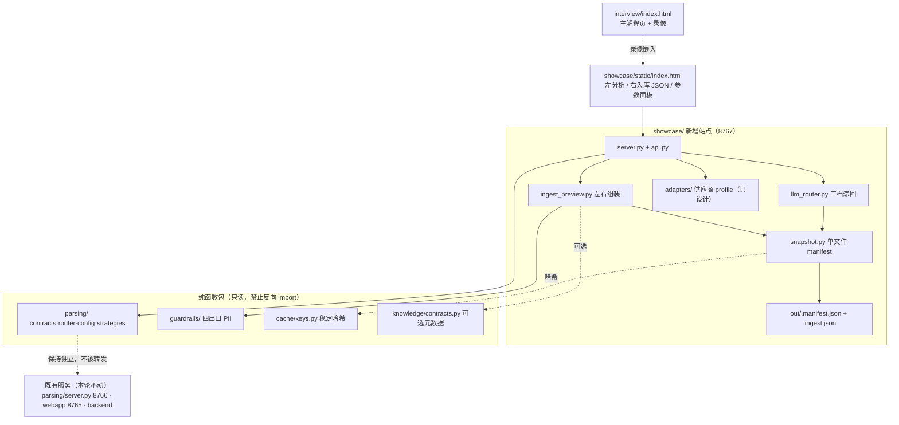

# showcase 架构与选型（Phase 1 实现 spec 事实源）

> 编制：系统架构师 梁承宇 ｜ 适用：`P5企业级知识库项目` 的 `showcase/` 独立演示站点
> **性质**：Phase 1 架构与技术选型 spec，供 Phase 2 前后端实现直接采用。本轮**只新增本文件**，不改源码、不改既有文件、不动 `webapp/` 行为、不动冻结区 `eval/` 与 `demo/`。
> **配套**：`docs/showcase/01-scope.md`（需求范围、两档剧本、7 类参数、验收与未做清单，scenario-product-manager 产出）。本文不改写其业务结论，只补架构、选型、契约与 schema。
> **事实源**：主理人 2026-11-15 收费解析 API 横向对比（直接采信，不重复检索）；本次实读 `parsing/{contracts,router,config,server}.py`、`parsing/strategies/{base,ocr_api,multimodal}.py`、`guardrails/{contracts,pipeline}.py`、`cache/keys.py`、`knowledge/contracts.py`、`docs/showcase/01-scope.md`。
> **三态纪律**：逐项标 `已实现` / `只设计` / `未做`；`已实现` 必须有可运行代码或落盘资产，演示替身、离线兜底、回放产物注明档次。
> **数字纪律**：阈值、权重、时长、单价均标「调研口径」「建议起始值」或「待 Phase 2 回填」，与 `01-scope.md` §4.3 一致；本轮 `wc -l -c` 与 `git status` 实测只在回传消息里报，不写进正文冒充功能指标。
> **编制时点**：其他成员并行产出可能在本文定稿后落盘，逐条状态以 Phase 2 汇总为准。

## 0. 结论摘要

1. **站点边界**：新建 `showcase/`（FastAPI + 同源静态单页，端口建议 8767），**同进程 import `parsing/` 纯函数包**，不 import `webapp/` / `backend/`、不转发 `parsing/server.py`；依赖单向。
2. **解析层裁决**：默认演示路径用**免费/已有能力自搭**（P0 `local` + P2 离线回放），因离线可跑、零付费、可复现；**收费对照档首选 Reducto**（质量 92 分、复杂表格最强）；**国内阿里云上线首选阿里云文档解析（大模型版）**（境内可达、无数据出境、人民币结算）。两路共用一个 `OcrApiStrategy` 槽位。
3. **视觉与路由**：复用已实测跑通的 P2 多模态 `deepseek-v4.1-flash-1017` + 低思考档，实时在线不作演示默认；新增 `showcase/llm_router.py` 以 `QualitySignals` / `VisionBudget` 为难度输入，三档 `standard` / `pro` / `fallback` + 双阈值滞回。
4. **单文件快照**：每次调用生成**一个** `showcase/out/<run_id>.manifest.json`，与入库 JSON 同批落盘、双向摘要互引；换模型/提示词/参数即换 `snapshot_version`。
5. **确定性**：`run_id` 由源文件 sha256 + 参数快照 + route 快照派生；`created_at` 取 `as_of` 固定逻辑时间，挂钟时间不进 JSON，保证 `01-scope.md` G5 双跑逐字节一致。四出口 PII 复用 `guardrails/`，密钥只留服务端，manifest 只回 `*_configured` 布尔。
6. **录像与上线**：ffmpeg 程序化渲染帧 → mp4 → 嵌入 `interview/index.html`；阿里云只出指导 HTML 与脚本，注册/实名/备案/支付由用户本人完成。

## 1. 总体架构与依赖方向

### 1.1 分层图



### 1.2 依赖方向（硬约束）与既有服务边界

| 层 | 允许 import | 禁止 import | 判据 |
|---|---|---|---|
| `showcase/` | `parsing/`、`guardrails/`、`cache/`、`knowledge/`、标准库、FastAPI/uvicorn | `webapp/`、`backend/`、`parsing.server` | 可独立 `uvicorn showcase.server:app` 启动，不拉起 SQLite / 鉴权 / 生产骨架 |
| `parsing/` | 标准库 + 可选 pypdf / Pillow | `showcase/`、`webapp/`、`backend/` | 纯函数包，`python -m parsing.vision_probe` 可独立运行 |
| `guardrails/` / `cache/` / `knowledge/` | 标准库 | `showcase/`、`webapp/` | 现有单测不依赖站点 |
| `parsing/server.py` | `parsing/` | `showcase/` | 保持 Docker 独立服务语义不变 |

**裁决：同进程 import 而非转发 `parsing/server.py`（8766）**。该文件已是独立 FastAPI 外壳（`/health/live`、`/parse/status`、`PUT /parse/strategy`、`POST /parse/probe`、`/parse/traces`，`MAX_BYTES = 8 MiB`），用于 `Dockerfile.parse` 场景。被否决的 HTTP 转发会引入第二个进程、跨服务超时、两份错误码与端口编排，与「简单演示」冲突；`parsing/` 零第三方依赖即可导入，同进程最简且保留该服务不动。`showcase/` 与 `webapp/` 端口分离（8767 / 8765）。既有资产状态：`parsing/` 三级策略 / `QualitySignals` / `VisionBudget` / `ParseTrace`、`strategies/local.py`、`strategies/multimodal.py`、`guardrails/` 四出口、`interview/index.html` 为**已实现**；`strategies/ocr_api.py`（`available()=False`、`__TBC__`）为**只设计**；`showcase/` 站点本体、manifest、录像、上线指导 HTML 为**未做**。

## 2. 技术选型表

### 2.1 六领域裁决

| 领域 | 选了谁 | 被否决备选 | 否决理由 | 三态 |
|---|---|---|---|---|
| **解析层** | 默认免费自搭（P0 `local` + P2 离线回放）；收费对照 **Reducto**；国内上线 **阿里云文档解析（大模型版）**，共用 `OcrApiStrategy` 槽位 | LlamaParse / Unstructured / Mistral OCR / PaddleOCR / AWS Textract·Azure DI·Google Doc AI / 腾讯云 / TextIn | 见 §2.3；核心是「演示默认离线」+「国内可达性与合规」 | 已实现（免费资产）／只设计（适配器） |
| **视觉层** | P2 `MultimodalStrategy` + Discovery `deepseek-v4.1-flash-1017` + 低思考档 `thinking={"type":"disabled"}` | 其余 5 个支持 image 的模型（`Agents-A1` / `Sage-A1.5` / `intern-s2` / `kimi-k3.1-pro` / `qwen3.8-27b`）、独立云端视觉 OCR | 目标模型是唯一做过双图对照传图实测的；其余只有 `/models` 元数据，未做质量实测；独立视觉 OCR 与 P1 重复计费 | 已实现（端点）／未做（演示接线） |
| **路由层** | 新增 `showcase/llm_router.py`，三档 + 滞回 | 把路由写进 `parsing/router.py`；随机按 90:10 分流；前端轮询猜档 | 写进纯函数包破坏 §1.2 依赖方向；主理人已明确 `vision_escalation_ratio=0.10` 是**熔断上限**不是随机分流；前端猜档无法进 manifest 留痕 | 只设计 |
| **前端** | `showcase/static/` 原生 HTML/CSS/JS 零构建同源单页 | React/Vite（`frontend/` 已有骨架）、新 npm 依赖、CDN 外链 | 诉求是单文件离线可开、便于嵌入录像、无构建链；`frontend/` 依赖 backend API 且需 npm install；CDN 违反离线要求 | 未做（站点）／已实现（`interview/index.html` 范式） |
| **录像** | ffmpeg 合成 mp4（H.264）+ `<video>` 本地文件 + poster | playwright 自动化录屏、GIF、外链视频 | 本机无 playwright；GIF 体积大无控件；外链违反离线与国内可达性 | 已实现（工具）／未做（录像） |
| **部署** | 阿里云 ECS 单机 + Nginx 同源反代 + systemd 托管 uvicorn；只出指导 HTML 与脚本 | K8s / Serverless 函数 / 复用 `webapp/` 容器 | 前两者超出 A/B 档且冷启动使本地 manifest 不持久；复用 `webapp/` 会改其行为，违反 `01-scope.md` V13 | 未做（只出指导） |

### 2.2 解析层专项裁决：「演示效果最好」

| 问 | 裁决 | 理由 |
|---|---|---|
| 演示默认路径 | **免费/已有能力自搭**：P0 `local` + P2 离线回放 / 结构化降级 | `01-scope.md` M6 / W5 已定「演示默认离线、外部请求 0」；收费 API 需凭证与真实流量，不能做默认；`parsing/` 质量门禁与预算闸门已实现，链路完整 |
| 「效果最好」的收费服务 | **Reducto**（质量 92 分 / $0.01 每页，Standard $150 免费额度约 15,000 页，batch 8 折，复杂表格 / 多栏 / 合并单元格 / 引用框最强，SOC2/HIPAA） | 主理人调研中质量分最高，对「图片 + PDF 分析结果」里最难的表格版面最强；免费额度足够跑完演示语料，不必先付费 |
| 国内阿里云上线 | **阿里云文档解析（大模型版）**：基础 0.02 元/页、增强 0.04 元/页 | 与 ECS 同账号同区域、境内可达、无数据出境、人民币结算；单价低于腾讯云 0.08、TextIn 0.042；Reducto 属境外 API，有可达性、出境合规、结算与延迟风险 |
| 两者怎么共存 | 共用 `parsing/strategies/ocr_api.py` 的 `OcrApiStrategy` 槽位，只换 `showcase/adapters/` 的供应商 profile 与响应→`ParseResult` 映射 | 可插拔的意义是下游 `chunks[]` / 入库 JSON / citation 契约不动；`parsing/strategies/base.py` 的 `REGISTRY` + `register()` 已提供注册机制 |

> **收费服务只做适配器 + 离线兜底，不代付、不代开通**（`01-scope.md` W1 / N7）。Phase 1 只定契约：`OcrApiStrategy._call()` 保持「故意不实现」，`contract()` 的 `__TBC__` 不填充，前端选中 `ocr_api` 时显示 `available()=False` 并降级留痕。

### 2.3 收费 API 横向对比（主理人调研口径，不重新检索）

| 服务 | 单价（调研口径） | 免费额度 | 定位 | 否决/保留理由 |
|---|---|---|---|---|
| **Reducto** | $0.01/页 | Standard $150（约 15,000 页） | **海外/效果对照首选** | 采纳；质量 92、复杂表格最强、SOC2/HIPAA；境外 API 不作国内首选 |
| **阿里云文档解析（大模型版）** | 基础 0.02 / 增强 0.04 元/页 | `__TBC__` | **国内上线首选** | 采纳；境内可达、同账号计费；复杂表格能力未独立实测，不声称等同 Reducto |
| 腾讯云多模态解析 | 0.08 元/页 | 首开 1000 页/1 年 | 国内备选 | 单价为阿里云增强档 2 倍 |
| TextIn xParse | 0.042 元/页起 | `__TBC__` | 国内备选 | 单价高于阿里云 |
| LlamaParse | Fast $0.00125 / Plus $0.056 每页 | 每月 10,000 credits | **否决** | 高低档约 15 倍差，成本随档位剧烈波动，演示时无法解释「为什么这一页贵」 |
| Mistral OCR | $0.004–0.005/页 | `__TBC__` | **失败链第三位** | 多语言 40+、Markdown 好，但复杂表格分数低于 Reducto |
| Unstructured | $0.03/页 | 每月 15,000 免费页 | **否决** | 单价约为 Reducto 3 倍且复杂版面不占优 |
| Docling（IBM, MIT） | 自托管免费；托管约 $4/1000 页 | 自托管免费 | 自搭增强备选（未来） | 本机未安装，托管版引入新依赖与镜像体积 |
| PaddleOCR / PP-Structure | 免费自搭 | — | **否决（本期）** | 需 GPU/CUDA 与模型体积，本机无 GPU、无 fitz/playwright，演示镜像膨胀 |
| AWS Textract / Azure DI / Google Doc AI | 大批量预算档 | `__TBC__` | **否决** | 复杂表格分数低于 Reducto，国内可达性/出境合规同样不利 |

### 2.4 两条可切换路径

| 路径 | 触发条件 | 生效策略 | 外部请求 | 凭证 | 三态 |
|---|---|---|---|---|---|
| **A 免费自搭（默认）** | 默认；或 `PARSING_OFFLINE=1` | `local_only` / `auto` 下 P0 `local` + P2 `structured_fallback` / 离线回放 | **0** | 不需要 | 已实现（资产）／未做（站点接线） |
| **B 收费适配器** | 用户本人配置 `PARSING_OCR_BASE_URL` + `PARSING_OCR_API_KEY` 且显式选 `ocr_api` | `OcrApiStrategy` + vendor profile（Reducto / 阿里云） | 按页数计 | 用户本人提供 | 只设计（`_call()` 未实现、契约 `__TBC__`） |

## 3. 模块划分与文件清单

### 3.1 `showcase/` 新增文件（精确路径 + 职责）

| 文件路径 | 职责 | 改动范围 | 三态 |
|---|---|---|---|
| `showcase/__init__.py` | 包标识与 `SHOWCASE_VERSION` | 新增 | 未做 |
| `showcase/server.py` | FastAPI app、静态挂载、CORS、全局异常处理、端口 8767 | 新增 | 未做 |
| `showcase/api.py` | 10 个 `/api/*` 路由、请求校验与错误码映射 | 新增 | 未做 |
| `showcase/params.py` | 7 类参数模型 + 参数快照稳定哈希 | 新增 | 未做 |
| `showcase/llm_router.py` | `DifficultySignals`、难度评分、三档状态机与滞回、route 快照构造 | 新增 | 只设计 |
| `showcase/snapshot.py` | 单文件 manifest 原子落盘、摘要互引、回放校验 | 新增 | 只设计 |
| `showcase/ingest_preview.py` | 左 `AnalysisView` / 右 `IngestDocument` 组装、精简与全字段两档 | 新增 | 未做 |
| `showcase/guard.py` | `guardrails/` 四出口接线、`SafetyReport` 汇总 | 新增 | 未做 |
| `showcase/adapters/__init__.py` | `VENDOR_REGISTRY`，profile 注册 | 新增 | 只设计 |
| `showcase/adapters/base.py` | `VendorProfile` 契约：`id` / `region` / `price_hint` / `endpoint` / `auth` / `request_schema` / `response_schema` / `to_parse_result()` | 新增 | 只设计 |
| `showcase/adapters/reducto.py` | Reducto profile + 响应→`ParseResult` 映射骨架 | 新增 | 只设计 |
| `showcase/adapters/aliyun_docmind.py` | 阿里云文档解析 profile + 映射骨架 | 新增 | 只设计 |
| `showcase/adapters/local_free.py` | 免费路径 profile（指向 `parsing/strategies/local.py`） | 新增 | 只设计 |
| `showcase/static/index.html` | 左右分栏 DOM + 参数面板 + 快照展开区 | 新增 | 未做 |
| `showcase/static/app.js` | 取参、上传、渲染两区、JSON 折叠、双跑对拍 | 新增 | 未做 |
| `showcase/static/style.css` | GitHub 风格两栏布局 | 新增 | 未做 |
| `showcase/samples/text_layer.pdf` | 简单档样例（有文本层） | 新增 | 未做 |
| `showcase/samples/scanned_page.png` | 复杂档样例（图片 / 扫描页） | 新增 | 未做 |
| `showcase/samples/replay_manifest.json` | 复杂档离线回放的预先留存真实解析产物（须标「回放」） | 新增 | 未做 |
| `showcase/out/.gitkeep` | manifest 输出目录占位（产物加入 `.gitignore`） | 新增 | 未做 |
| `showcase/README.md` | 启动命令、离线开关、两档操作、三态说明 | 新增 | 未做 |
| `showcase/tests/test_contracts.py` | 参数快照、route 快照、JSON 双跑一致性用例 | 新增 | 未做 |
| `showcase/Dockerfile` | 站点镜像（阿里云指导用，可选） | 新增 | 只设计 |
| `showcase/deploy/aliyun-notes.md` | 上线指导素材来源 | 新增 | 未做 |
| `docs/showcase/02-architecture.md` | **本文件** | **本轮唯一新增** | **已实现（本文件）** |

> `showcase/adapters/` 只放**静态 profile 与映射骨架**，不发起任何外部请求；`base.py` 未实现的字段一律 `__TBC__`。真实 `_call()` 若 Phase 2 要接通，属修改 `parsing/` 纯函数包，需单独评审。

### 3.2 复用资产（只读引用，本轮不改）

| 文件路径 | 复用内容 | 依赖方向 |
|---|---|---|
| `parsing/contracts.py` | `QualitySignals` / `Block` / `ParseResult` / `ParseTrace` / `StrategyUnavailable` / `LEVEL_*` / `STRATEGY_*` | `showcase/` → `parsing/` |
| `parsing/router.py` | `PageInput` / `VisionBudget` / `ParseRouter.status/split_pages/needs_upgrade/parse_document` | 同上 |
| `parsing/config.py` | `ParseConfig` / `VISION_CAPABLE_MODELS` / `current_strategy()` / `set_strategy()` | 同上 |
| `parsing/strategies/base.py` | `ParseStrategy` / `REGISTRY` / `register()` | 同上 |
| `parsing/strategies/{local,ocr_api,multimodal}.py` | P0 免费实现 / P1 适配器槽位（`__TBC__`）/ P2 视觉与 `structured_fallback()` | 同上 |
| `parsing/{images,tables}.py` | 图片事实抽取、表格结构检查 | 同上 |
| `guardrails/contracts.py` | `GATE_*` 四出口 / `RedactionResult` / `SafetyReport` / `RULE_VERSION = "PII-RULES@1.0"` | `showcase/` → `guardrails/` |
| `guardrails/pipeline.py` | `Guardrails.ingest/context/output/audit/sources` / `gather()` / `export_rows()` | 同上 |
| `cache/keys.py` | `policy_version()` / `query_hash()` 稳定哈希思路 | `showcase/` → `cache/` |
| `knowledge/contracts.py` | `DocMeta`（`checksum` / `revision` / `indexed_at`）可选元数据 | `showcase/` → `knowledge/` |
| `interview/index.html` / `docs/showcase/01-scope.md` | 主解释页 / 两档剧本与验收清单 | 页面与文档引用，非 import |

### 3.3 明确不动

| 路径 | 原因 |
|---|---|
| `webapp/` / `backend/` | `01-scope.md` V13；不改演示切片行为、不拉生产骨架进站点 |
| `parsing/server.py` / `Dockerfile.parse` | 保持 Docker 独立解析服务；showcase 同进程 import 包而非转发它 |
| `parsing/strategies/ocr_api.py` 的 `_call()` / `contract()` | 收费服务未开通，契约保持 `__TBC__`，本轮不填充 |
| `eval/` / `demo/` | 冻结区；`__TBC__` / `NOT_COMPARABLE` / `run_id=RUN-095a2a4a40c6` 不变 |
| `.env` 的 `DISCOVERY_API_KEY` 等 / `docs/CHANGELOG.md` | 密钥只读取存在性，值不落库不回传；历史日志不回改 |

## 4. 接口契约

### 4.1 API 总表（前缀 `/api`，端口 8767）

| # | 路径 | 方法 | 用途 | 同步/异步 | 三态 |
|---|---|---|---|---|---|
| A1 | `/api/health` | GET | 健康检查与依赖可用状态 | 同步 | 未做 |
| A2 | `/api/params` | GET | 获取 7 类参数当前值与取值范围 | 同步 | 未做 |
| A3 | `/api/params` | PUT | 修改参数（进程内生效，返回新参数快照哈希） | 同步 | 未做 |
| A4 | `/api/strategies` | GET | 策略与供应商 profile 列表（含 `available` / `__TBC__`） | 同步 | 未做 |
| A5 | `/api/analyze` | POST | 上传并分析，一次返回左视图 + 右入库 JSON + manifest 引用 | 同步 | 未做 |
| A6 | `/api/route/decide` | POST | 只做 LLM 路由决策（不解析文件），用于面板预演 | 同步 | 只设计 |
| A7 | `/api/ingest/preview` | GET | 按 `run_id` 取入库 JSON（`format=compact/full`） | 同步 | 未做 |
| A8 | `/api/manifest/{run_id}` | GET | 取单文件 manifest 全文并校验摘要 | 同步 | 只设计 |
| A9 | `/api/guardrails/scan` | POST | 单文本四出口脱敏预演（可选） | 同步 | 未做 |
| A10 | `/api/samples` | GET | 两类内置样例文件清单 | 同步 | 未做 |

### 4.2 主要 API 详细契约

**A5 `POST /api/analyze`（核心）**

| 项 | 内容 |
|---|---|
| 请求体 | `multipart/form-data`：`file`（必填，≤8 MiB，继承 `parsing/server.py` 的 `MAX_BYTES`）、`params`（可选 JSON 字符串，覆盖 A2 的 7 类参数）、`as_of`（可选 ISO-8601 UTC，确定性逻辑时间） |
| 支持 MIME | `application/pdf`、`image/png`、`image/jpeg`、`image/webp`、`image/gif`、`image/bmp`、`text/plain`（与 `parsing/router.py::split_pages` 对齐） |
| 响应体 | `{"run_id","schema_version","analysis":<AnalysisView>,"ingest":<IngestDocument>,"manifest_ref":{"path","sha256","snapshot_version"},"runtime":{"wall_clock","elapsed_ms","external_request_count"},"errors":[]}` |
| 关键约束 | `analysis` 与 `ingest` 由**同一次** `ParseRouter.parse_document()` 结果组装，共用 `run_id` 与 `params_snapshot`；`created_at` 取 `as_of`，`runtime.wall_clock` 不进 `ingest` |
| 错误码 | `INVALID_PARAM` 422 / `FILE_TOO_LARGE` 413 / `UNSUPPORTED_MIME` 415 / `STRATEGY_UNAVAILABLE` 503 / `UPSTREAM_TIMEOUT` 504 / `UPSTREAM_ERROR` 502 / `PII_BLOCKED` 422 / `OFFLINE_ONLY` 503 / `INTERNAL_ERROR` 500 |

**A2 `GET /api/params` 响应（7 类，对应 `01-scope.md` §4）**

| 字段 | 类型 | 说明 |
|---|---|---|
| `strategy` | enum | `auto` / `local_only` / `ocr_api` / `multimodal` / `off`（`parsing/contracts.py`） |
| `confidence_min` | float | 质量门禁阈值；建议起始值取 `parsing/config.py` 的 `0.75`，标注非实测 |
| `chunk_size_chars` / `chunk_overlap_chars` | int | 分块大小与重叠；默认待 Phase 2 回填 |
| `vision_escalation_ratio` / `vision_min_slots` | float / int | 视觉预算上限（`0.10` 是熔断上限，不是随机分流） |
| `llm_tier_override` | enum / null | `null` = 自动；可强制 `standard` / `pro` / `fallback` |
| `redact_enabled` / `ingest_format` | bool / enum | 四出口开关 / `compact` / `full` |
| `as_of` / `params_hash` | string | 确定性逻辑时间 / 参数快照稳定哈希 |

**其余 API 契约**

| API | 请求 | 响应 | 错误码 |
|---|---|---|---|
| A3 `PUT /api/params` | A2 字段子集 | `{"params","params_hash","changed":[...],"note":"进程内生效，重启回落默认"}` | `INVALID_PARAM` 422 |
| A4 `GET /api/strategies` | — | `{"strategies":[{"id","label","recommended"}],"levels":[{"level","name","available","reason","contract","cost"}],"vendors":[{"id","region","price_hint","available","contract"}],"budget":{},"thresholds":{},"vision_models_probe":{}}`；复用 `ParseRouter.status()`，未接通档 `contract` 保持 `__TBC__` | `INTERNAL_ERROR` 500 |
| A6 `POST /api/route/decide` | `{"signals":<DifficultySignals>,"current_tier":"standard"}` | `{"route":<RouteSnapshot>,"hysteresis":{"enter","exit","consecutive_hits","state"},"reason"}` | `INVALID_PARAM` 422 / `STRATEGY_UNAVAILABLE` 503 |
| A7 `GET /api/ingest/preview` | `?run_id=&format=` | `<IngestDocument>` | `RUN_NOT_FOUND` 404 |
| A8 `GET /api/manifest/{run_id}` | 路径参数 | manifest 全文 + `{"checks":{"ingest_sha256_match":bool,"route_snapshot_match":bool}}`；任一 false 返回 404/500，不静默回放 | `RUN_NOT_FOUND` 404 / `INTERNAL_ERROR` 500 |
| A9 `POST /api/guardrails/scan` | `{"text","gates":["ingest","context","output","audit"]}` | `SafetyReport.as_dict()`（`blocked` / `total_hits` / `gates` / `results` / `rule_version`） | `PII_BLOCKED` 422 |
| A10 `GET /api/samples` | — | `{"samples":[{"id","tier","filename","mime","replay":bool}]}` | `RUN_NOT_FOUND` 404 |
| A1 `GET /api/health` | — | `{"status":"ok","service":"showcase","version","offline","strategy","levels_available":{},"external_configured":{"discovery":bool,"ocr_api":bool},"note":"只回布尔，不回密钥值"}` | `INTERNAL_ERROR` 500 |

### 4.3 错误码表

| 错误码 | HTTP | 触发条件 | 前端展示口径 |
|---|---|---|---|
| `INVALID_PARAM` | 422 | 参数越界 / 未知策略 / `as_of` 非法 | 标红对应参数项 |
| `FILE_TOO_LARGE` | 413 | 文件 > 8 MiB | 提示上限与当前大小 |
| `UNSUPPORTED_MIME` | 415 | 非 PDF / 图片 / 纯文本 | 列出支持类型 |
| `STRATEGY_UNAVAILABLE` | 503 | 强制 `ocr_api` 但 `available()=False` | 显示「未接通，跳过」并给降级结果，不静默 |
| `UPSTREAM_TIMEOUT` | 504 | 视觉端点超过 `vision_timeout_s` | 显示留痕并回退本级正文 |
| `UPSTREAM_ERROR` | 502 | 外部端点 5xx / 空正文 | 结构化降级，不编造文本 |
| `PII_BLOCKED` | 422 | `guardrails` 命中 `ACTION_BLOCK`（如 API_KEY） | 显示被拦截类别，不回显原文 |
| `OFFLINE_ONLY` | 503 | `PARSING_OFFLINE=1` 却请求实时档 | 提示切回离线回放 |
| `RUN_NOT_FOUND` | 404 | `run_id` 不存在或摘要校验失败 | 提示重跑 |
| `INTERNAL_ERROR` | 500 | 未预期异常 | 只回 `trace_id`，不回堆栈 |

## 5. 左右分栏数据契约

### 5.1 左侧 `AnalysisView`（给人看）

| 字段 | 类型 | 来源 | 说明 |
|---|---|---|---|
| `run_id` / `doc_id` / `filename` / `mime` / `page_count` | string / int | 请求 + `ParseRouter` | 与右侧同源的文件标识 |
| `strategy` / `params_snapshot` | enum / object | 请求 / A2 | 生效策略与本次参数（含 `params_hash`） |
| `pages[]` | array | `parse_document()["results"]` + `traces` | 逐页结果，见下 |
| `pages[].page_no` / `preview` | int / string | 页结果 | 图片缩略或文本前 N 字符 |
| `pages[].level` / `confidence` / `degraded` | string / float / string | `ParseResult` | 级别、置信度、降级原因 |
| `pages[].signals` | object | `QualitySignals.as_dict()` | `text_chars` / `text_density` / `image_ratio` / `table_cells` / `table_complete` / `ocr_needed` / `confidence` / `notes` |
| `pages[].blocks[]` | array | `Block.as_dict()` | `block_type` / `text` / `page_no` / `section_path` / `cells` / `facts` / `confidence` |
| `pages[].trace` | object | `ParseTrace.as_dict()` | `upgraded_from` / `budget_blocked` / `reason` / `latency_ms` / `notes` |
| `summary` | object | `parse_document()["summary"]` | `by_level` / `upgrades` / `budget_blocked` / `degraded` / `total_latency_ms` |
| `budget` | object | `VisionBudget.as_dict()` | `total_pages` / `ratio` / `slots` / `used` / `remaining` |
| `pii` / `route` / `warnings[]` | object / object / array | `SafetyReport` / `RouteSnapshot` / 各层 | 四出口汇总、生效档位快照、降级与回放标记 |

### 5.2 右侧 `IngestDocument`（给机器看，可复现）

```json
{
  "schema_version": "showcase-ingest@1.0",
  "run_id": "sha256(source + params_hash + route_snapshot_version)[:20]",
  "created_at": "<as_of，确定性逻辑时间>", "doc_id": "...",
  "source": {"filename", "mime", "size_bytes", "sha256", "page_count"},
  "parser": {"strategy", "levels", "config": {"ocr_text_chars_min", "confidence_min",
    "table_check_fail_ratio", "image_entropy_min", "vision_escalation_ratio",
    "vision_min_slots", "offline"}, "budget": {"total_pages", "ratio", "slots",
    "used", "remaining"}, "thresholds": {"threshold_note": "非压测结论"}},
  "llm_route": {"<完整 RouteSnapshot，见 §6.3>"},
  "chunks": [{"chunk_id", "page_no", "block_type", "text", "section_path",
    "confidence", "source_level", "cells", "facts", "char_start", "char_end",
    "redacted", "rule_version"}],
  "trace": [{"<ParseTrace.as_dict() 全字段>"}],
  "guardrails": {"rule_version", "gates", "total_hits", "blocked", "by_kind"},
  "manifest": {"path", "sha256", "snapshot_version"},
  "cost": {"estimated": true, "currency", "external_request_count", "note"},
  "note": "演示产物，不是生产入库记录"
}
```

### 5.3 左 → 右逐字段对应表

| 左侧字段 | 右侧字段 | 变换规则 | 可复现性说明 |
|---|---|---|---|
| `run_id` | `run_id` | 原样 | 由 `source.sha256 + params_hash + snapshot_version` 派生，不含挂钟时间 |
| `filename` / `mime` / `page_count` | `source.filename` / `source.mime` / `source.page_count` | 原样 + 补 `size_bytes` / `sha256` | 文件摘要进 `run_id` |
| `params_snapshot` | `parser.config` + `parser.thresholds` | 取影响解析的字段，`params_hash` 另存 manifest | 改任一参数 → `params_hash` 变 → `run_id` 变（G5「改参必变」） |
| `strategy` | `parser.strategy` | 原样 | 强制档与自动档产生不同 `run_id` |
| `pages[].level` | `parser.levels[]` + `chunks[].source_level` | 聚合 + 逐块标注 | `source_level` 取 `local` / `ocr_api` / `multimodal` / `degraded` |
| `pages[].blocks[]` | `chunks[]` | 按 `chunk_size_chars` / `chunk_overlap_chars` 切分，保留页级元数据 | `chunk_id` 由 `page_no + 序号 + 内容摘要` 确定性生成 |
| `pages[].signals` | `chunks[].confidence` + `trace[]` | 置信度逐块落，信号明细进 `trace[].notes` | 阈值变化改 `low_confidence` 判定 → 改 `trace[].reason` |
| `pages[].trace` | `trace[]` | `ParseTrace.as_dict()` 原样 | 升级 / 降级 / 预算拦截全留痕 |
| `budget` | `parser.budget` | 原样 | 预算耗尽写 `trace[].reason = "escalation_budget_exceeded"` |
| `pii` | `guardrails` | `SafetyReport` 汇总；逐块 `redacted` + `rule_version` | 四出口脱敏后文本才进 `chunks[].text` |
| `route` | `llm_route` | **完整快照原样嵌入**，非引用 | 换模型/提示词/参数 → `snapshot_version` 变 → `run_id` 变 |
| `warnings[]` | `note` + `cost.note` | 汇总为可审计说明 | 回放产物必须标「回放」 |
| `runtime.wall_clock`（左侧外层） | **不进右侧** | — | 保证同参双跑逐字节一致（G5） |
| `summary.total_latency_ms` | **不进右侧** | 离线回放时耗时固定为留存值 | 实时耗时不参与确定性 JSON |

### 5.4 精简 / 全字段两档（对应 `01-scope.md` P7）

| 字段组 | `compact`（简单档） | `full`（复杂档） |
|---|---|---|
| `schema_version` / `run_id` / `created_at` / `doc_id` / `source` | 有 | 有 |
| `parser.strategy` / `parser.levels` | 有 | 有 + `config` / `budget` / `thresholds` |
| `llm_route` | `route_id` / `tier` / `model` / `snapshot_version` / `placeholder` | 完整 `RouteSnapshot` |
| `chunks[]` | `chunk_id` / `page_no` / `block_type` / `text` / `section_path` | 全字段（含 `confidence` / `source_level` / `cells` / `facts` / `redacted`） |
| `trace[]` | 仅 `page_no` / `level` / `reason` | 全字段 |
| `guardrails` / `manifest` / `cost` | 无 | 有 |

## 6. LLM 路由分流与单文件快照设计

### 6.1 难度评分输入（6 项，全部来自可复算字段）

| 输入 | 类型 | 来源 | 归一化 |
|---|---|---|---|
| `page_count` | int | `parse_document()["page_count"]` | `min(1, pages / PAGE_REF)`，`PAGE_REF` 待 Phase 2 定 |
| `no_text_layer_ratio` | float | `QualitySignals.ocr_needed` 命中页数 / 总页数 | 0..1 原样 |
| `table_cells_total` | int | `sum(QualitySignals.table_cells)` | `min(1, cells / CELLS_REF)` |
| `min_confidence` | float | `min(QualitySignals.confidence)` | `1 - min_confidence` |
| `ocr_needed` | bool | 任一页 `QualitySignals.ocr_needed` | `1.0 / 0.0` |
| `budget_remaining_ratio` | float | `VisionBudget.as_dict()["remaining"] / slots` | `1 - remaining_ratio`（余量越少越难） |

评分公式（**建议结构，权重为待定起始值，非实测结论**）：`difficulty = Σ (w_i × norm_i)`，`Σ w_i = 1`，`w_i` / `PAGE_REF` / `CELLS_REF` 由 Phase 2 spec 回填。`DifficultySignals` 为不可变 dataclass，含 6 项 + `raw` + `notes`；`as_dict()` 同时进 `RouteSnapshot.signals` 与 manifest，保证「为什么升档」可回放。

### 6.2 档位、触发阈值与滞回

| 档位 | 语义 | 触发条件 | 外部调用 |
|---|---|---|---|
| `standard` | 默认档 | `difficulty < θ_exit` | 离线/免费路径不调用；在线用 `deepseek-v4.1-flash-1017` |
| `pro` | 难度升级兜底（用户原话「RAG 后面解析难度变大会上一些 Pro 版本 LLM」） | `difficulty ≥ θ_enter` 且**连续 `k` 次**命中；或 `llm_tier_override = "pro"` | Pro 档模型与单价 `__TBC__`（未选定，不编造） |
| `fallback` | 事件触发，非分数触发 | `PARSING_OFFLINE=1` / `StrategyUnavailable` / 上游超时 / 预算耗尽 / 强制 `off` | **0**，走 `structured_fallback()`，保留本级正文 |

| 滞回规则 | 内容 |
|---|---|
| 双阈值 | `θ_enter > θ_exit`，带宽 `δ = θ_enter - θ_exit`（建议 `δ ≥ 0.15`，具体值待 Phase 2 回填） |
| 连续命中 | 升档需连续 `k` 次（建议 `k = 2`）`difficulty ≥ θ_enter`；降档需连续 `k` 次 `difficulty < θ_exit` |
| 状态保持 | 阈值落在 `[θ_exit, θ_enter)` 时**保持当前档**，不切换 |
| 事件优先 | `fallback` 由事件直接触发，忽略滞回计数；事件解除后回 `standard` 重新计数 |
| 留痕 | 每次决策写 `hysteresis = {"enter","exit","consecutive_hits","state","last_transition"}` 进 route 快照 |
| 与解析预算的关系 | `VisionBudget` 控制**解析层**最多 10% 页升级到 P2；`llm_router` 控制**生成层**档位。两者独立，不得把 90:10 当成 LLM 随机分流 |

### 6.3 `RouteSnapshot` 字段 schema

| 字段 | 类型 | 有 LLM 时 | 无 LLM（占位规则） |
|---|---|---|---|
| `route_id` | string | 稳定哈希 | 稳定哈希（必填） |
| `tier` | enum | `standard` / `pro` | `fallback` |
| `model` | string | 实际模型 id（如 `deepseek-v4.1-flash-1017`） | `""` 空占位 |
| `model_snapshot_at` | string / null | ISO-8601 UTC 快照时间 | `null` |
| `snapshot_version` | string | 内容稳定哈希（复用 `cache.keys.policy_version()` 思路） | 内容稳定哈希（必填） |
| `prompt` / `prompt_version` | string | 实际提示词全文（P2 复用 `VISION_PROMPT`）/ 内容哈希 | `""` / `""` 空占位 |
| `params` | object | `temperature` / `max_tokens` / `thinking` / `top_p` 等生效值 | `{}` 空占位 |
| `fallback_chain` | array | 如 `["pro", "standard", "fallback"]` | `[]` 空占位 |
| `trigger` | string | `difficulty_threshold` / `override` / `event:<reason>` | `offline` / `strategy_unavailable` / `budget_exhausted` |
| `cost_hint` | object | `{"currency","price_hint","estimated":true,"note"}` | `{"estimated":false,"note":"无外部调用"}` |
| `placeholder` | bool | `false` | **`true`** |
| `reason` / `difficulty` | string / float | 升档原因码 / 评分值 | 降级原因 / 评分值（离线信号仍可算） |
| `signals` / `hysteresis` | object | `DifficultySignals.as_dict()` / §6.2 状态 | 同左 |
| `decided_at` | string | `as_of`（确定性时间，非挂钟） | `as_of` |

> **占位纪律**（`01-scope.md` V7 / K2）：缺字段一律空字符串 / 空对象 / 空数组 / `null` + `placeholder=true`，**绝不填编造的模型名、提示词或时间**。Pro 档模型未选定前 `model` 保持空占位，不写猜测型号。

### 6.4 「单文件」manifest 定义与落地

**定义**：「单文件」不是全局配置文件，而是**一次 LLM 路由选择对应一个物理文件** `showcase/out/<run_id>.manifest.json`，与同次入库 JSON 组成一对产物；换模型、换提示词、换参数都会改变 `snapshot_version` → 改变 `run_id`，旧 manifest 不复用。

| manifest 字段 | 说明 |
|---|---|
| `schema_version` | `showcase-manifest@1.0` |
| `run_id` / `created_at` | 与 `IngestDocument` 一致（`created_at` 用 `as_of`） |
| `source_sha256` / `params_hash` / `config_snapshot` | 复现三要素 |
| `route` | **完整 `RouteSnapshot`（与 `ingest.llm_route` 逐字段相同）** |
| `ingest_ref` | `{"path","sha256"}`，指向 `out/<run_id>.ingest.json` |
| `pii_rule_version` / `offline` / `external_request_count` | `PII-RULES@1.0` / 离线与流量证据 |
| `warnings[]` | 降级 / 回放 / 预算拦截 |

**落盘与回放流程（同一次 A5 请求内）**：① 算 `DifficultySignals` → `llm_router.decide()` 得 `RouteSnapshot`（含 `snapshot_version`）→ ② `ParseRouter.parse_document()` 得 `results[]` / `traces[]` / `budget` / `summary` → ③ `guardrails` 四出口依次 `ingest` / `context` / `output` / `audit` → ④ `ingest_preview.py` 组装 `IngestDocument`，把**同一份** `RouteSnapshot` 原样写入 `llm_route` → ⑤ 先写 `out/<run_id>.manifest.json.tmp`，计算 ingest JSON 的 sha256 回填 `manifest.ingest_ref.sha256` 后 `os.replace()` 原子替换；随后写 `out/<run_id>.ingest.json`，其 `manifest.sha256` 指向 manifest 摘要，形成**双向摘要互引** → ⑥ A8 回放时重算 ingest sha256 与 `route.snapshot_version`，任一不符即 404/500，不静默回放。双向互引是「跟着这个 LLM 走」的可验证落点：只改模型名不改 manifest，或只改 manifest 不改入库 JSON，都会在对拍时暴露。

## 7. 非功能目标

| 维度 | 目标 | 实现手段 | 验证方式 |
|---|---|---|---|
| **离线可跑** | 断网 / 无 key 时两档跑完，外部请求计数 0 | `PARSING_OFFLINE=1` → P0 `local` + `structured_fallback()`；复杂档用 `showcase/samples/replay_manifest.json` 回放预先留存的真实产物；`runtime.external_request_count` 计数 | `01-scope.md` G1 / V1：断网双跑，计数 0 |
| **确定性可复现** | 同参双跑入库 JSON 逐字节一致；改任一参数必变 | `run_id = sha256(source.sha256 + params_hash + snapshot_version)[:20]`；`created_at` 取 `as_of`；挂钟时间与耗时只进左侧 `runtime` / `trace`；`chunk_id` 内容派生 | G5 / V5：`cmp` 双跑产物、改参对拍 |
| **超时与降级** | 外部失败不 500、不丢本级正文 | `vision_timeout_s`（`ParseConfig` 默认 60，标注非实测）；`StrategyUnavailable` → `_merge_fallback()` 保留本级 `text` / `blocks`；连接错误最多重试 1 次，`quota_exceeded` 不重试；超时/5xx → `UPSTREAM_TIMEOUT` / `UPSTREAM_ERROR` + 留痕 | 故障注入：关 key、模拟 5xx、构造空正文 |
| **密钥不落库不下发** | 密钥值不进 JSON / manifest / 日志 / 响应 | 只在服务端 `os.environ`；A1 只回 `external_configured` 布尔；`guardrails` 的 `ACTION_BLOCK` 对 `API_KEY` 命中即拒；`GATE_AUDIT` 写 manifest 与日志前二次脱敏 | 全仓 `git grep` 密钥模式零命中；抓包检查 `/api/*` 响应无密钥 |
| **PII 四出口复用** | 入库前 / 进模型前 / 输出前 / 日志导出前一致 | `showcase/guard.py` 依次调 `Guardrails.ingest/context/output/audit`；`SafetyReport` 进右侧 `guardrails`；`RULE_VERSION = "PII-RULES@1.0"`；`export_rows()` 用于 JSON 导出 | A9 预演 + 四出口 `chain` 对照 |
| **可观测** | 每次调用可回放「为什么这样解析、为什么这样路由」 | `run_id` / `trace[]`（`ParseTrace` 全字段）/ `budget` / `upstream.usage`（P2 已回传 `prompt_tokens` / `completion_tokens` / `reasoning_tokens`）/ `rule_version` / `schema_version` / `external_request_count` / `offline` | A7 + A8 交叉核对 |
| **范围隔离** | 不改 `webapp/`、不动冻结区、纯函数包不反向依赖 | §1.2 + §3.3 | `git diff --exit-code -- webapp/ eval/ demo/`；`grep -R "import showcase" parsing/ guardrails/` 零命中 |

## 8. 成本估算与风险清单

### 8.1 成本估算（只给前提与公式，不拍确定数字）

**前提**：① 单文件 ≤ 8 MiB、页数上限由 Phase 2 定（建议 ≤ 20 页）；② 演示默认离线免费自搭，外部请求 0；③ 收费 API 只做适配器，开通与付费由用户本人决定；④ 单价为主理人 2026-11-15 调研口径，**不是本项目实测账单**；⑤ 免费额度按供应商公示值，未核验实际到账；⑥ 不含 GPU / ECS / 域名 / 备案等基础设施费用；⑦ 不含真实压测与质量基线成本。
**公式**：`C = P × r × m`，`P` = 送收费服务的页数，`r` = 每页单价，`m` = 档位/批量系数（Reducto batch 8 折即 `m = 0.8`）。离线路径 `P = 0` 故 `C = 0`。

| 服务 | 单价 `r`（调研口径） | 免费额度（公示值） | 量级关系 |
|---|---|---|---|
| 免费自搭 P0 / P2 离线回放 | 0 | — | 演示默认，无外部费用 |
| Reducto | $0.01/页 | Standard $150（约 15,000 页） | 效果对照档；batch 后约 $0.008/页 |
| 阿里云文档解析（大模型版） | 基础 0.02 / 增强 0.04 元/页 | `__TBC__` | 国内上线档，低于腾讯云与 TextIn |
| 腾讯云多模态解析 / TextIn xParse | 0.08 / 0.042 元/页 | 首开 1000 页/1 年 / `__TBC__` | 依次为阿里云增强档 2 倍 / 介于增强与腾讯云之间 |
| LlamaParse | Fast $0.00125 / Plus $0.056 每页 | 每月 10,000 credits | 高低档约 15 倍差，成本不可解释 |
| Mistral OCR / Unstructured | $0.004–0.005 / $0.03 每页 | `__TBC__` / 每月 15,000 免费页 | 失败链第三位 / 约为 Reducto 3 倍 |
| Docling 托管 / PaddleOCR 自搭 | 约 $4/1000 页 / 0 | 自托管免费 / — | 自搭增强备选 / GPU 与模型体积成本另计 |

### 8.2 风险清单

| # | 类别 | 风险 | 触发条件 | 影响 | 应对 |
|---|---|---|---|---|---|
| K1 | 技术 | 把离线回放讲成实时在线识别 | 复杂档镜头未标「回放」 | 完成度夸大 | `samples/replay_manifest.json` 标 `replay`，`warnings[]` 与分镜口播同步 |
| K2 | 技术 | `RouteSnapshot` 缺字段时填编造值 | 无 LLM 调用却写模型名 | 违反「没有就空占位」 | §6.3 占位规则 + V7；`placeholder=true` 强校验 |
| K3 | 技术 | 参数改动未进 JSON | `params_hash` 未写入契约 | G5「改参必变」不成立 | 参数快照进 `parser.config` 与 `run_id` 派生 |
| K4 | 技术 | `created_at` 用挂钟时间破坏双跑一致 | 直接 `datetime.now()` 写入库 JSON | V5 失败 | 取 `as_of`；挂钟只进左侧 `runtime` |
| K5 | 技术 | `ocr_api` 被静默跳过 | P1 未接通但面板不提示 | 用户以为收费能力可用 | A4 返回 `available=False` + `reason`；`trace[]` 留痕 |
| K6 | 技术 | 视觉端点超时拖垮演示 | 复杂档实时调用且网络抖动 | 录像录制失败 | 默认离线回放；在线设超时 + 结构化降级 |
| K7 | 成本 | 演示消耗真实流量 / 费用 | 未强制 `PARSING_OFFLINE=1` | 非预期费用 | M6 默认离线 + `external_request_count` 断言 0 |
| K8 | 成本 | 档位导致账单跳变 | 误选 LlamaParse Agentic Plus | 单价约 15 倍差 | 本期否决该服务；profile 固定档位并写 `price_hint` |
| K9 | 合规 | 数据出境 | 国内演示误调境外 Reducto | 合规风险 | 国内上线固定走阿里云档；Reducto 仅作海外对照 |
| K10 | 合规 | PII 进入 manifest / 日志 / 导出 | 只做展示层打码 | 原始标识符残留 | 四出口 + `GATE_AUDIT` 写盘前二次脱敏 |
| K11 | 合规 | 密钥泄漏到前端或产物 | 把 `.env` 值拼进响应 | 凭证外泄 | 只回 `*_configured` 布尔；`ACTION_BLOCK` 拦截 `API_KEY` |
| K12 | 国内可达性 | 境外 API 延迟 / 不可达 | 用 Reducto 做国内默认 | 演示卡顿或失败 | 国内档固定阿里云；离线默认路径不依赖外网 |
| K13 | 国内可达性 | 备案 / 实名被写成「已上线」 | 指导页措辞含糊 | 对外承诺失真 | 指导页只列「用户本人完成」的步骤，不给「已上线」结论 |
| K14 | 范围 | 纯函数包被反向 import | 在 `parsing/` 里读 `showcase/` 配置 | 依赖方向破坏 | §1.2 + `grep` 回归判据 |
| K15 | 范围 | 本轮改动越界 | 顺手改 `webapp/` 或冻结区 | 破坏既有回归 | `git diff --exit-code -- webapp/ eval/ demo/` |

## 9. 三态纪律汇总

| 状态 | 代表项 |
|---|---|
| **已实现**（有代码或落盘资产） | `parsing/` 三级策略、`router.py` 质量门禁与 `VisionBudget`；`strategies/local.py`（P0）；`strategies/multimodal.py`（P2，Discovery 网关实测跑通）；`contracts.py` 的 `QualitySignals` / `ParseResult` / `ParseTrace`；`parsing/server.py` 独立服务；`guardrails/` 四出口与 `SafetyReport`；`cache/keys.py` 稳定哈希；`knowledge/contracts.py` 的 `DocMeta`；`interview/index.html` 单文件主解释页；本机 ffmpeg / PIL / imageio / cv2 / pypdf / httpx；`docs/showcase/01-scope.md` 与 **本文件** |
| **只设计**（有契约 / 占位，逻辑未落地） | `showcase/llm_router.py` 三档与滞回；`snapshot.py` 单文件 manifest；`RouteSnapshot` schema；`showcase/adapters/` 的 Reducto / 阿里云 profile；`OcrApiStrategy._call()`（保持 `__TBC__`）；Pro 档模型与单价（未选定，空占位）；录像嵌入与上线指导 HTML 的**设计** |
| **未做**（代码与设计产物均无） | `showcase/` 站点本体（server / api / static / samples / out / tests / README）；10 个 `/api/*` 路由实现；参数面板接线；左右分栏渲染；入库 JSON 生成与双跑对拍；录像 mp4；主解释页新增章节；阿里云上线指导 HTML；真实部署、域名、备案；playwright 录屏；实时在线视觉调用作为默认路径；真实压测 / 质量基线 / 监控告警 SLO |

## 10. 本轮改动清单与 Phase 2 交接

| 文件路径 | 改动范围 | 说明 |
|---|---|---|
| `docs/showcase/02-architecture.md` | **本轮唯一新增** | 全文：架构与依赖方向、选型裁决、文件级清单、接口契约、左右分栏契约、LLM 路由与 manifest、非功能、成本与风险、三态 |
| `docs/showcase/` | 目录已存在（承载 `01-scope.md`） | 本轮新增本文件，不改动 `01-scope.md` |
| `parsing/` / `guardrails/` / `cache/` / `knowledge/` | 只读引用 | 事实引用与依赖方向说明，零写入 |
| `webapp/` / `backend/` / `parsing/server.py` / `interview/index.html` | 明确不动 | 保持既有行为 |
| `eval/` / `demo/` / `.env` / `docs/CHANGELOG.md` | 冻结 / 明确不动 | 冻结对象与密钥纪律 |

**给 Phase 2 的必填项**（本文件不代填，避免编造默认值）：`chunk_size_chars` / `chunk_overlap_chars` 默认值、`PAGE_REF` / `CELLS_REF`、难度权重 `w_i`、`θ_enter` / `θ_exit` / `k`、Pro 档模型 id 与单价、页数上限、`as_of` 默认取值策略（全部在 `01-scope.md` §4.3 数字纪律下回填）。**强约束**：① 依赖方向单向（§1.2）；② `run_id` 与 `created_at` 确定性口径（§5.3 / §7）；③ `RouteSnapshot` 占位规则（§6.3）；④ manifest 双向摘要互引（§6.4）；⑤ `ocr_api` 未接通时不得静默（§4.3 / A4）；⑥ 复杂档视觉结果必须标「回放」（§8.2 K1）。
